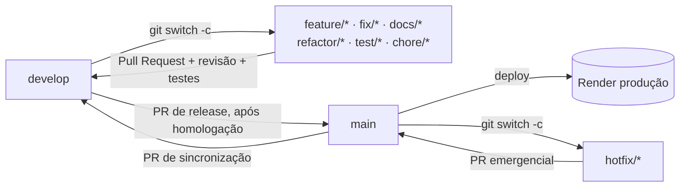

# Gestão Rural - Fluxo Git

> **Referência oficial de colaboração Git e GitHub do projeto.** Define branches, nomes, commits, Pull Requests, revisão, homologação, publicação e regras para agentes de IA.
>
> Complementa o [`ContextoProjeto.md`](ContextoProjeto.md), que descreve o estado técnico do sistema. Este arquivo prevalece em qualquer assunto de fluxo Git.

| Item                 | Valor                                                                                   |
| -------------------- | --------------------------------------------------------------------------------------- |
| Versão               | 1.0                                                                                     |
| Data                 | 24/10/2026                                                                              |
| Decisão              | equipe (Pedro Simon e Gustavo Lopes): `develop` substitui `qa`; `qa` excluída           |
| Repositório          | `https://github.com/PedroSimon1/gestao-rural` (**público**, branch padrão `main`)       |
| Projeto Jira         | `GR` — as tarefas serão organizadas **depois** da consolidação documental               |

---

# 1 - Visão Geral do Fluxo

```text
<tipo>/<descricao>  ──PR──▶  develop  ──PR (homologado)──▶  main  ──▶  Render (produção)
     ▲                          │
     └──── criada a partir ─────┘

hotfix/<descricao>  ──PR──▶  main   e depois   main ──PR de sincronização──▶ develop
```



Regras fundamentais:

1. **Ninguém desenvolve nem faz push direto em `main` ou `develop`.**
2. Toda branch de tarefa nasce da `develop` atualizada (exceção: `hotfix/*`, que nasce da `main`).
3. Toda mudança entra na `develop` por **Pull Request**.
4. Só o que foi revisado e homologado segue por **PR de `develop` para `main`**.
5. A branch `qa` está **excluída** e não deve ser recriada.

---

# 2 - Branches Permanentes

| Branch    | Finalidade                                    | Recebe mudanças de                     | Quem pode integrar                        |
| --------- | --------------------------------------------- | -------------------------------------- | ----------------------------------------- |
| `main`    | **produção**: o que está publicado no Render e é entregue ao professor | PR de `develop` (release) ou de `hotfix/*` | merge após revisão, homologação e autorização |
| `develop` | **integração, testes e homologação**: soma das tarefas concluídas antes de ir para produção | PR de branches de tarefa; PR de sincronização vinda da `main` | merge após revisão e testes |

- `main` precisa estar sempre publicável. Cada commit dela pode virar deploy.
- `develop` precisa estar sempre com a suíte de testes passando. Uma tarefa quebrada não entra.

## 2.1 - Histórico da branch `qa` (HISTÓRICO)

| Fato                                                                                       | Situação                          |
| ------------------------------------------------------------------------------------------ | --------------------------------- |
| `qa` criada em 29/09/2026 como branch de integração/homologação, no commit `f7786e8`       | HISTÓRICO                         |
| `qa` nunca recebeu PR; os PRs #1–#19 tiveram base `main`                                   | HISTÓRICO                         |
| Fluxo anterior documentado: `feature/*` ou `docs/*` → `qa` → `main`                        | HISTÓRICO — substituído por este documento |
| 24/10/2026: `qa` **excluída do GitHub**; `develop` existe no remoto, também em `f7786e8`   | verificado com `git ls-remote` e `gh` |
| Na máquina local de Pedro ainda existem a branch local `qa` e a referência obsoleta `origin/qa` | pendente de limpeza manual (seção 3.4) |

Documentos e auditorias anteriores que citam `qa` descrevem o estado daquela data e não devem ser reescritos.

---

# 3 - Branches de Tarefa

## 3.1 - Padrão de nomes

Formato: `<tipo>/<descricao-curta>`, em minúsculas, palavras separadas por hífen, sem acentos nem espaços. Quando houver tarefa no Jira, inclua a chave: `<tipo>/GR-<n>-<descricao>`.

| Tipo         | Uso                                                        | Nasce de  | PR para    | Exemplo                                      |
| ------------ | ---------------------------------------------------------- | --------- | ---------- | -------------------------------------------- |
| `feature/*`  | nova funcionalidade                                        | `develop` | `develop`  | `feature/n2-etapa2-consulta-fornecedor`      |
| `fix/*`      | correção de defeito encontrado antes da produção           | `develop` | `develop`  | `fix/validacao-parcela-sem-vencimento`       |
| `docs/*`     | somente documentação                                       | `develop` | `develop`  | `docs/n2-etapa2-fluxo-git`                   |
| `refactor/*` | reorganização sem mudar comportamento                      | `develop` | `develop`  | `refactor/orquestracao-processamento`        |
| `test/*`     | criação ou ajuste de testes                                | `develop` | `develop`  | `test/cobertura-classificador`               |
| `chore/*`    | manutenção: dependências, scripts, build, configuração     | `develop` | `develop`  | `chore/atualiza-requirements`                |
| `hotfix/*`   | correção **urgente** de defeito em produção                | `main`    | `main` (e depois sincroniza `develop`) | `hotfix/login-producao`     |

Evite nomes genéricos (`feature/ajustes`, `fix/bug`) e nomes com letras maiúsculas.

**Branches existentes fora do padrão:** a branch local `feature/Auditoria-Correcao` foi criada em 24/10/2026, antes deste documento. Ela tem maiúsculas e contém só documentação, então o tipo adequado seria `docs/*`. Sua base (`f7786e8`) é o mesmo commit da `develop`. Renomeá-la é opcional e cabe à equipe (ver seção 13).

## 3.2 - Criar uma branch de tarefa

```bash
git status --short --branch          # 1. working tree limpo? (commite ou guarde seu trabalho antes)
git fetch --prune origin             # 2. atualiza referências e remove as apagadas no remoto
git switch develop                   # 3. vai para a develop
git pull --ff-only origin develop    # 4. atualiza sem criar merge local
git switch -c feature/<descricao>    # 5. cria a branch de tarefa
git push -u origin feature/<descricao>   # 6. publica a branch (quando houver o primeiro commit)
```

`--ff-only` impede que a `develop` local diverja da remota. Se o comando falhar, a `develop` local recebeu commits indevidos. Pare e investigue, sem forçar.

## 3.3 - Atualizar uma branch de tarefa com a `develop`

Faça isso antes de abrir o PR e sempre que a `develop` receber mudanças que afetem sua tarefa.

**Opção padrão — merge** (seguro para branches já publicadas e compartilhadas):

```bash
git fetch origin
git switch feature/<descricao>
git merge origin/develop             # resolva conflitos, se houver (seção 9)
python manage.py test                # a suíte precisa continuar passando
git push
```

**Opção alternativa — rebase.** Só para branches que **ninguém mais usa**:

```bash
git fetch origin
git switch feature/<descricao>
git rebase origin/develop
python manage.py test
git push --force-with-lease          # nunca use --force simples
```

Nunca faça rebase de `main` ou `develop`, nem de uma branch em que outra pessoa trabalha.

## 3.4 - Limpeza local após a exclusão da `qa`

Comandos que cada integrante executa na própria máquina, quando quiser:

```bash
git fetch --prune origin             # remove a referência obsoleta origin/qa
git branch -d qa                     # apaga a branch local qa (recusa se houver commits não integrados)
git switch -c develop --track origin/develop   # cria a develop local, se ainda não existir
```

## 3.5 - Depois do merge

- Apague a branch de tarefa no GitHub (botão do PR) e localmente: `git branch -d <branch>`.
- Atualize a `develop` local: `git switch develop && git pull --ff-only`.

---

# 4 - Commits (Conventional Commits)

Formato:

```text
<tipo>(<escopo opcional>): <descrição no imperativo, minúscula, sem ponto final>

<corpo opcional: o quê e por quê, não como>

<rodapé opcional: Refs: GR-<n>, FLU-04 · BREAKING CHANGE: ...>
```

| Tipo       | Quando usar                                         | Exemplo                                                    |
| ---------- | --------------------------------------------------- | ---------------------------------------------------------- |
| `feat`     | nova funcionalidade                                 | `feat(documentos): exibe resultado da consulta de fornecedor` |
| `fix`      | correção de defeito                                 | `fix(extrator): aceita parcela sem número`                 |
| `docs`     | somente documentação                                | `docs: cria ContextoFluxoGit com fluxo develop/main`       |
| `refactor` | mudança interna sem alterar comportamento           | `refactor(processamento): separa montagem do resultado`    |
| `test`     | testes                                              | `test(classificador): cobre resposta sem categoria`        |
| `chore`    | manutenção, dependências, scripts                   | `chore: adiciona driver PostgreSQL ao requirements`        |
| `style`    | formatação sem efeito no código                     | `style: aplica formatação nos templates`                   |
| `perf`     | desempenho                                          | `perf(gemini): reduz tentativas em erro definitivo`        |
| `build`/`ci` | build e integração contínua                       | `ci: adiciona workflow de testes`                          |
| `revert`   | desfaz um commit anterior                           | `revert: feat(documentos): exibe resultado da consulta`    |

Escopos usuais: `agents`, `extrator`, `classificador`, `gemini`, `documentos`, `processamento`, `usuarios`, `config`, `deploy`, `banco`, `docs`.

Regras:

- um commit = uma mudança coerente; não misture refatoração com funcionalidade;
- descrição de até ~72 caracteres;
- cite o Jira (`Refs: GR-<n>`) e, quando aplicável, os IDs da [matriz de requisitos](docs/requisitos/matriz-n2-etapa2.md);
- use `git add <arquivos>` com lista explícita e revise com `git diff --cached` antes de commitar;
- nunca commite `.env`, `README.txt`, credenciais, `staticfiles/`, `media/`, `uploads/` ou `.venv/`.

O histórico até a Etapa 1 já segue esse padrão (por exemplo `refactor: simplify N2 stage 1 to stateless architecture`, `docs: consolidate current project context`).

---

# 5 - Pull Requests, Revisão e Testes

## 5.1 - Regras de Pull Request

| Regra             | Detalhe                                                                                   |
| ----------------- | ----------------------------------------------------------------------------------------- |
| Base              | branches de tarefa → **`develop`**; `hotfix/*` → `main`; release: `develop` → `main`      |
| Título            | no formato Conventional Commits (ex.: `feat(documentos): consulta existência do faturado`) |
| Tamanho           | um assunto por PR; prefira PRs pequenos e revisáveis                                       |
| Descrição         | o quê e por quê; como testar; IDs da matriz e chave Jira; riscos; capturas de tela se a interface mudou |
| Rascunho          | use **Draft PR** enquanto a tarefa não estiver pronta                                     |
| Segredos          | nenhum valor de `.env`, chave ou senha em código, descrição, comentários ou capturas       |

Modelo de descrição:

```markdown
## O que muda
## Por quê (IDs da matriz / GR-<n>)
## Como testar
## Testes executados
## Riscos e pontos de atenção
## Checklist (seção 12 do ContextoFluxoGit.md)
```

## 5.2 - Code review

- Todo PR para `develop` ou `main` precisa de **revisão do outro integrante** antes do merge. O autor não aprova o próprio PR.
- A revisão confere:
  - se o PR atende à tarefa e aos critérios de aceite da matriz;
  - se há testes novos ou ajustados;
  - se há segredos;
  - se respeita as regras do `ContextoProjeto.md` (o que é IMPLEMENTADO e o que é PLANEJADO);
  - se é simples e legível.
- Comentários que exigem mudança são resolvidos pelo autor com novos commits, não com force-push silencioso.
- PR gerado ou alterado por agente de IA segue as mesmas regras e é revisado por uma pessoa (seção 13).

## 5.3 - Testes obrigatórios

Antes de abrir o PR e após cada atualização com a `develop`:

```bash
python manage.py check
python manage.py test                # todos os testes devem passar
git diff --check
```

Quando a mudança envolver produção (`config/`, `build.sh`, `start.sh`, `requirements.txt`):

```bash
DJANGO_DEBUG=False DJANGO_SECRET_KEY=<valor-forte-de-teste> DJANGO_ALLOWED_HOSTS=localhost \
  python manage.py check --deploy    # aceitos hoje: apenas security.W004 e security.W008
```

- Teste novo para comportamento novo; teste de regressão para defeito corrigido.
- Não há CI no repositório (verificado em 24/10/2026). Por isso, informe na descrição do PR o resultado dos testes executados localmente.
- **Etapa 2:** os testes de `config/test_sem_banco.py` e parte de `config/test_producao.py` proíbem banco. A introdução do Supabase ([ADR-001](docs/arquitetura/ADR-001-supabase.md)) vai exigir substituí-los no mesmo PR que adicionar o banco, com justificativa na descrição.

---

# 6 - Merge e Homologação

## 6.1 - Merge na `develop`

Condições:

1. revisão aprovada;
2. testes passando com a branch atualizada com a `develop`;
3. sem conflitos;
4. checklist da seção 12 completo.

Método recomendado: **Squash and merge** para branches de tarefa (um commit por tarefa na `develop`, com título Conventional Commits). Use **Create a merge commit** quando os commits individuais precisarem ser preservados.

## 6.2 - Homologação na `develop`

Antes de promover a `develop` para a `main`:

- atualizar a `develop` local e rodar `check` e `test`;
- executar a aplicação localmente (`runserver`) e percorrer os fluxos afetados: login, upload, processamento, consultas e lançamento (Etapa 2);
- quando houver banco, aplicar as migrations num banco de homologação ou desenvolvimento (**nunca** o de produção) e validar;
- registrar o resultado da homologação no PR de release.

Não há ambiente Render de homologação comprovado (ver `ContextoProjeto.md`, seção 22.2). Até que exista, a homologação é local.

## 6.3 - Release: `develop` → `main`

- PR com base `main` e origem `develop`, título `release: <resumo>` ou `chore(release): <resumo>`.
- Descrição: lista dos PRs incluídos, resultado da homologação, migrations envolvidas, variáveis novas no Render (somente nomes), plano de reversão.
- Merge com **Create a merge commit**, para preservar a correspondência com a `develop`. Não use squash na release.
- Somente com autorização explícita da equipe.

---

# 7 - Publicação na `main` e Cuidados com o Render

Estado registrado em 29/09/2026 e **não reverificado** em 24/10/2026:

- Render Web Service, plano Free, publicando a `main`;
- build `./build.sh`, start `./start.sh`, `WEB_CONCURRENCY=1`;
- configuração mantida no painel (não há `render.yaml`).

Confirme no painel se o deploy automático por push na `main` está ligado.

Antes do merge na `main`:

1. as variáveis novas foram criadas no painel do Render (nomes no `.env.example`, valores só no painel);
2. migrations (Etapa 2): se for preciso executar `migrate` no build ou no pre-deploy, isso foi revisado. As migrations precisam ser compatíveis com os dados já existentes;
3. o `requirements.txt` instala no Python de `.python-version`;
4. existe plano de reversão: reverter o merge com PR `revert` ou redeploy do commit anterior no painel.

Depois do merge:

- acompanhar o log do deploy até o serviço ficar *Live*;
- testar a URL pública: login, processamento de uma nota de teste e, na Etapa 2, consulta e lançamento;
- conferir o requisito DEL-05: a tela principal mostra o código do último commit;
- registrar no PR o resultado, ou o problema encontrado.

Cuidados:

- O plano Free suspende por inatividade, e o primeiro acesso pode demorar.
- Não publique perto do prazo de entrega (27/10/2026, 23h59) sem margem para reverter.
- Nunca use o banco de produção para testes.
- Nunca altere variáveis de produção sem registrar no PR, sem os valores.

---

# 8 - Trabalho Paralelo

- Cada integrante trabalha na própria branch de tarefa. Não commitem os dois na mesma branch sem combinar.
- Divida as tarefas por área para reduzir conflitos. A divisão da Etapa 2 será feita com base na [matriz](docs/requisitos/matriz-n2-etapa2.md), depois da consolidação documental.
- Arquivos de alto conflito exigem aviso prévio ao outro integrante:
  - `config/settings.py`;
  - `requirements.txt`;
  - migrations;
  - `documentos/views.py`;
  - templates base;
  - `ContextoProjeto.md`.
- **Migrations:** só uma pessoa gera migrations por vez em cada app. Se as duas branches criarem migrations, a segunda atualiza com a `develop` e regera ou mescla (`makemigrations --merge`) antes do PR.
- Integre com frequência: PRs pequenos reduzem conflitos.

---

# 9 - Resolução de Conflitos

1. Atualize a branch com a `develop` (seção 3.3).
2. Liste os arquivos em conflito: `git status`.
3. Resolva cada arquivo **entendendo as duas versões**. Na dúvida, converse com o autor da outra mudança.
4. Remova todos os marcadores (`<<<<<<<`, `=======`, `>>>>>>>`). `git diff --check` acusa os que sobrarem.
5. Rode `python manage.py check` e `python manage.py test`.
6. Conclua: `git add <arquivos>` e depois `git commit` (merge) ou `git rebase --continue` (rebase).
7. Para desistir: `git merge --abort` ou `git rebase --abort`.

Proibido:

- resolver conflito descartando a mudança alheia sem combinar;
- usar `git push --force` em branch compartilhada;
- resolver conflito direto na `develop` ou na `main`.

---

# 10 - Correções Emergenciais (hotfix)

Use `hotfix/*` **somente** para defeito em produção que não pode esperar o ciclo normal da `develop`.

```bash
git fetch origin
git switch -c hotfix/<descricao> origin/main
# corrigir + teste de regressão
python manage.py check && python manage.py test
git push -u origin hotfix/<descricao>
# PR: hotfix/<descricao> → main (revisão obrigatória, mesmo que rápida)
```

**Sincronização obrigatória**: depois do merge na `main`, a correção precisa voltar para a `develop`, ou será perdida na próxima release.

```bash
# PR de sincronização, base develop, origem main
# título: chore: sincroniza hotfix <descricao> da main para develop
```

Se houver conflito, crie `chore/sincroniza-hotfix-<descricao>` a partir da `develop`, faça `git merge origin/main`, resolva e abra o PR para a `develop`.

---

# 11 - Proteção de Branches e Segurança

## 11.1 - Situação verificada (24/10/2026)

| Item                  | Situação                                                              |
| --------------------- | --------------------------------------------------------------------- |
| Proteção de `main`    | **nenhuma** (`protected=false`)                                       |
| Proteção de `develop` | **nenhuma** (`protected=false`)                                       |
| Rulesets              | nenhum                                                                |
| CI (GitHub Actions)   | nenhum workflow                                                       |
| Métodos de merge      | merge commit, squash e rebase habilitados                             |
| Apagar branch após merge | desabilitado                                                       |

Enquanto não houver proteção, as regras deste documento valem **por disciplina da equipe**. O GitHub não impede push direto.

## 11.2 - Configuração recomendada

Ação manual de quem administra o repositório. **Não foi executada.**

Para `main` e `develop`, criar uma regra de proteção ou ruleset com:

- PR obrigatório antes do merge;
- pelo menos uma aprovação;
- descartar aprovações após novos commits;
- conversas resolvidas;
- bloquear force-push e exclusão;
- quando houver CI, exigir o status dos testes.

Também recomendado: ligar *Automatically delete head branches*.

## 11.3 - Segurança das credenciais

O repositório é **público**: tudo o que for commitado fica exposto, inclusive no histórico.

| Nunca versionar                                      | Situação atual                         |
| ---------------------------------------------------- | -------------------------------------- |
| `.env`                                               | ignorado (`.gitignore`)                |
| `README.txt` / `Readme.txt` da entrega (login, senha, chave LLM) | ignorado (`.gitignore`); entregar por canal privado |
| Credenciais do Supabase / strings de conexão         | só variáveis de ambiente               |
| Gemini API Keys                                      | digitadas na tela; nunca no código     |
| `staticfiles/`, `media/`, `uploads/`, `.venv/`       | ignorados                              |

Se um segredo for commitado:

1. **revogue ou troque o segredo imediatamente**. Apagar o commit não basta, porque ele já foi exposto;
2. remova-o do código em novo PR;
3. avise o outro integrante;
4. reescrever o histórico só com decisão da equipe.

---

# 12 - Checklist Obrigatório Antes de Cada PR

- [ ] Branch criada a partir da `develop` atualizada (ou da `main`, se for `hotfix/*`), com nome no padrão da seção 3.1.
- [ ] Branch atualizada com a base (`git merge origin/develop`) e sem conflitos.
- [ ] `git status --short --branch` mostra só os arquivos pretendidos.
- [ ] `git diff --check` sem erros.
- [ ] `python manage.py check` sem problemas.
- [ ] `python manage.py test` com todos os testes passando (resultado copiado no PR).
- [ ] `check --deploy` executado, se a mudança afeta produção.
- [ ] Testes novos ou ajustados para o comportamento alterado.
- [ ] Nenhum segredo, valor de `.env`, chave, senha ou dado real no diff ou na descrição.
- [ ] Commits em Conventional Commits; título do PR no mesmo padrão.
- [ ] Base do PR correta: `develop`, ou `main` para hotfix e release.
- [ ] Documentação atualizada, se aplicável: `ContextoProjeto.md`, matriz, ADR, índice.
- [ ] Descrição com o quê, por quê, como testar, riscos, IDs da matriz e chave Jira.
- [ ] Revisor definido (o outro integrante).

---

# 13 - Regras para Agentes de IA

Valem para Claude Code, ChatGPT Codex e qualquer outro agente que atue no repositório.

1. **Ler antes de agir:** este arquivo, o [`ContextoProjeto.md`](ContextoProjeto.md) e, para a Etapa 2, a [matriz](docs/requisitos/matriz-n2-etapa2.md) e os [ADRs](docs/arquitetura/).
2. **Verificar o estado:** rodar `git status --short --branch` antes de qualquer alteração e identificar trabalho não commitado.
3. **Preservar trabalho local:** nunca usar `git reset --hard`, `git clean`, `git checkout -- <arquivo>`, `git restore` sobre mudanças alheias, nem `git stash` sem autorização explícita.
4. **Branches:** nunca trabalhar em `main` ou `develop`. Só trocar, criar ou renomear branch quando a pessoa pedir.
5. **Sem ações externas automáticas:** commit, push, abertura de PR, merge, criação de tags, alteração de proteções, deploy e alterações no Jira só com autorização explícita para aquela ação.
6. **Nunca** usar `push --force` em branch compartilhada, nem `--no-verify` para pular verificações.
7. **Escopo:** alterar só o que a tarefa pede. Mudanças de código, dependências, banco ou infraestrutura exigem pedido explícito.
8. **Segredos:** não ler, copiar, exibir nem registrar valores de `.env`, `README.txt` ou credenciais. Na documentação, só nomes de variáveis.
9. **Veracidade:** não descrever como implementado o que é requisito ou plano; não inventar arquivos, endpoints, entidades ou resultados de teste; relatar falhas com a saída real.
10. **Commits de IA:** seguir Conventional Commits, `git add` com lista explícita e incluir a linha de coautoria definida pela ferramenta.
11. **Revisão humana:** todo PR produzido por agente é revisado por Pedro Simon ou Gustavo Lopes antes do merge.
12. **Relatório:** ao terminar, informar arquivos alterados, verificações executadas e o que ficou pendente.

---

# 14 - Manutenção deste Documento

- Alterações neste arquivo passam pelo mesmo fluxo (`docs/*` → PR para `develop` → `main`) e exigem concordância dos dois integrantes.
- Ao mudar uma regra, atualize a versão e a data no topo, e registre a regra antiga na seção 15.
- Mantenha coerência com o [`docs/organizacao/LEIA-ME-integracao.md`](docs/organizacao/LEIA-ME-integracao.md), que resume este fluxo para o uso diário.

# 15 - Histórico de Versões

| Versão | Data       | Mudança                                                                                   |
| ------ | ---------- | ----------------------------------------------------------------------------------------- |
| —      | até 29/09/2026 | prática real: branch de tarefa → PR → `main` (PRs #1–#19)                             |
| —      | 29/09–24/10/2026 | fluxo documentado `feature/*`/`docs/*` → `qa` → `main`; `ContextoFluxoGit.md` não localizado nesse período (HISTÓRICO) |
| 1.0    | 24/10/2026 | `develop` substitui `qa` (excluída); padrão de nomes, Conventional Commits, PR, homologação, hotfix, proteção e regras para IA |
