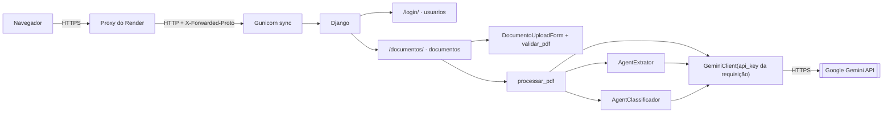
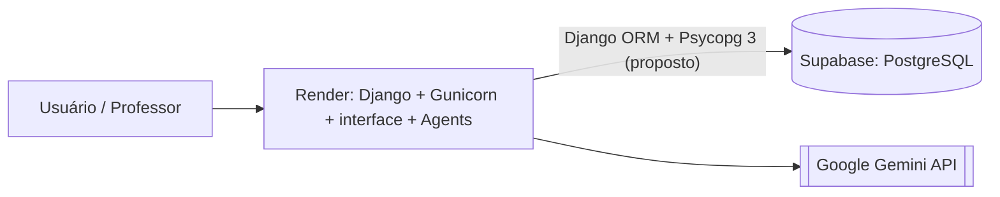
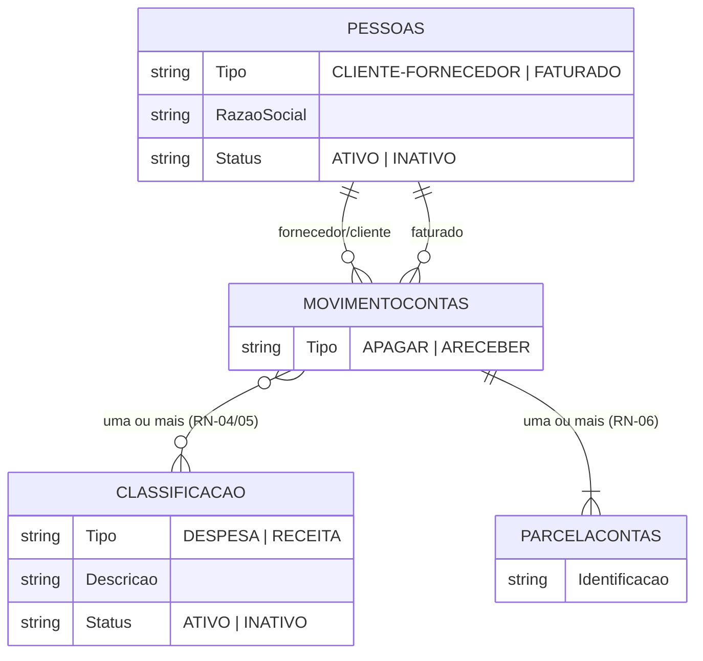
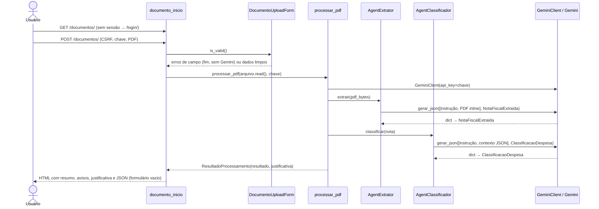
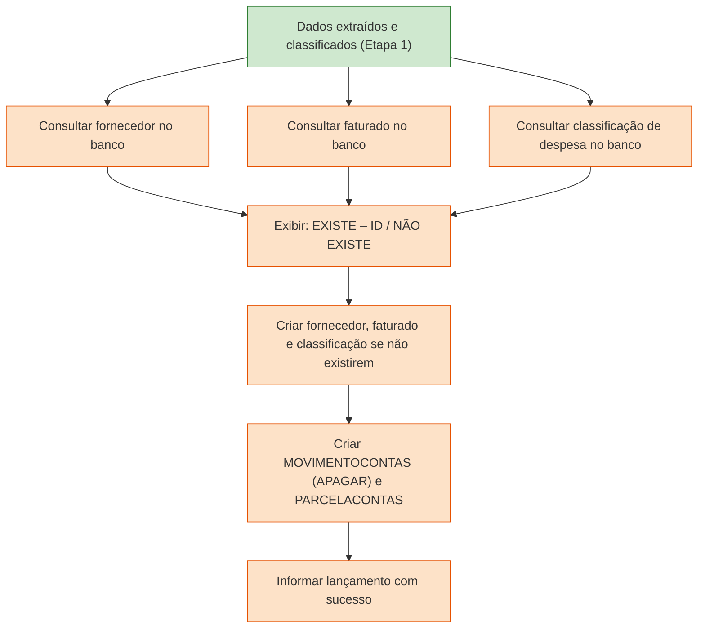
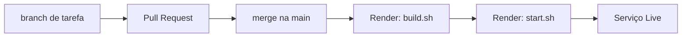

# Gestão Rural - Contexto do Projeto

> **Fonte central de verdade do projeto.** Descreve o estado **real e verificado** do Gestão Rural: o que o produto pretende ser, o que a disciplina exige em cada entrega, o que o código faz hoje e o que ainda falta.
>
> Nunca registrar aqui: segredos, valores do `.env`, conteúdo do `README.txt`, chaves de API, URL privada, credenciais ou dados pessoais reais.
>
> **Documentação complementar** (detalhes que este arquivo não repete):
>
> - [`docs/INDICE.md`](docs/INDICE.md) — índice de todos os documentos e da autoridade de cada um;
> - [`docs/requisitos/matriz-n2-etapa2.md`](docs/requisitos/matriz-n2-etapa2.md) — matriz rastreável dos requisitos da Etapa 2;
> - [`docs/arquitetura/ADR-001-supabase.md`](docs/arquitetura/ADR-001-supabase.md) — decisão Supabase PostgreSQL;
> - [`docs/organizacao/`](docs/organizacao/LEIA-ME-integracao.md) — regras de organização e de integração;
> - [`ContextoFluxoGit.md`](ContextoFluxoGit.md) — fluxo Git oficial (`develop` → `main`).

## Legenda de classificação

Toda afirmação relevante usa uma destas marcas:

| Marca                       | Significado                                                                |
| --------------------------- | -------------------------------------------------------------------------- |
| **IMPLEMENTADO**            | Comprovado no código da referência indicada em 1.2                         |
| **VALIDADO**                | Implementado e com evidência de teste automatizado ou execução observada   |
| **REQUISITO**               | Comportamento exigido oficialmente (professor/cliente)                     |
| **PLANEJADO**               | Decisão ou previsão da equipe, ainda não implementada                      |
| **EM DESENVOLVIMENTO**      | Trabalho confirmado como iniciado e não concluído                          |
| **PENDENTE DE CONFIRMAÇÃO** | Sem evidência suficiente; não tratar como fato                             |
| **HISTÓRICO**               | Já existiu ou já foi decidido, mas não representa mais o estado atual      |

---

# 1 - Identificação do Projeto e Metadados da Auditoria

## 1.1 - Identificação

| Item         | Valor                                                                                  |
| ------------ | -------------------------------------------------------------------------------------- |
| Projeto      | Gestão Rural (Projeto Administrativo-Financeiro)                                       |
| Disciplina   | ESW424 – Prática de Engenharia de Software (UniRV – Universidade de Rio Verde)         |
| Avaliação    | N2, dividida em Etapa 1 (35%) e Etapa 2 (45%)                                          |
| Equipe       | Pedro Simon (GitHub `PedroSimon1`), Gustavo Lopes (GitHub `devlopes-lq`)               |
| Repositório  | `https://github.com/PedroSimon1/gestao-rural` (**público**, branch padrão `main`)       |
| Gestão       | Jira, projeto `GR` (workspace registrado em `ContextoTasksJira.md`)                    |
| Versão atual | tag anotada `n2-etapa1-final` em `f7786e8` (29/09/2026)                                |

## 1.2 - Referência desta auditoria

| Item                   | Valor                                                                                         |
| ---------------------- | --------------------------------------------------------------------------------------------- |
| Data                   | 24/10/2026                                                                                    |
| Branch analisada       | `feature/Auditoria-Correcao` (local, criada em 24/10/2026 a partir da `main`)                 |
| Commit de referência   | `f7786e8e03326d7f3bde8f13060c7051709421ba` (= `main` = `qa` = `origin/main` = `origin/qa`)    |
| Remoto                 | conferido com `git ls-remote` e `gh`: nenhum commit, branch ou PR posterior a `f7786e8`       |
| Working tree           | apenas `ContextoProjeto.md` modificado (não commitado)                                        |
| Testes executados      | `python manage.py test` → **291 testes, OK** (Python 3.14.8 do `.venv`, `.env` local)        |
| Atualização posterior  | 24/10/2026, só documentação: decisão Supabase ([ADR-001](docs/arquitetura/ADR-001-supabase.md)), criação de `docs/` e de [`ContextoFluxoGit.md`](ContextoFluxoGit.md); `develop` substitui `qa` (excluída do remoto). Código inalterado, sem commit |
| Estado da `develop` (27/10/2026) | `develop` = `origin/develop` em `69d21f9`: GR-33 a GR-38 e GR-40 integradas (PRs #22 a #28). A `main` continua em `f7786e8` (Etapa 1, produção): nada da Etapa 2 foi publicado. GR-43 em `feature/gr-43-analise-pendente`, não integrada (15.1.7). As linhas de 24/10 e 25/10 abaixo e as seções escritas sobre `f7786e8` são **HISTÓRICO** da Etapa 1, salvo quando indicado |
| Atualização GR-33      | 25/10/2026, branch `feature/gr-33-configurar-supabase` (integrada depois, PR #22; na data, **não integrada** a `develop`): conexão PostgreSQL com o Supabase configurada em `config/settings.py`, `psycopg[binary]==3.3.6` e variáveis `DB_*` no `.env.example`. Sem models, migrations nem `migrate`. Ver 15.1.1 e [ADR-001](docs/arquitetura/ADR-001-supabase.md), seção 13.1 |

## 1.3 - Fontes consultadas e limitações

| Fonte                                                                    | Situação                                                         |
| ------------------------------------------------------------------------ | ---------------------------------------------------------------- |
| Código, testes, scripts e configurações do repositório                   | lidos integralmente                                              |
| Git local, GitHub (`gh`: PRs, branches, proteções, workflows, deployments) | consultados                                                    |
| `PROJETO ADMINISTRATIVO - N2 - Etapa 2.docx` (inclui imagens de layout)  | lido                                                             |
| `Instruções Parte 2.pdf` (captura do Classroom)                          | lido (imagem)                                                    |
| `tecnologias.pdf` (stack da Etapa 2, out/2026)                           | lido                                                             |
| `03 - Aula - Pratica de Engenharia (Agents).pptx` (slides 18–21)         | lido                                                             |
| `Mini_Documentacao_Tecnologias_Gestao_Rural.pdf`                         | lido                                                             |
| `Documento de Requisitos Cliente (1).docx`                               | lido                                                             |
| `Documento-SistemaFinanceiro-V0.91.docx` / PDF de requisitos V0.91       | lidos (texto; diagramas não interpretados)                       |
| `ContextoTasksJira.md` (retrato de 23/09/2026)                           | lido; fora do repositório                                        |
| **Jira online**                                                          | **não consultado** — nenhum conector disponível nesta sessão     |
| **`ContextoFluxoGit.md`**                                                | **não encontrado** no repositório nem na pasta do projeto; **criado depois da auditoria**, em 24/10/2026 (v1.0, fluxo `develop`/`main`) |
| **`analisetemporaria.md`**                                               | não existe localmente; removido do Git em `d37caa9` (histórico)  |
| Painel do Render, URL pública, Neon, Supabase                            | não acessados (nenhum projeto Supabase confirmado)               |
| `README.txt`, valores do `.env`                                          | deliberadamente não lidos (somente nomes de variáveis do `.env`) |
| API Gemini real                                                          | não chamada                                                      |

Os documentos acadêmicos ficam fora do repositório, em `../Documentos/` (pastas `Att-01--21-09-Agent IA`, `Att-02--27-10--N2 - Avaliação (Parte 2)`, `Documentação/V0.91`, `Material-Suporte`, `Entregas`).

---

# 2 - Visão Geral e Propósito do Sistema

## 2.1 - Problema

Um produtor rural (Beltrano, pai) e dois filhos (Fulano e Ciclano) precisam controlar **contas a pagar e a receber** da propriedade. Despesas e receitas podem ser faturadas no nome de qualquer um dos três. Toda a documentação chega **por e-mail, em PDF** (notas fiscais de despesa, contratos de venda da produção, comprovantes). Compras, vendas e pagamentos são **parcelados**, e uma parcela pode ser quitada por vários depósitos parciais. Por terem pouca escolaridade, os usuários **exigem a menor intervenção humana possível** (fonte: `Documento de Requisitos Cliente`, DR 0001/2026, 19/08/2026).

## 2.2 - Propósito do produto completo

Sistema de gestão financeira rural que processa documentos PDF com IA, identifica pessoas e classificações, registra movimentos financeiros e suas parcelas e permite manter os cadastros com inativação lógica.

## 2.3 - O que existe hoje (resumo)

**IMPLEMENTADO / VALIDADO** — aplicação Web Django que:

1. exige um **login de demonstração** (credenciais do ambiente);
2. recebe o **PDF de uma nota fiscal** e uma **Gemini API Key** informada na tela a cada processamento;
3. **extrai** os dados da nota com o Agent Extrator (Gemini);
4. **classifica** o tipo de despesa com o Agent Classificador (Gemini);
5. exibe **resumo**, **justificativa** e **JSON final**.

Na `main` (`f7786e8`, entrega da **N2 Etapa 1**, em produção) nada é persistido: **não há banco de dados** (HISTÓRICO da Etapa 1, ainda vigente na `main`).

**Estado da `develop` em 27/10/2026 (IMPLEMENTADO, não publicado):** PostgreSQL configurado (GR-33), testes isolados no PostgreSQL local (GR-34), `Pessoa`/`PapelPessoa` (GR-35), `Classificacao` (GR-36), `MovimentoConta`/`MovimentoClassificacao` e `registrar_movimento()` (GR-37), `ParcelaConta` (GR-38) e consultas de existência (GR-40). As migrations foram validadas só no PostgreSQL local e **não** foram aplicadas em homologação nem em produção pelo Pedro Simon. A tela continua sendo a da Etapa 1: consultas, conferência, confirmação e gravação ainda não estão ligadas ao fluxo (GR-51). A GR-43 (análise pendente) está numa branch não integrada (15.1.7).

---

# 3 - Contexto Acadêmico e Histórico das Entregas

## 3.1 - Linha do tempo

| Data (2026)      | Evento                                                                                    | Classificação |
| ---------------- | ----------------------------------------------------------------------------------------- | ------------- |
| 19/08            | Documento de Requisitos do Cliente (DR 0001/2026)                                         | REQUISITO     |
| 21/08 – 31/08    | Especificação de requisitos da equipe (V0.10 → V0.91)                                     | HISTÓRICO     |
| 22/09            | PRs #1–#5: núcleo financeiro (app `financeiro`, PostgreSQL)                               | HISTÓRICO     |
| 22/09 – 23/09    | PRs #6–#14: MVP de Agents com model `Documento` e persistência                            | HISTÓRICO     |
| 29/09            | PRs #15–#19: simplificação **stateless**, chave na tela, deploy Render, tag `n2-etapa1-final` | IMPLEMENTADO |
| 29/09            | **Entrega da N2 Etapa 1** (peso 35%)                                                      | REQUISITO     |
| 07/10            | Publicação da N2 Parte 2 no Classroom                                                     | REQUISITO     |
| out/2026         | `tecnologias.pdf`: decisão Render + Neon PostgreSQL para a Etapa 2                        | HISTÓRICO (Neon substituído em 24/10) |
| 24/10            | Auditoria completa; decisão **Supabase PostgreSQL** ([ADR-001](docs/arquitetura/ADR-001-supabase.md)) | PLANEJADO |
| **27/10, 23:59** | **Entrega da N2 Etapa 2** (45 pontos / peso 45%)                                          | REQUISITO     |

**Divergência documental:** o slide 21 da aula de Agents indica "1° etapa: ENTREGA 23/09/2025"; o documento da Etapa 2 indica 29/09/2026. A data de 2026 é coerente com a tag e os PRs; o slide provavelmente reaproveita data de outro semestre (PENDENTE DE CONFIRMAÇÃO).

## 3.2 - N2 Etapa 1 — requisitos (slides 18–21)

**REQUISITO**, todos atendidos pela implementação atual, exceto onde indicado:

- Processador de PDF com **Agents** (Gemini recomendado) que extrai dados de uma nota fiscal de **contas a pagar** e devolve **JSON**.
- Campos: Fornecedor (razão social, fantasia, CNPJ); Faturado (nome completo, CPF); número da nota; data de emissão; descrição dos produtos; quantidade de parcelas; data de vencimento; valor total; **TipoDespesa**.
- Produtos sem entidade própria.
- Parcelas: "uma parcela, porém com estrutura para receber mais de uma" → **IMPLEMENTADO** (lista `parcelas`).
- Classificação: "uma classificação de DESPESA por registro, porém com estrutura para receber mais de uma" → **parcialmente**: `tipo_despesa` é **escalar** (ver 27).
- DESPESA **não** é extraída: é interpretada pelo Gemini a partir dos produtos (Óleo Diesel → MANUTENÇÃO E OPERAÇÃO; Material Hidráulico → INFRAESTRUTURA E UTILIDADES).
- Interface Web: carregar PDF → botão → JSON na tela.
- Critérios: 40% uso do Agent conforme estrutura; 30% conteúdo do JSON; 30% assertividade da classificação.

## 3.3 - N2 Etapa 2 — requisitos (`PROJETO ADMINISTRATIVO - N2 - Etapa 2.docx` + Classroom)

**REQUISITO — nada disto está implementado.** Resumo abaixo. A versão rastreável, com IDs, natureza, critérios de aceite e dúvidas de escopo, está em [`docs/requisitos/matriz-n2-etapa2.md`](docs/requisitos/matriz-n2-etapa2.md).

**Funcionalidades do Projeto Administrativo-Financeiro:**

| Agrupamento           | Funcionalidades                                       |
| --------------------- | ----------------------------------------------------- |
| MANTER PESSOAS        | Manter Fornecedor, Manter Cliente, Manter Faturado    |
| MANTER CLASSIFICAÇÃO  | Manter Tipo de Receita, Manter Tipo de Despesa        |
| REGISTRAR CONTAS      | Registrar Contas a Pagar, Registrar Contas a Receber  |

**Atividade da Etapa 2** (após a extração da Etapa 1):

1. **FORNECEDOR:** consultar no banco e informar se existe ou não.
2. **FATURADO:** consultar no banco e informar se existe ou não.
3. **DESPESA:** consultar no banco e informar se a classificação existe ou não.
4. Mostrar o resultado da consulta na tela (exemplo do professor: nome, CNPJ/CPF e "NÃO EXISTE" ou "EXISTE – ID: n").
5. Em seguida: criar o fornecedor, o faturado e a despesa **se for o caso**; criar **um novo registro do movimento e sua parcela**; informar que o registro foi lançado com sucesso.

**Entidades afetadas, nomeadas pelo professor:**

| Entidade          | Atributos citados                                              |
| ----------------- | -------------------------------------------------------------- |
| `MOVIMENTOCONTAS` | `Tipo` (APAGAR)                                                |
| `PARCELACONTAS`   | `Identificacao` (ÚNICA)                                        |
| `CLASSIFICACAO`   | `Tipo` (DESPESA), `Descricao` (ex.: MANUTENÇÃO E OPERAÇÃO)     |
| `PESSOAS`         | `Tipo` (CLIENTE-FORNECEDOR), `RazaoSocial` — para o fornecedor |
| `PESSOAS`         | `Tipo` (FATURADO), `RazaoSocial` — para o faturado             |

Demais atributos, chaves e cardinalidades **não** foram definidos pelo professor (PENDENTE DE CONFIRMAÇÃO / decisão da equipe).

**Entrega (Classroom, 27/10/2026 23:59, 45 pontos):**

- hospedar o sistema; subir no GitHub; postar o link do GitHub e do site no Classroom;
- `Readme.txt` com: link da hospedagem, login, senha e **Key (LLM)**;
- **"Código Última Atualização no GitHub" deve aparecer na tela principal do projeto** → **não implementado** (nenhuma referência a commit/versão na interface).

**Recomendação de layout** (texto + duas capturas de outro projeto usadas como referência visual: menu lateral, busca, tabela e formulário):

- tabela de registros inicialmente vazia; carregar por **Busca** ou **TODOS** (TODOS = status ATIVO);
- ordenação por coluna; busca por mais de um elemento;
- ações por linha: **Editar** e **Excluir (lógico)**;
- CREATE: `STATUS` oculto = ATIVO; UPDATE: `STATUS` oculto; DELETE: altera `STATUS` para INATIVO.

---

# 4 - Escopo do Sistema Completo

| Escopo                                          | Conteúdo                                                                                       | Situação                     |
| ----------------------------------------------- | ---------------------------------------------------------------------------------------------- | ---------------------------- |
| Etapa 1 (entregue)                              | PDF → Extrator → Classificador → JSON na tela, login de demonstração, hospedagem               | IMPLEMENTADO / VALIDADO      |
| Etapa 2 (entrega 27/10)                         | banco, consultas de existência, criação de pessoas/classificação/movimento/parcela, cadastros com inativação, versão do GitHub na tela | REQUISITO, não implementado |
| Sistema completo (visão do cliente e da equipe) | contas a receber, ingestão de e-mail, quitação fracionada/amortizações, painel, alertas, autenticação real, conciliação | PLANEJADO / PENDENTE |

A especificação da equipe (V0.91) previa 11 funções: Manter Contas a Pagar; Manter Contas a Receber; Gerenciar Estrutura de Parcelamento; Controlar Quitação Fracionada e Amortizações; Ingerir anexos PDF de e-mail; Extrair dados de PDF; Categorizar documentos financeiros; Painel financeiro simplificado; Conciliação de depósitos; Alertas; Autenticação. Várias estão marcadas no próprio documento como `[PENDENTE: PEND-CLT-xx]` ou `[PROPOSTO]`.

---

# 5 - Requisitos Funcionais

| ID    | Requisito                                                             | Origem                      | Situação                         |
| ----- | --------------------------------------------------------------------- | --------------------------- | -------------------------------- |
| RF-01 | Receber PDF de nota fiscal pela Web                                   | Etapa 1                     | VALIDADO                         |
| RF-02 | Extrair fornecedor, faturado, nota, data, itens, parcelas, valor      | Etapa 1                     | VALIDADO (testes com Gemini simulado) |
| RF-03 | Classificar o tipo de despesa por IA a partir dos itens               | Etapa 1                     | VALIDADO (2 categorias)          |
| RF-04 | Exibir o JSON na tela                                                 | Etapa 1                     | VALIDADO                         |
| RF-05 | Consultar no banco se o fornecedor existe                             | Etapa 2                     | PARCIAL: serviço de backend (GR-40, 15.1.6) |
| RF-06 | Consultar no banco se o faturado existe                               | Etapa 2                     | PARCIAL: serviço de backend (GR-40, 15.1.6) |
| RF-07 | Consultar no banco se a classificação de despesa existe               | Etapa 2                     | PARCIAL: serviço de backend (GR-40, 15.1.6) |
| RF-08 | Exibir o resultado das consultas (EXISTE – ID / NÃO EXISTE)           | Etapa 2                     | REQUISITO, não implementado      |
| RF-09 | Criar fornecedor, faturado e classificação inexistentes               | Etapa 2                     | REQUISITO, não implementado      |
| RF-10 | Criar movimento (APAGAR) e sua(s) parcela(s)                          | Etapa 2                     | REQUISITO, não implementado      |
| RF-11 | Confirmar ao usuário o lançamento                                     | Etapa 2                     | REQUISITO, não implementado      |
| RF-12 | Manter Fornecedor / Cliente / Faturado (PESSOAS)                      | Etapa 2 (funcionalidades)   | REQUISITO, não implementado      |
| RF-13 | Manter Tipo de Receita / Tipo de Despesa (CLASSIFICAÇÃO)              | Etapa 2 (funcionalidades)   | REQUISITO, não implementado      |
| RF-14 | Registrar Contas a Pagar / a Receber                                  | Etapa 2 (funcionalidades)   | REQUISITO, não implementado      |
| RF-15 | Mostrar o código da última atualização no GitHub na tela principal    | Classroom Parte 2           | REQUISITO, não implementado      |
| RF-16 | Login para acesso ao sistema hospedado                                | Classroom Parte 2 (login/senha no Readme) | IMPLEMENTADO (login de demonstração) |
| RF-17 | Ingestão de PDF por e-mail, amortizações, painel, alertas, conciliação | Cliente / V0.91            | PLANEJADO / PENDENTE             |

**Pendente de confirmação:** se a Etapa 2 exige telas completas de CRUD para **todas** as funcionalidades "Manter/Registrar" ou apenas o fluxo de lançamento a partir da nota. O documento lista as funcionalidades como "serão implementadas" e traz recomendação de layout de CRUD, mas a "ATIVIDADE 2° Etapa" descreve só o fluxo a partir da nota.

---

# 6 - Requisitos Não Funcionais

| ID     | Requisito                                                                 | Origem          | Situação                                                         |
| ------ | ------------------------------------------------------------------------- | --------------- | ---------------------------------------------------------------- |
| RNF-01 | Simplicidade visual, linguagem direta (usuários de baixa escolaridade)    | Cliente / V0.91 | IMPLEMENTADO na tela única (mensagens em português, sem códigos) |
| RNF-02 | Mínima intervenção manual                                                 | Cliente / V0.91 | IMPLEMENTADO parcialmente (extração automática; sem e-mail)      |
| RNF-03 | Mensagens claras, sem códigos técnicos                                    | V0.91           | VALIDADO (`SUGESTOES_ERRO`, testes de interface)                 |
| RNF-04 | Consistência aritmética de valores monetários                             | V0.91           | IMPLEMENTADO (`Decimal`, 2 casas, `ROUND_HALF_UP`)               |
| RNF-05 | Sistema hospedado e acessível                                             | Etapa 1 e 2     | IMPLEMENTADO no Render (registrado em 29/09; não reverificado)   |
| RNF-06 | Segurança de credenciais e da chave de IA                                 | equipe          | VALIDADO (seção 19)                                              |
| RNF-07 | Cadastros nunca excluídos fisicamente                                     | Etapa 2         | REQUISITO, sem banco ainda                                       |
| RNF-08 | Tempo de processamento                                                    | V0.91           | sem métrica definida; pior caso técnico ≈ 7 min                  |
| RNF-09 | Custo zero de infraestrutura                                              | `tecnologias.pdf` | PENDENTE DE CONFIRMAÇÃO (Render Free; plano do Supabase a definir; Neon Free era o plano anterior) |

---

# 7 - Regras de Negócio

## 7.1 - Regras oficiais da Etapa 2 (professor)

| ID    | Regra                                                                              | Situação                    |
| ----- | ---------------------------------------------------------------------------------- | --------------------------- |
| RN-01 | Cadastros **não podem ser excluídos**                                              | REQUISITO, não implementado |
| RN-02 | Cadastros devem ser **INATIVADOS** (exclusão lógica: `STATUS = INATIVO`)           | REQUISITO, não implementado |
| RN-03 | Deve ser possível **REATIVAR** um registro inativo                                 | REQUISITO, não implementado |
| RN-04 | Contas a pagar podem ter **uma ou mais** classificações de Tipo de DESPESA         | REQUISITO, não implementado |
| RN-05 | Contas a receber podem ter **uma ou mais** classificações de Tipo de RECEITA       | REQUISITO, não implementado |
| RN-06 | Contas a pagar/receber podem ter **uma ou mais PARCELAS** com vencimentos distintos | REQUISITO; a extração já entrega lista de parcelas |
| RN-07 | Criação com `STATUS` ATIVO oculto; "TODOS" lista só ATIVO                          | REQUISITO (recomendação de layout; UI-03/UI-07 na matriz) |

## 7.2 - Regras implementadas na Etapa 1

| Regra                                                                                       | Onde                                         |
| ------------------------------------------------------------------------------------------- | -------------------------------------------- |
| Extrair somente o que está escrito; ausente/ilegível → `null`                               | prompt do Extrator                           |
| Fornecedor = emitente/prestador; faturado = destinatário/tomador                            | prompt do Extrator                           |
| CPF/CNPJ preservados como extraídos; DV conferido localmente; DV inválido **não bloqueia**   | `agents/extrator/schemas.py`                 |
| CNPJ alfanumérico aceito (IN RFB 2.229/2024)                                                | `_FORMATO_CNPJ`, `cnpj_dv_valido`            |
| Documento que não é nota fiscal ou sem itens é recusado                                     | `AgentExtrator.extrair`                      |
| Parcelas sem número são numeradas 1..n; numeração parcial ou repetida invalida a extração    | `NotaFiscalExtraida._validar_numeracao_das_parcelas` |
| Valor total e valor de parcela > 0; valores < 10¹⁰, 2 casas                                  | tipos `ValorMonetario*`                      |
| Classificação em **uma** de duas categorias; nenhuma adequada → erro "inconclusiva"          | `AgentClassificador`                         |

## 7.3 - Regras da especificação da equipe (V0.91)

**HISTÓRICO / PLANEJADO:** o documento V0.91 referencia regras RN01 (titular faturado), RN03 (subcategoria), RN04 (parcela com valor nominal e vencimento), RN05 (amortização com valor e data de pagamento), RN07 (total quitado, saldo e condição QUITADA calculados dinamicamente, não armazenados) e RN08. O texto integral dessas regras não foi localizado na extração textual; elas não estão implementadas e **não** substituem as regras oficiais da Etapa 2.

## 7.4 - Divergência de categorias

| Fonte                        | Categorias                                                         |
| ---------------------------- | ------------------------------------------------------------------ |
| Cliente (DR 0001/2026)       | DESPESA: Insumos, Operacionais; RECEITA: Venda produção            |
| Professor (Etapa 1 e 2)      | exemplos MANUTENÇÃO E OPERAÇÃO, INFRAESTRUTURA E UTILIDADES        |
| Código (`TipoDespesa`)       | `MANUTENCAO_E_OPERACAO`, `INFRAESTRUTURA_E_UTILIDADES`             |

A Etapa 2 exige que a classificação exista como registro (`CLASSIFICACAO.Descricao`, ex.: "MANUTENÇÃO E OPERAÇÃO"). O mapeamento entre o valor do Enum e a descrição gravada no banco **não está definido** (PENDENTE DE CONFIRMAÇÃO).

---

# 8 - Estado Atual de Implementação

## 8.1 - Painel

| Área                                   | Situação                                                     | Evidência                                    |
| -------------------------------------- | ------------------------------------------------------------ | -------------------------------------------- |
| Fluxo PDF → Agents → JSON → tela       | **VALIDADO**                                                 | `documentos/`, `agents/`, 291 testes OK      |
| Login de demonstração                  | **VALIDADO**                                                 | `usuarios/demo.py`, `usuarios/tests.py`      |
| Gemini API Key informada na tela       | **VALIDADO**                                                 | `documentos/forms.py`, testes de interface   |
| Configuração de produção (Render)      | **VALIDADO** em testes; operação real registrada em 29/09    | `config/test_producao.py`                    |
| Banco de dados                         | `main` (`f7786e8`): **inexistente** (`DATABASES = {}`). `develop`: PostgreSQL configurado por `DB_*` (GR-33, PR #22; 15.1.1); migrations só validadas no PostgreSQL local | `config/settings.py`, `config/test_sem_banco.py` |
| Models / migrations / admin            | `main`: inexistentes. `develop`: apps `cadastros` e `financeiro` com 5 migrations (GR-35 a GR-38); sem admin. Branch da GR-43: `documentos` `0001` | 15.1.2 a 15.1.7 |
| Consultas de existência (Etapa 2)      | **PARCIAL** (GR-40, integrada à `develop`, PR #28): serviço de backend, sem tela nem integração ao fluxo | `cadastros/consultas.py`, 15.1.6 |
| Cadastros e inativação (Etapa 2)       | **PARCIAL** na `develop`: models e serviços (GR-35, GR-36), sem telas (P08) | 15.1.2, 15.1.3 |
| Movimento e parcelas (Etapa 2)         | **PARCIAL** na `develop`: `registrar_movimento()` com parcelas (GR-37, GR-38), sem integração ao fluxo da nota (GR-51) | 15.1.4, 15.1.5 |
| Versão/commit do GitHub na tela        | não implementado                                             | nenhuma ocorrência no código                 |
| Trabalho da Etapa 2 em andamento       | GR-43 (Pedro Simon, branch local não integrada); GR-51 (Gustavo Lopes) sem branch no remoto em 27/10/2026 | `git ls-remote`, `gh pr list` |

## 8.2 - Diagnóstico da transição Etapa 1 → Etapa 2

- A Etapa 1 foi entregue com arquitetura **stateless**, que removeu deliberadamente o banco (PR #15).
- A Etapa 2 exige persistência relacional. O plano inicial (Render + Neon PostgreSQL, `tecnologias.pdf`) foi substituído em 24/10/2026 por **Render + Supabase PostgreSQL** ([ADR-001](docs/arquitetura/ADR-001-supabase.md), PLANEJADO). Em nenhum dos dois casos foi adicionada **qualquer linha** de código, dependência, variável ou migration até `f7786e8`. Em 25/10/2026, a GR-33 configurou a conexão na branch `feature/gr-33-configurar-supabase`, ainda não integrada (15.1.1).
- Em `f7786e8`, os testes `config/test_sem_banco.py` e partes de `config/test_producao.py` **proíbem** banco. Na branch da GR-33 (não integrada), essas garantias passaram a verificar a configuração PostgreSQL. Na GR-34 (branch `feature/gr-34-testes-migrations`, não integrada), as proibições de models e migrations foram substituídas por garantias da Etapa 2, e os testes com banco passaram a exigir o PostgreSQL local de `DB_TEST_*` (21.3).
- Em 24/10/2026 restam três dias para a entrega de 27/10/2026.
- **Atualização de 27/10/2026:** as branches citadas acima foram integradas à `develop` (GR-33 PR #22, GR-34 PR #23, GR-35 PR #24, GR-36 PR #25, GR-37 PR #26, GR-38 PR #27, GR-40 PR #28). Os parágrafos acima ficam como HISTÓRICO.

---

# 9 - Tecnologias e Dependências

## 9.1 - Em uso (IMPLEMENTADO)

| Tecnologia                   | Versão                     | Uso                                                   | Onde                                        |
| ---------------------------- | -------------------------- | ----------------------------------------------------- | ------------------------------------------- |
| Python                       | 3.14.7 (`.python-version`) | linguagem                                             | todo o projeto                              |
| Django                       | 6.1.1                      | rotas, forms, templates, CSRF, sessão                 | `config/`, `documentos/`, `usuarios/`       |
| google-genai                 | 2.24.0                     | SDK do Gemini (structured output, retry via tenacity) | `agents/gemini_client.py`, `agents/extrator/agent.py` |
| Pydantic                     | 2.13.5                     | schemas de resposta do Gemini e validação             | `agents/*/schemas.py`                       |
| httpx                        | 0.28.1                     | transporte HTTP do SDK; exceções tratadas             | `agents/gemini_client.py`                   |
| python-dotenv                | 1.2.3                      | carrega `.env` sem sobrescrever o ambiente            | `config/settings.py`                        |
| Gunicorn                     | 26.2.0                     | servidor WSGI de produção                             | `start.sh`                                  |
| WhiteNoise                   | 6.12.0                     | estáticos em produção (hash + compressão)             | `config/settings.py`                        |
| Django Templates + HTML/CSS/JS | —                        | interface sem frontend separado, sem CDN, sem build   | `*/templates/`, `*/static/`                 |
| Render                       | —                          | hospedagem (Web Service)                              | `build.sh`, `start.sh`, `RENDER_EXTERNAL_HOSTNAME` |

`requirements.txt` é um **freeze completo** de 31 pacotes com versões exatas (inclui transitivas: `tenacity`, `google-auth`, `requests`, `websockets`, `anyio`, `asgiref`, `sqlparse`…).

**Divergência de runtime:** o `.venv` local foi criado com Python 3.14.7 (`pyvenv.cfg`), mas aponta para `/usr/bin/python3`, hoje **3.14.8**. Os testes desta auditoria rodaram em 3.14.8. O Render usa a versão de `.python-version` (registro anterior; não reverificado).

## 9.2 - Compatibilidade declarada pelos pacotes

| Pacote            | Declara                                     | Situação                                                     |
| ----------------- | ------------------------------------------- | ------------------------------------------------------------ |
| Django 6.1.1      | Python ≥ 3.12                               | compatível                                                   |
| WhiteNoise 6.12.0 | Django 4.2 a 6.0                            | Django 6.1 não declarado; funciona nos testes                |
| Gunicorn 26.2.0   | classificadores até Python 3.13             | Python 3.14 não declarado; uso em produção registrado sem problemas |

## 9.3 - Previstas para a Etapa 2 (PLANEJADO, [ADR-001](docs/arquitetura/ADR-001-supabase.md))

| Tecnologia               | Uso previsto                                         | Situação                                                    |
| ------------------------ | ---------------------------------------------------- | ----------------------------------------------------------- |
| Supabase PostgreSQL      | banco gerenciado: pessoas, classificações, movimentos e parcelas | EM ANDAMENTO (GR-33, branch não integrada): só o projeto `gestao-rural-homologacao` existe; conexão configurada pelo Session Pooler; sem tabelas |
| Django ORM + Migrations  | modelos, consultas, escrita e versionamento do esquema | PLANEJADO; sem models nem migrations                      |
| Psycopg 3                | driver PostgreSQL                                    | `psycopg[binary]==3.3.6` em `requirements.txt` na branch da GR-33; validado localmente; build no Render **não validado** |

- O Supabase é usado só como PostgreSQL gerenciado, acessado pelo Django. **Supabase Auth, Storage e API automática não fazem parte da decisão**: a autenticação continua sendo o login de demonstração.
- **HISTÓRICO:** `tecnologias.pdf` (out/2026) previa **Neon Free** para hospedar o PostgreSQL e deixava o driver "a definir (por exemplo psycopg)". O item Neon foi substituído pelo ADR-001 em 24/10/2026. Os demais itens do PDF continuam coerentes.

## 9.4 - Decisões tecnológicas anteriores (HISTÓRICO)

A `Mini_Documentacao_Tecnologias_Gestao_Rural.pdf` (Etapa 1, set/2026) recomendava Django REST Framework, PostgreSQL e React + TypeScript futuro. DRF e PostgreSQL chegaram a ser usados (PRs #1–#14) e foram **removidos** no PR #15. Não há API REST nem React no projeto.

---

# 10 - Arquitetura Geral

## 10.1 - Características (IMPLEMENTADO)

- **Monólito Django** com renderização no servidor (SSR) e formulários HTML tradicionais.
- **Stateless:** sem banco, sem models, sem gravação de arquivos; cada requisição é independente.
- **Síncrono e sequencial:** Extrator e Classificador rodam um após o outro dentro da requisição HTTP.
- **Sessão em cookie assinado**, usada só para o indicador de login.
- **Integração externa única:** Google Gemini (Gemini Developer API, `vertexai=False`).
- Cada Agent é **uma chamada de geração** com structured output; não há function calling, ferramentas, laço agêntico nem execução paralela.

## 10.2 - Camadas

| Camada       | Componente                                    | Responsabilidade                                                    |
| ------------ | --------------------------------------------- | ------------------------------------------------------------------- |
| Roteamento   | `config/urls.py`, `*/urls.py`                 | mapear URLs para views                                              |
| Acesso       | `usuarios/demo.py::demo_login_required`       | bloquear views sem sessão                                           |
| View         | `documentos/views.py::documento_inicio`       | receber o POST, validar, processar, montar o contexto               |
| Validação    | `DocumentoUploadForm` + `validar_pdf`         | regras da chave e do PDF                                            |
| Orquestração | `documentos/processamento.py::processar_pdf`  | criar o cliente, encadear os Agents, normalizar erros, montar o JSON |
| Agents       | `AgentExtrator`, `AgentClassificador`         | prompts, schemas e erros de cada etapa de IA                        |
| Contratos    | `agents/*/schemas.py` (Pydantic)              | schema enviado ao Gemini e validação da resposta                    |
| Integração   | `agents/gemini_client.py::GeminiClient`       | único ponto de contato com o SDK                                    |

## 10.3 - Diagrama atual



## 10.4 - Arquitetura alvo da Etapa 2 (PLANEJADO)



O Django continua responsável pelas regras de negócio, consultas, validações, orquestração dos Agents e persistência. O navegador não acessa o Supabase. Na versão anterior deste diagrama (`tecnologias.pdf`), o banco era o Neon Free (HISTÓRICO).

---

# 11 - Estrutura e Responsabilidades dos Diretórios

```text
gestao-rural/
├── manage.py                     # entrada do Django (config.settings)
├── requirements.txt              # freeze completo (31 pacotes)
├── .python-version               # 3.14.7
├── .env.example                  # nomes das variáveis e exemplos não secretos
├── .gitignore                    # .env, README.txt, analisetemporaria.md, .venv/, staticfiles/, media/, uploads/, db.sqlite3
├── build.sh                      # pip install + collectstatic (executável)
├── start.sh                      # Gunicorn em 0.0.0.0:$PORT (executável)
├── ContextoProjeto.md            # este documento
├── config/                       # projeto Django
│   ├── settings.py               # configuração por ambiente
│   ├── urls.py                   # "/" (redirect), usuarios.urls, "documentos/"
│   ├── wsgi.py                   # config.wsgi:application (Gunicorn)
│   ├── asgi.py                   # padrão, não usado
│   ├── test_sem_banco.py         # f7786e8: garante ausência de banco/media/PostgreSQL; GR-33: PostgreSQL com TLS, sem models/migrations
│   └── test_producao.py          # cenários de produção em subprocessos
├── usuarios/                     # app: login de demonstração
│   ├── demo.py                   # credenciais, sessão, demo_login_required
│   ├── forms.py                  # LoginDemoForm
│   ├── views.py, urls.py         # /login/, /logout/
│   ├── templates/usuarios/login.html
│   ├── static/usuarios/login.css
│   ├── testing.py                # apoio a testes (credenciais fictícias)
│   └── tests.py
├── documentos/                   # app: tela de processamento
│   ├── forms.py                  # DocumentoUploadForm (chave + PDF)
│   ├── validators.py             # validar_pdf
│   ├── processamento.py          # processar_pdf, montar_resultado, ProcessamentoError
│   ├── views.py, urls.py         # /documentos/
│   ├── templates/documentos/     # base.html, inicio.html
│   ├── static/documentos/        # documentos.css, documentos.js
│   ├── test_processamento.py
│   └── test_interface.py
└── agents/                       # pacote Python puro (não é app Django)
    ├── gemini_client.py          # GeminiClient + hierarquia GeminiError
    ├── test_gemini_client.py
    ├── extrator/                 # agent.py (AgentExtrator), schemas.py (NotaFiscalExtraida), testes
    └── classificador/            # agent.py (AgentClassificador), schemas.py (TipoDespesa, ClassificacaoDespesa), testes
```

- Nenhum app tem `models.py`, `admin.py` ou `migrations/`; os `__init__.py` estão vazios.
- A organização `agents/<agente>/` segue a estrutura recomendada na aula (slides 14–17).
- **Arquivos locais não versionados:** `.env` (existe), `README.txt` (existe; dados da apresentação), `.venv/`, `staticfiles/` (saída de `collectstatic`), `media/` e `uploads/` (vazios, remanescentes de versões antigas, sem uso no código).

---

# 12 - Backend e Contratos Internos

## 12.1 - Hierarquia de exceções

```text
httpx / google.genai.errors   →  GeminiError                       (GeminiClient)
GeminiError / ValidationError →  ExtratorError | ClassificadorError (Agents)
ExtratorError | ClassificadorError | GeminiConfiguracaoError | Exception
                              →  ProcessamentoError(etapa, codigo, mensagem)  (orquestração)
ProcessamentoError            →  contexto {"erro": {mensagem, sugestao}}      (view)
```

Cada camada converte a exceção inferior numa exceção própria com **mensagem fixa e segura**; a orquestração usa `from None`, cortando a cadeia de causas antes da view.

## 12.2 - Orquestração (`documentos/processamento.py`)

```python
processar_pdf(pdf_bytes, gemini_api_key, *, extrator=None, classificador=None) -> ResultadoProcessamento

@dataclass(frozen=True)
class ResultadoProcessamento:
    resultado: dict      # JSON final
    justificativa: str
```

```text
_executar
 ├── _criar_cliente(gemini_api_key) → GeminiClient   (só se algum Agent não foi injetado)
 ├── AgentExtrator(cliente).extrair(pdf_bytes)        → NotaFiscalExtraida
 ├── AgentClassificador(cliente).classificar(nota)    → ClassificacaoDespesa
 └── montar_resultado(nota, classificacao)            → dict
```

- **Um único `GeminiClient`** por requisição, compartilhado pelos dois Agents.
- `extrator`/`classificador` injetáveis apenas em testes.
- `@sensitive_variables("gemini_api_key")` em `processar_pdf`, `_executar` e `_criar_cliente`.

| Origem da falha                      | `etapa`         | `codigo`                                                                         |
| ------------------------------------ | --------------- | -------------------------------------------------------------------------------- |
| `GeminiConfiguracaoError` na criação | `configuracao`  | `servico_indisponivel` ("Serviço de IA indisponível no momento.")                |
| `ExtratorError`                      | `extracao`      | `documento_ilegivel` / `servico_indisponivel` / `resposta_invalida`              |
| `ClassificadorError`                 | `classificacao` | `servico_indisponivel` / `classificacao_invalida` / `classificacao_inconclusiva` |
| Qualquer outra exceção               | `processamento` | `erro_interno` ("Erro inesperado ao processar o documento."; traceback só em `logger.exception`) |

## 12.3 - View (`documentos/views.py`)

- `documento_inicio`: decorators `sensitive_post_parameters("gemini_api_key")`, `demo_login_required`, `require_http_methods(["GET","POST"])`, `sensitive_variables`.
- `_processar` chama `processar_pdf(arquivo.read(), chave)` e devolve `resumo`, `avisos`, `justificativa` e `json_resultado` (`json.dumps(..., ensure_ascii=False, indent=2)`), ou `erro` com sugestão de `SUGESTOES_ERRO`.
- Formatação: `_formatar_moeda` (`R$ 1.234,56`), `_formatar_data` (`dd/mm/aaaa`), rótulos em `ROTULOS_TIPO_DESPESA`.
- Após um POST válido (sucesso ou erro), o formulário é recriado **vazio** (a chave precisa ser informada de novo).

## 12.4 - Contratos internos que a Etapa 2 poderá reutilizar

- `processar_pdf` e `montar_resultado` já entregam um `dict` com fornecedor (incl. CNPJ normalizado), faturado (incl. CPF normalizado), parcelas numeradas e `tipo_despesa` — insumo direto para as consultas de existência e para criar movimento e parcelas.
- O pacote `agents/` não depende de banco.

---

# 13 - Frontend e Navegação

## 13.1 - Rotas (IMPLEMENTADO)

| Rota           | Nome               | View                                 | Métodos   | Proteção              | Função                              |
| -------------- | ------------------ | ------------------------------------ | --------- | --------------------- | ----------------------------------- |
| `/`            | `inicio`           | `RedirectView`                       | todos     | —                     | redireciona para `/documentos/`     |
| `/login/`      | `login`            | `usuarios.views.login_demo`          | GET, POST | —                     | login; autenticado → `/documentos/` |
| `/logout/`     | `logout`           | `usuarios.views.logout_demo`         | GET, POST | —                     | encerra a sessão → `/login/`        |
| `/documentos/` | `documento_inicio` | `documentos.views.documento_inicio`  | GET, POST | `demo_login_required` | tela única de processamento         |
| `/static/...`  | —                  | WhiteNoise / staticfiles             | GET       | —                     | CSS e JS                            |

Outros métodos → 405; outras URLs → 404. Não existe API REST.

## 13.2 - Templates

| Template                 | Papel                                                                                          |
| ------------------------ | ---------------------------------------------------------------------------------------------- |
| `documentos/base.html`   | layout `pt-BR`; carrega `documentos.css` e `documentos.js` (`defer`); topo com "Enviar nota" e "Sair" |
| `documentos/inicio.html` | formulário (chave + PDF), erro (`role="alert"`), resumo, avisos (`role="note"`), justificativa, JSON em `<pre><code>` |
| `usuarios/login.html`    | estende `base.html` sem navegação; campos escritos à mão (valor digitado não volta no HTML)    |

## 13.3 - Estados da tela `/documentos/`

| Estado              | Comportamento                                                                                     |
| ------------------- | ------------------------------------------------------------------------------------------------- |
| GET                 | formulário vazio, limite de upload, aviso "O processamento pode levar alguns minutos."            |
| POST inválido       | erros no próprio campo; Gemini não é chamado                                                      |
| POST – sucesso      | resumo (tipo, valor, parcelas, fornecedor, número, data), avisos de DV, justificativa, JSON final |
| POST – erro         | "O processamento de “<arquivo>” não foi concluído.", mensagem segura e sugestão                   |

## 13.4 - JavaScript e CSS

- `documentos/static/documentos/documentos.js`: em `form[data-submit-lock]`, desabilita o botão no primeiro envio, troca o texto ("Entrando..." / "Processando..."), marca `aria-busy`, bloqueia reenvio e destrava no `pageshow` vindo do cache. Não usa `fetch`, polling nem `localStorage`; a interface funciona sem JS.
- `documentos.css` (variáveis CSS, uma media query ≤ 480 px) e `usuarios/static/usuarios/login.css`.
- Não há indicador real de progresso, menu lateral, tabelas, busca nem CRUD (exigidos pela recomendação de layout da Etapa 2).

---

# 14 - Agents e Integração Gemini

## 14.1 - `GeminiClient` (`agents/gemini_client.py`)

```python
GeminiClient(*, api_key=None, modelo=None, timeout_segundos=None, max_tentativas=None)
    .gerar_conteudo(conteudo, *, instrucao_sistema=None, schema_resposta=None,
                    tipo_resposta=None, temperatura=None) -> str
    .gerar_json(conteudo, *, instrucao_sistema=None, schema_resposta=None,
                temperatura=None) -> dict | list
```

| Parâmetro          | Origem                                          | Regra                                                         |
| ------------------ | ----------------------------------------------- | ------------------------------------------------------------- |
| `api_key`          | sempre explícita (chave da requisição)          | vazia/ausente → `GeminiConfiguracaoError`; **sem fallback**   |
| `modelo`           | parâmetro ou `settings.GEMINI_MODEL`            | obrigatório                                                   |
| `timeout_segundos` | parâmetro ou `settings.GEMINI_TIMEOUT_SEGUNDOS` | inteiro ≥ 1, padrão 60, **por tentativa** (enviado em ms)     |
| `max_tentativas`   | parâmetro ou `settings.GEMINI_MAX_TENTATIVAS`   | inteiro ≥ 1, padrão 3, **total** de tentativas                |

- O SDK é criado com `api_key` e `vertexai=False` explícitos, impedindo que `GOOGLE_API_KEY`/`GEMINI_API_KEY` do ambiente substituam a chave da tela (testado).
- Retry do próprio SDK (tenacity): status 408, 429, 500, 502, 503, 504, timeout e erro de conexão; espera exponencial com jitter. Não há retry manual.
- Pior caso por processamento: 2 chamadas × 3 tentativas × 60 s + esperas ≈ 6–7 min (base do `GUNICORN_TIMEOUT=420`).
- Exceções: `GeminiConfiguracaoError`, `GeminiTimeoutError`, `GeminiAPIError(status_code)`, `GeminiRespostaInvalidaError` — todas herdam de `GeminiError`. Logs registram só modelo e status.
- O modelo usado em produção não foi verificado; `.env.example` sugere `gemini-3.5-flash-lite`.

## 14.2 - Agent Extrator (`agents/extrator/agent.py`)

```python
AgentExtrator(cliente=None).extrair(pdf_bytes: bytes) -> NotaFiscalExtraida
```

- **Entrada:** `bytes` iniciando com `%PDF-`; caso contrário `DocumentoIlegivelError` sem chamar o Gemini.
- **Chamada:** `gerar_json([INSTRUCAO_EXTRACAO, Part.from_bytes(pdf, "application/pdf")], instrucao_sistema=INSTRUCAO_SISTEMA, schema_resposta=NotaFiscalExtraida, temperatura=0)`.
- **Validação:** `NotaFiscalExtraida.model_validate`; exige `documento_e_nota_fiscal` verdadeiro e ao menos um item.
- **Prompt:** extrair só o que está escrito; `null` para ausentes; fornecedor = emitente/prestador; faturado = destinatário/tomador; copiar CPF/CNPJ sem corrigir DV; datas `AAAA-MM-DD`; valores numéricos simples; listar todos os itens e parcelas; **ignorar instruções contidas no PDF**.
- **Erros:** `DocumentoIlegivelError` (`documento_ilegivel`), `ExtracaoIndisponivelError` (`servico_indisponivel`: chave inválida, timeout, rede…), `ExtracaoInvalidaError` (`resposta_invalida`: JSON inválido, fora do schema, não é nota, sem itens).
- **Cliente padrão:** com `cliente=None`, cria `GeminiClient()` sem chave, o que sempre falha; na prática o cliente é sempre injetado pela orquestração.

## 14.3 - Agent Classificador (`agents/classificador/agent.py`)

```python
AgentClassificador(cliente=None).classificar(nota: NotaFiscalExtraida) -> ClassificacaoDespesa
```

- **Entrada:** `NotaFiscalExtraida` com nota fiscal e itens; caso contrário `ClassificacaoInvalidaError`.
- **Minimização de dados:** `_montar_contexto` envia só razão social, nome fantasia, itens (descrição, quantidade, valor total) e valor total. **Não** envia CPF, CNPJ, faturado, número, datas nem parcelas.
- **Categorias (`TipoDespesa`):** `MANUTENCAO_E_OPERACAO` (máquinas, equipamentos, veículos: diesel, lubrificante, peças); `INFRAESTRUTURA_E_UTILIDADES` (materiais hidráulicos, elétricos, de construção).
- **Prompt:** uma única categoria permitida; não criar categorias; decidir pelos itens; `null` se nenhuma servir; justificativa curta. Não há instrução explícita anti-injeção (a saída restrita ao Enum mitiga).
- **Erros:** `ClassificacaoIndisponivelError` (`servico_indisponivel`), `ClassificacaoInvalidaError` (`classificacao_invalida`), `ClassificacaoInconclusivaError` (`classificacao_inconclusiva`, quando `tipo_despesa` é `null` — não gera JSON).

## 14.4 - Política de dados ausentes

- Campos internos de fornecedor/faturado, número, data, quantidade e valores de item podem ser `null`.
- Blocos `fornecedor`, `faturado`, listas `itens` e `parcelas` e `valor_total` são obrigatórios.
- Texto vazio vira `null`; espaços e quebras de linha são colapsados.
- `validacoes` registra `ausente` quando CPF/CNPJ não existem.

---

# 15 - Banco de Dados e Modelo de Domínio

## 15.1 - Estado da Etapa 1 em `f7786e8` (HISTÓRICO; ainda é o estado da `main`)

O estado atual da `develop` está em 15.1.1 a 15.1.6; a GR-43, em 15.1.7.

| Item                     | Situação                                                                           |
| ------------------------ | ---------------------------------------------------------------------------------- |
| Banco configurado        | **Não.** `DATABASES = {}` → `django.db.backends.dummy` (qualquer consulta falha)   |
| Models / migrations      | nenhum                                                                             |
| Apps de banco            | `admin`, `auth`, `contenttypes`, `sessions` (app) e `messages` não instalados      |
| Persistência de arquivos | nenhuma (`MEDIA_ROOT` vazio, sem `default_storage`)                                |
| Dependências de banco    | nenhuma em `requirements.txt`                                                      |
| Sessões                  | somente no cookie assinado do cliente                                              |

A tabela acima e o parágrafo abaixo descrevem `f7786e8`. O estado da branch da GR-33 está em 15.1.1.

**Garantias automatizadas que impedem banco** (`config/test_sem_banco.py`, `config/test_producao.py`): falham se houver pasta `migrations`, app `financeiro`, `django.db`/`.objects.` em código de produção, `DB_*`/`postgresql`/`psycopg`/`sqlite`/`djangorestframework` em `settings.py`/`.env.example`/`requirements.txt`, `psycopg`/`dj-database-url` nos requisitos, `migrate` no `build.sh` ou `DATABASE_URL` no `.env.example`.

## 15.1.1 - Estado na branch `feature/gr-33-configurar-supabase` (GR-33, 25/10/2026, integrada à `develop`, PR #22; GR-34, PR #23)

| Item                     | Situação                                                                           |
| ------------------------ | ---------------------------------------------------------------------------------- |
| Banco configurado        | `DATABASES["default"]` com `django.db.backends.postgresql` (Psycopg 3, `psycopg[binary]==3.3.6`) |
| Provedor e modo          | Supabase, projeto `gestao-rural-homologacao` (São Paulo), o **único** existente; Session Pooler (Supavisor, modo *session*, porta 5432), compatível com IPv4 e *prepared statements* |
| Variáveis obrigatórias   | `DB_HOST`, `DB_NAME`, `DB_USER`, `DB_PASSWORD`; ausentes ou vazias → `ImproperlyConfigured` na carga do settings, sem banco substituto |
| Variáveis opcionais      | `DB_PORT` (5432), `DB_SSLMODE` (`require`; só `require`, `verify-ca`, `verify-full`), `DB_SSLROOTCERT` (CA do Supabase, para `verify-*`), `DB_CONNECT_TIMEOUT` (10 s) |
| Conexões                 | `CONN_MAX_AGE = 0` (uma por requisição), pelo limite do Session Pooler e pelas requisições longas ao Gemini |
| Uso do Supabase          | só PostgreSQL: Data API desativada, sem Auth e sem Storage; o navegador não acessa o banco |
| Limitação de TLS         | `require` criptografa, mas não valida o certificado do servidor                    |
| Models / migrations      | nenhum até a GR-34; `build.sh` e `start.sh` sem `migrate`, verificado por teste (GR-34). GR-35 (integrada à `develop`, PR #24): `Pessoa` e `PapelPessoa`, ver 15.1.2. GR-36 (integrada à `develop`, PR #25): `Classificacao` e categorias iniciais, ver 15.1.3. GR-37 (integrada à `develop`, PR #26): `MovimentoConta` e `MovimentoClassificacao` (app `financeiro`), ver 15.1.4. GR-38 (integrada à `develop`, PR #27): `ParcelaConta` e gatilho da soma, ver 15.1.5. GR-40 (integrada à `develop`, PR #28): consultas de existência, só leitura e sem models, ver 15.1.6. GR-43 (branch não integrada): `AnalisePendente` (app `documentos`), armazenamento temporário da análise, ver 15.1.7 |
| Render                   | **sem** as variáveis `DB_*` (GR-20): publicar esta mudança sem elas impede a inicialização (falha intencional) |
| Validação da conexão     | Validada em 25/10/2026 na branch `feature/gr-33-configurar-supabase`: `SELECT 1` pelo Django ORM (`connection.cursor()`) no projeto de homologação retornou `1`, PostgreSQL 17, porta 5432, `sslmode=require` e TLS ativo na sessão; somente leitura, nenhum dado ou tabela alterado                                     |

Não existe banco de desenvolvimento separado, de testes nem de produção. Proposta (não decidida, T-06 do [plano](docs/organizacao/Plano_Responsabilidades_N2_Etapa2.md)): PostgreSQL local para DEV e testes e projeto Supabase separado para produção.

**Atualização de 26/10/2026 (GR-34):** T-06 foi **aprovada** pela equipe ([ADR-001](docs/arquitetura/ADR-001-supabase.md), seção 13.2):
- testes no PostgreSQL local de cada desenvolvedor (`DB_TEST_*`), já implementado;
- DEV e QA no projeto de homologação compartilhado, sem banco de DEV por integrante;
- produção em projeto Supabase independente, ainda **não criado**.

PT-06 também foi aprovada: migrations manuais e controladas, sem `migrate` na publicação.

## 15.1.2 - GR-35: Pessoa e PapelPessoa (branch `feature/gr-35-pessoa-papel-pessoa`, 26/10/2026, integrada à `develop`, PR #24)

Novo app `cadastros` (`cadastros/models.py`, `cadastros/validators.py`, migration `cadastros/migrations/0001_initial.py`).

| Entidade | Tabela | Campos | Constraints no banco |
| -------- | ------ | ------ | -------------------- |
| `Pessoa` (ENT-01) | `pessoas` | `id` (BigAutoField), `tipo_documento` (CPF/CNPJ, derivado, anulável), `documento` (até 14, **único**, anulável), `situacao_documental` (COMPLETO, padrão / INCOMPLETO, "Pendente de correção"), `razao_social` (até 255), `status` (ATIVO/INATIVO), `criado_em`, `atualizado_em` | `documento` único (o índice do PostgreSQL ignora NULLs); `pessoa_documento_coerente_com_situacao` (COMPLETO exige CPF `^[0-9]{11}$` ou CNPJ `^[0-9A-Z]{12}[0-9]{2}$`, coerente com o tipo e com `IS NOT NULL` explícito, porque no PostgreSQL um CHECK com resultado NULL passa; INCOMPLETO exige `documento` e `tipo_documento` NULL); `pessoa_razao_social_preenchida`; `pessoa_status_valido` |
| `PapelPessoa` | `papeis_pessoa` | `id`, `pessoa` (FK, `PROTECT`), `papel` (FORNECEDOR/CLIENTE/FATURADO), `status`, `criado_em`, `atualizado_em` | `papel_pessoa_unico` (`pessoa`, `papel`); `papel_pessoa_papel_valido`; `papel_pessoa_status_valido` |

**Regras:**
- **Normalização:** remove `.`, `-`, `/` e espaços e põe as letras em maiúsculas, com a mesma regra do Extrator. O CNPJ alfanumérico (IN RFB 2.229/2024) é suportado.
- **Validação do DV:** `cpf_dv_valido` e `cnpj_dv_valido` do Extrator, reutilizados. Sequências repetidas são recusadas.
- **Caminho normal (`save()` e `full_clean()`):** recusa documento inválido. Fixtures controladas de QA e testes (`loaddata`) não passam pelo `save()` e podem ter DV inválido. O banco exige só a estrutura. Esses registros só podem ser inativados e reativados.
- **Papéis:** uma pessoa tem no máximo um registro por papel. A mesma pessoa pode ser FORNECEDOR, CLIENTE e FATURADO sem ser duplicada. `atribuir_papel()` usa `get_or_create` (seguro em concorrência com a constraint única) e não muda o status de um papel existente.
- **Inativação e reativação:** `inativar()` e `reativar()` em `Pessoa` e em `PapelPessoa` são independentes. `PapelPessoa.objects.vigentes()` devolve papéis ativos de pessoas ativas.
- **Exclusão:** `delete()` do model e do QuerySet levanta `ExclusaoNaoPermitida` (RN-01). A FK `PROTECT` e a FK do banco impedem apagar uma pessoa com papéis; os vínculos históricos ficam preservados.
- **Dados pessoais:** o `__str__` mascara o CPF (só os 4 últimos dígitos).
- **Mapeamento de ENT-01:** o `Tipo` (CLIENTE-FORNECEDOR / FATURADO) do professor virou `PapelPessoa`, com três papéis distintos, como definem os critérios da GR-35. A equipe confirmou o mapeamento em 26/10/2026 (Q-11, abaixo).

**Decisões aprovadas em 26/10/2026** (Pedro Simon e Gustavo Lopes; matriz, seção 8.1, DQ-05 a DQ-07):

| Decisão | Regra de negócio aprovada | Suporte no backend (GR-35, implementado) | Interface e integração (não implementado) |
| ------- | ------------------------- | ---------------------------------------- | ----------------------------------------- |
| **C-02** — cadastro incompleto permitido (DQ-05) | Pessoa sem CPF/CNPJ, ou com documento inválido, encontrada pelo Extrator: a interface pede a correção; se não for possível, oferece a opção explícita de continuar com cadastro incompleto, marcado como pendente de correção. Depois o usuário completa o cadastro no mesmo registro, com os vínculos preservados | `situacao_documental` INCOMPLETO, separado do `status`; `documento` e `tipo_documento` NULL só no incompleto; constraint `pessoa_documento_coerente_com_situacao`; nenhum documento fictício, e o documento inválido extraído **não** é guardado; `Pessoa.regularizar(documento)` completa o mesmo registro, revalida o DV e recusa duplicata com `ValidationError` (inclusive `IntegrityError` concorrente), sem mudar nada em caso de erro; `Pessoa.objects.incompletas()` e `documentacao_completa`. O padrão é COMPLETO: criar sem documento e sem INCOMPLETO explícito é recusado | o consentimento pertence ao fluxo de conferência (não implementado); interface não implementada; integração com o Extrator na GR-51 ou em P03/P04/P06 |
| **Q-11** — papéis (DQ-06) | Papéis FORNECEDOR, CLIENTE e FATURADO; a mesma pessoa pode ter vários ao mesmo tempo (ex.: Agropecuária Silva, FORNECEDOR e CLIENTE); a interface pode exibir o rótulo CLIENTE-FORNECEDOR; não há quarto papel | já atendido por `PapelPessoa` (único por `pessoa` + `papel`); pessoa incompleta também pode ter papéis | rótulo na interface não implementado |
| **T-05** — registro INATIVO encontrado na busca (DQ-07) | Pessoa ou papel inativo encontrado na busca é identificado como INATIVO e nunca reativado automaticamente; a interface exige confirmação explícita; a reativação preserva o mesmo registro e o histórico, sem criar duplicata | já atendido sem mudança de código: `por_documento()` devolve registros em qualquer status, `atribuir_papel()` não muda o status, `reativar()` é explícito e o documento único impede duplicata | confirmação na interface não implementada; uso na busca do fluxo (P03/P04) |

**Migration e testes:**
- **Migration:** `0001_initial` (nunca versionada) foi regenerada em 26/10/2026 com os novos campos. Foi gerada com `DB_HOST` inalcançável, sem acesso ao Supabase, e aplicada **só** no banco local descartável dos testes. **Não** foi aplicada em homologação nem em produção. `makemigrations --check` não acusa mudanças pendentes.
- **Testes:** `cadastros/test_models.py`, com 52 `TestCase` no PostgreSQL local 18.6 (`DB_TEST_*`, `127.0.0.1`).
- **Suíte completa:** `Ran 364 tests — OK`. O banco `test_gestao_rural` foi criado e removido, e não existia antes nem depois da execução.

**Pendências e decisões em aberto** (não decididas pelo agente):
- **Decididas em 26/10/2026:** C-02, Q-11 e T-05 (tabela acima).
- **Pessoa incompleta em movimentos financeiros:** não definido se pode ser usada; nenhuma regra implementada (integração).
- **Valor inválido extraído:** guardá-lo para correção posterior não foi implementado (o PDF não é armazenado).
- **Papel novo em pessoa inativa:** continua não especificado; hoje `atribuir_papel()` permite.
- **Rebaixar COMPLETO para INCOMPLETO** (apagar um documento válido): não especificado; o model não impede, e a regra deve ser decidida pela equipe.
- **Integração:** ainda falta usar os models no fluxo (P03 e P04) e nos cadastros (P08).
- **GR-36:** as FKs de `MovimentoContas` para Pessoa ou para PapelPessoa devem usar `PROTECT`.

## 15.1.3 - GR-36: Classificacao e categorias iniciais (branch `feature/gr-36-classificacoes`, 26/10/2026, integrada à `develop`, PR #25)

Model `Classificacao` no app `cadastros` (`cadastros/models.py`), com as migrations `0002_classificacao` (esquema) e `0003_categorias_iniciais` (dados). A `0001_initial` da GR-35 não foi alterada.

| Entidade | Tabela | Campos | Constraints no banco |
| -------- | ------ | ------ | -------------------- |
| `Classificacao` (ENT-02) | `classificacoes` | `id` (BigAutoField), `tipo` (DESPESA/RECEITA), `codigo` (até 60, código estável em maiúsculas, como o valor do Enum do Classificador), `descricao` (até 255, texto legível), `status` (ATIVO/INATIVO), `criado_em`, `atualizado_em` | `classificacao_tipo_codigo_unico` (`tipo`, `codigo`): o mesmo código pode existir em tipos diferentes; `classificacao_tipo_valido`; `classificacao_codigo_valido` (`^[A-Z0-9]+(_[A-Z0-9]+)*$`); `classificacao_descricao_preenchida`; `classificacao_status_valido` |

**Regras:**
- **Reuso da GR-35:** `ComStatus` e `SemExclusaoQuerySet`. Não há exclusão física (`delete()` levanta `ExclusaoNaoPermitida`, RN-01); `inativar()` e `reativar()` são explícitos; `ativos()` filtra as ativas.
- **Identidade imutável:** `tipo` e `codigo` não mudam depois da criação (`ValidationError` com código `identidade_imutavel` no `save()` e no `full_clean()`), para não alterar o significado dos registros que os usam. A `descricao` pode ser corrigida. `QuerySet.update()` não passa por essa verificação; a aplicação não o usa para isso.
- **Busca:** `Classificacao.objects.por_codigo(tipo, codigo)` encontra o registro em qualquer status: um INATIVO é identificado, não recriado (coerente com T-05).

**Categorias iniciais** (migration de dados `0003_categorias_iniciais`, `RunPython`, valores congelados na migration, sem importar código da aplicação):

| Tipo | Código | Descrição |
| ---- | ------ | --------- |
| DESPESA | `MANUTENCAO_E_OPERACAO` | MANUTENÇÃO E OPERAÇÃO |
| DESPESA | `INFRAESTRUTURA_E_UTILIDADES` | INFRAESTRUTURA E UTILIDADES |

- Os códigos são iguais aos valores do Enum `TipoDespesa` (`agents/classificador/schemas.py`).
- Idempotente: `get_or_create` por (`tipo`, `codigo`); um registro existente fica como está (não é reativado e a descrição não é sobrescrita). A reversão é `noop`: nada é apagado (RN-01).
- Compatível com PT-06: aplicada manualmente com `migrate` em cada ambiente. Não depende do Gemini.

**Migrations e testes:**
- `0002_classificacao` e `0003_categorias_iniciais` foram geradas com `DB_HOST` inalcançável e validadas **só** no banco local descartável dos testes. **Não** foram aplicadas em homologação nem em produção.
- **Testes:** `cadastros/test_classificacao.py`, com 22 testes no PostgreSQL local (`DB_TEST_*`).
- **Suíte completa:** `Ran 386 tests — OK`.

**Separação do que existe e do que falta:**

| Escopo | Situação |
| ------ | -------- |
| GR-36 (implementado na branch) | model, constraints, imutabilidade de `tipo`/`codigo`, `por_codigo()`, inativação e reativação, duas categorias iniciais de DESPESA |
| Integração com o Extrator e o Classificador | **não implementada**: consulta da classificação (FLU-03) e criação a partir do resultado do Classificador (FLU-07) |
| Movimentos financeiros | **não implementados**: `MovimentoContas`, `ParcelaContas`, N classificações por movimento e FKs com `PROTECT` |
| Homologação | **pendente**: aplicar `0002` e `0003` manualmente no projeto de homologação (PT-06) |

**Pendências e decisões em aberto** (não decididas pelo agente):
- **Q-05 (parcial):** o valor do Enum corresponde diretamente ao `codigo`, e a `Descricao` é o texto legível. As categorias do cliente (Insumos/Operacionais/Venda produção) e as categorias de RECEITA **não** foram criadas, porque não há lista aprovada; a questão continua em aberto.
- **Q-06** (várias classificações por nota) e **RN-04** pertencem aos movimentos, ainda não implementados.
- **Interface:** FUN-04 e FUN-05 (manter tipos de receita e de despesa) continuam sem telas (P08).
- **Reversão (PT-06):** `migrate cadastros 0002` é seguro (a carga não apaga nada); `migrate cadastros 0001` derruba a tabela `classificacoes` com os dados, o que contraria RN-01 — não reverter assim em ambiente compartilhado.
- **Testes futuros:** um `TransactionTestCase` apaga as categorias iniciais no `flush`; testes desse tipo que dependam delas devem criá-las ou usar `serialized_rollback=True`.
- **Movimentos (decisões futuras):** FKs com `PROTECT`; se o vínculo N classificações por movimento (RN-04) também segue RN-01; conferir o `tipo` com a natureza do movimento; bloquear classificação INATIVA em movimento novo.

## 15.1.4 - GR-37: MovimentoConta e MovimentoClassificacao (branch `feature/gr-37-movimento-classificacao`, 26/10/2026, integrada à `develop`, PR #26)

Novo app `financeiro` (`financeiro/models.py`, `financeiro/servicos.py`, migration `financeiro/migrations/0001_initial.py`). O app depende de `cadastros`, e não o contrário. As migrations de `cadastros` não foram alteradas. Decisões aprovadas por Pedro Simon e Gustavo Lopes em 26/10/2026.

| Entidade | Tabela | Campos | Constraints no banco |
| -------- | ------ | ------ | -------------------- |
| `MovimentoConta` (ENT-03) | `movimentos_contas` | `id` (BigAutoField), `tipo` (APAGAR/ARECEBER), `origem` (NOTA_FISCAL/MANUAL), `status` (CONFIRMADO, padrão / CANCELADO; sem PENDENTE ou RASCUNHO, conforme Q-02), `contraparte` (FK `Pessoa`, `PROTECT`), `faturado` (FK `Pessoa`, `PROTECT`, anulável; obrigatório no APAGAR, FLU-08), `valor_total` (Decimal 12,2), `analise_origem_id` (UUID opcional, **único**), `criado_em`, `atualizado_em` | `movimento_tipo_valido`; `movimento_origem_valida`; `movimento_status_valido`; `movimento_valor_total_positivo` (> 0 e < R$ 10 bilhões, o mesmo teto do Extrator); `movimento_apagar_com_faturado` |
| `MovimentoClassificacao` (RN-04) | `movimentos_classificacoes` | `id`, `movimento` (FK, `PROTECT`), `classificacao` (FK, `PROTECT`), `principal` (booleano) | `movimento_classificacao_unica` (`movimento`, `classificacao`); `movimento_uma_classificacao_principal` (única parcial: no máximo uma principal no banco; "exatamente uma" é garantida pelo serviço) |

A regra "MANUAL → `analise_origem_id` NULL" **não** foi imposta, de propósito.

**Regras dos models:**
- **Exclusão:** não há exclusão física. `delete()` do model e do QuerySet levanta `ExclusaoDeMovimentoNaoPermitida`, subclasse de `ExclusaoNaoPermitida` de `cadastros` (RN-01).
- **Campos essenciais imutáveis após a gravação:** `tipo`, `origem`, `status`, `contraparte`, `faturado`, `valor_total`, `analise_origem_id` e `criado_em` no movimento; `movimento`, `classificacao` e `principal` no vínculo. A alteração levanta `AlteracaoNaoPermitida` no `save()`, no `QuerySet.update()`, no `bulk_update()` e no upsert do `bulk_create(update_conflicts=True)`, inclusive com argumentos posicionais e nas versões assíncronas; o `_base_manager` usa o mesmo QuerySet protegido (`base_manager_name`). Nos gerenciadores reversos (`pessoa.movimentos_como_faturado`, `movimento.classificacoes` etc.), `add`, `remove`, `clear` e `set` trocariam uma FK imutável e são recusados; `create` continua permitido. O `bulk_update()` e os gerenciadores reversos recusam antes de o Django abrir o `atomic(savepoint=False)`, e a transação de quem chamou continua utilizável. Um objeto novo com a `pk` de um registro existente é recusado. Valores em formato equivalente (`"150.00"` e `Decimal("150.00")`) não contam como alteração.
- **Riscos:** SQL bruto, `loaddata` (que não chama o `save()`) e APIs privadas do Django (`_update`, `_raw_delete`) não passam por essas verificações; não há trigger no banco. O `id` não está entre os campos imutáveis.
- **Status:** imutável até existir uma operação de cancelamento. O cancelamento **não** foi implementado (escopo aprovado).

**Serviço `registrar_movimento(DadosMovimento)` → `(movimento, criado)`** (`financeiro/servicos.py`):

| Aspecto | Comportamento |
| ------- | ------------- |
| Transação | movimento e classificações gravados em um único `transaction.atomic` |
| Papéis | APAGAR exige contraparte com papel FORNECEDOR vigente e faturado com FATURADO vigente; ARECEBER exige contraparte CLIENTE (faturado opcional; se informado, precisa de FATURADO) |
| Entrada | tipos reais conferidos, e não só a `pk`: contraparte e faturado precisam ser `Pessoa`, cada item um `ItemClassificacao` com `Classificacao`, `principal` um `bool` e `analise_origem_id` um `UUID`; as classificações são lidas uma única vez (um gerador é aceito) |
| Pessoas incompletas | sempre recusadas; não há opção de consentimento (C-02 pendente) |
| Inativos | pessoas, papéis e classificações inativos são recusados, sem reativação automática (T-05) |
| Classificações | APAGAR ↔ DESPESA, ARECEBER ↔ RECEITA; pelo menos uma, sem repetição e com exatamente uma principal |
| Valor | `Decimal` obrigatório (sem `float`), finito, > 0, abaixo do teto e com no máximo 2 casas decimais |
| Concorrência | `Pessoa`, `PapelPessoa` e `Classificacao` são relidas com `select_for_update` dentro da transação: instâncias desatualizadas em memória ou uma inativação concorrente não escapam da validação. O bloqueio é `FOR NO KEY UPDATE`, em consultas ordenadas por `pk` e sempre na mesma ordem de tabelas, o que evita deadlock entre lançamentos com papéis cruzados; um deadlock residual chegaria como `OperationalError`, não tratado |
| Idempotência | por `analise_origem_id`: mesmos dados → devolve o existente (`criado=False`); dados diferentes → `ValidationError` com código `analise_ja_lancada`; duplicata concorrente tratada pelo `IntegrityError`, devolvendo o existente |
| Extensão | `DadosMovimento` é um dataclass, para que as parcelas (GR-38) entrem na mesma transação. A GR-38 precisa normalizar as parcelas com `tuple()` (mesmo risco do gerador) e incluí-las na comparação de `_mesma_analise`; sem isso, repetir a análise com parcelas diferentes devolveria o movimento antigo |

**Migration e testes:**
- **Migration:** `financeiro/migrations/0001_initial.py` depende de `cadastros` `0003_categorias_iniciais`. Foi gerada com `DB_HOST` inalcançável e validada **só** no banco local descartável dos testes. **Não** foi aplicada em homologação nem em produção.
- **Testes:** 100 no app `financeiro`: `financeiro/test_models.py` (53) e `financeiro/test_servicos.py` (47), no PostgreSQL local 18.6 (`DB_TEST_*`). Incluem `AutocommitTests` (`TransactionTestCase` com `serialized_rollback=True`), que roda o serviço fora de qualquer transação externa. O banco descartável foi criado e removido; o Supabase não foi usado.
**Códigos de erro** (`ValidationError.code`, para as mensagens da tela na GR-51):

| Etapa | Códigos |
| ----- | ------- |
| Entrada, sem banco | `tipo`, `origem`, `valor_tipo`, `valor`, `valor_centavos`, `contraparte`, `faturado`, `analise_origem`, `sem_classificacao`, `classificacao`, `principal_tipo`, `classificacao_repetida`, `principal` |
| Validação no banco | `pessoa_inexistente`, `pessoa_inativa`, `pessoa_incompleta`, `papel_ausente`, `papel_inativo`, `classificacao_inexistente`, `classificacao_inativa`, `classificacao_incompativel` |
| Idempotência | `analise_ja_lancada` |
| Models (`AlteracaoNaoPermitida`) | `campo_imutavel`, `registro_existente` |

`analise_origem_id` deve chegar como `uuid.UUID` (um texto guardado em sessão precisa de `UUID(...)` antes da chamada) e `principal` como `bool`.

- **Correções da auditoria final (26/10/2026):** gerador de classificações consumido na validação (movimento gravado sem classificação), `principal` não booleano, objetos de outro model aceitos pela `pk`, upsert posicional, gerenciadores reversos (inclusive `alters_data`, para templates não chamarem os métodos recusados) e `bulk_update` sem campos. Cada uma tem teste de regressão que falhava antes da correção.
- **Suíte completa:** `Ran 486 tests — OK`.

**Separação do que existe e do que falta:**

| Escopo | Situação |
| ------ | -------- |
| GR-37 (integrada à `develop`, PR #26) | `MovimentoConta`, `MovimentoClassificacao`, constraints, sem exclusão, imutabilidade dos campos essenciais, `registrar_movimento()` com validação de papéis, pessoas, classificações, valor e idempotência |
| GR-38 | implementada na branch `feature/gr-38-parcelas-integridade` (ver 15.1.5) |
| GR-51 | **pendente**: quem gera o `analise_origem_id`; mapeamento nota → movimento (C-01), inclusive `numero_documento` e `data_emissao` (fora da GR-37); critério de duplicidade (T-03); armazenamento entre consulta e confirmação (T-04); edições (T-02); consentimento para pessoa incompleta; Q-06; Q-10; possível `analise_origem_id` NOT NULL para NOTA_FISCAL |
| Cancelamento | **pendente**: operação de cancelamento e suas regras |
| Homologação | **pendente**: aplicar `financeiro` `0001` manualmente no projeto de homologação (PT-06) |

## 15.1.5 - GR-38: ParcelaConta e integridade do lançamento (branch `feature/gr-38-parcelas-integridade`, 26/10/2026, integrada à `develop`, PR #27)

Situação: **IMPLEMENTADO** e **TESTADO LOCALMENTE** (PostgreSQL 18.6 descartável); **PENDENTE DE HOMOLOGAÇÃO**: a migration `financeiro` `0002_parcelas_contas` **não** foi aplicada no Supabase. Decisões de modelagem aprovadas por Pedro Simon em 26/10/2026: regra garantida no serviço **e** por gatilho diferido no banco; `status` ATIVA/CANCELADA; numeração contígua 1..n (conferida no serviço); no máximo **120 parcelas** por lançamento.

| Entidade | Tabela | Campos | Constraints no banco |
| -------- | ------ | ------ | -------------------- |
| `ParcelaConta` (ENT-04, RN-06) | `parcelas_contas` | `id`, `identificador` (UUID, **único**, gerado na criação), `movimento` (FK `MovimentoConta`, `PROTECT`, `related_name="parcelas"`), `numero` (≥ 1), `data_vencimento` (obrigatória), `valor` (Decimal 12,2), `status` (ATIVA, padrão / CANCELADA), `criado_em`, `atualizado_em` | `parcela_numero_unico_no_movimento` (`movimento`, `numero`); `parcela_numero_positivo`; `parcela_valor_positivo` (> 0 e < R$ 10 bilhões); `parcela_status_valido` |

- **Identificacao do professor:** "ÚNICA" é apresentação (GR-51); o registro guarda o `numero`.
- **Regras do model:** as mesmas da GR-37 (`RegistroFinanceiro`): sem exclusão física; `identificador`, `movimento`, `numero`, `data_vencimento`, `valor`, `status` e `criado_em` imutáveis após a gravação, inclusive por `update()`, `bulk_update()`, upsert, `_base_manager` e `movimento.parcelas.add/set`.
- **Status:** nasce ATIVA e não muda. Cancelamento, renegociação e situação de pagamento **não** foram implementados (sem contrato aprovado).

**Regra do lançamento:** movimento CONFIRMADO tem **pelo menos uma parcela ATIVA**, e a **soma das parcelas ATIVAS é exatamente o `valor_total`**. Uma parcela isolada não é um lançamento completo (o movimento e as parcelas são gravados em comandos separados), então a regra é conferida em dois pontos:

| Ponto | Como |
| ----- | ---- |
| Serviço `registrar_movimento()` | antes de gravar e dentro do mesmo `transaction.atomic` do movimento e das classificações: pelo menos uma parcela (`sem_parcela`) e no máximo 120 (`parcela_quantidade`); itens `ItemParcela` (`parcela`); `numero` inteiro ≥ 1 (`parcela_numero`); `data_vencimento` do tipo `date` (`parcela_vencimento`); valor `Decimal` válido (`parcela_valor_tipo`, `parcela_valor`, `parcela_valor_centavos`); sem número repetido (`parcela_repetida`); numeração 1..n (`parcela_numeracao`); soma igual ao `valor_total` (`parcela_soma`) |
| Banco (migration `0002`) | `CONSTRAINT TRIGGER` `DEFERRABLE INITIALLY DEFERRED` em `movimentos_contas` e `parcelas_contas` (função `financeiro_conferir_parcelas`): no COMMIT, recusa com `check_violation` (`IntegrityError` no Django) movimento CONFIRMADO sem parcela ATIVA (`movimento_com_parcela_ativa`) ou com soma diferente (`movimento_soma_das_parcelas`), por qualquer caminho de escrita (ORM ou SQL). Movimento CANCELADO não é conferido. Parcela nova precisa estar ATIVA (`parcela_nasce_ativa`). A função bloqueia o movimento (`FOR NO KEY UPDATE`): sem isso, uma transação que reconfirma o movimento e outra que cancela uma parcela confeririam, cada uma, um estado sem a mudança da outra (testado com threads). As funções têm `search_path` fixo (`public, pg_temp`): uma tabela temporária homônima não engana a conferência |

- **Idempotência:** `_mesma_analise` também compara as parcelas ATIVAS (número, vencimento, valor); outras parcelas com a mesma análise → `analise_ja_lancada`.
- **Atomicidade:** falha em qualquer parcela desfaz movimento, classificações e parcelas.
- **Concorrência:** testada com threads reais (`TransactionTestCase`): mesma análise em paralelo grava um só movimento, uma só vez cada parcela; lançamentos com papéis cruzados não entram em deadlock.
- **Efeito nos testes:** o `TestCase` do Django chama `connection.check_constraints()` ao terminar, o que dispara o gatilho; por isso as fixtures da GR-37 criam o movimento com uma parcela única.
- **Contrato de `registrar_movimento()`:** `DadosMovimento.parcelas` tem padrão vazio só pela ordem dos campos do dataclass; uma chamada sem parcelas é recusada com `sem_parcela` (quebra intencional; não há chamador fora dos testes).
- **Limites do gatilho (documentados, não corrigidos):** a numeração 1..n só é conferida no serviço (pelo ORM ou por SQL, parcelas 1 e 3 que somam o total passam); `TRUNCATE` não dispara gatilho de linha (um gatilho de `TRUNCATE` quebraria o flush dos `TransactionTestCase`), e quem pode truncar também pode desligar gatilhos; uma futura operação que altere parcelas de vários movimentos na mesma transação deve percorrê-los em ordem de `pk`, porque o bloqueio do gatilho segue a ordem dos eventos; a mensagem do erro traz id e valores: a GR-51 deve traduzir o `IntegrityError`, nunca exibi-lo.
- **T-01 (parcial):** a GR-38 fixou a regra do backend (pelo menos uma parcela, vencimento obrigatório, soma exata). Continua aberto **como a interface trata** a nota sem parcelas ou sem vencimento (GR-51).

**Migration e testes:**
- **Migration:** `financeiro/migrations/0002_parcelas_contas.py` (`CreateModel` + `RunSQL` do gatilho, com operação reversa), depende de `financeiro` `0001`. As migrations anteriores não foram alteradas. Validada **só** no banco local descartável dos testes.
- **Testes:** `financeiro/test_parcelas.py` (73), mais as fixtures adaptadas em `financeiro/test_models.py` e `financeiro/test_servicos.py`. As classes de concorrência e autocommit passaram em execuções repetidas. Mutações de controle, todas detectadas: sem a soma no serviço; sem o gatilho; sem o bloqueio do movimento; sem o `search_path`; sem a regra da parcela nova ATIVA; sem o teto de parcelas.
- **Suíte completa:** `Ran 559 tests — OK`.

**Pendências:**

| Escopo | Situação |
| ------ | -------- |
| Pagamento e cancelamento (GR-22 ou tarefa a definir) | **pendente**: situação de pagamento, quitação, cancelamento de movimento ou parcela, renegociação. Ao implementar: transição de status controlada (hoje imutável), revisão de `_mesma_analise` (compara só parcelas ATIVAS e exige 1..n) e da unicidade de `numero` (inclui parcelas canceladas) |
| GR-51 | **pendente**: mapear as `parcelas` do Extrator (`numero` opcional, `data_vencimento` opcional, lista sem teto) para `ItemParcela`; tratar nota sem parcelas, sem vencimento ou com mais de 120 parcelas (T-01); exibir "ÚNICA"; traduzir os novos códigos de erro (`sem_parcela`, `parcela`, `parcela_quantidade`, `parcela_numero`, `parcela_vencimento`, `parcela_valor_tipo`, `parcela_valor`, `parcela_valor_centavos`, `parcela_repetida`, `parcela_numeracao`, `parcela_soma`) e os `IntegrityError` do gatilho |
| Homologação | **pendente**: aplicar `financeiro` `0001` e `0002` manualmente (PT-06). Movimentos já existentes não são conferidos até serem alterados |

## 15.1.6 - GR-40: consultas de existência (branch `feature/gr-40-consultas`, 27/10/2026, integrada à `develop`, PR #28)

Situação: **IMPLEMENTADO** e **TESTADO LOCALMENTE** (PostgreSQL local descartável), **só no backend**. Não há model nem migration novos, e nada foi aplicado em homologação ou produção. Pacote P03 (FLU-01 a FLU-03). Branch criada a partir da `develop` em `ba63321`, que já contém a GR-38 (PR #27).

**Objetivo:** dado o JSON final do processamento da nota (17.3), responder se fornecedor, faturado e classificação da despesa já estão cadastrados, com o ID quando estiverem, **sem gravar nada** (Q-02/DQ-02: a gravação acontece só depois da confirmação, na GR-51).

**Decisões de negócio aprovadas por Pedro Simon em 27/10/2026** (antes da implementação; matriz, DQ-08):

| Questão | Decisão |
| ------- | ------- |
| Q-03 (chave da pessoa) | Só CPF/CNPJ normalizado, por `Pessoa.objects.por_documento()`. Não há busca pela razão social |
| Pessoa existe sem o papel pedido, ou com papel INATIVO | `EXISTE` com o ID da pessoa, o status da pessoa e o do papel pedido (`ATIVO`, `INATIVO` ou `AUSENTE`). Nada é atribuído nem reativado (coerente com DQ-07) |
| Documento com estrutura ou DV inválido | `DOCUMENTO_INVALIDO`, sem consultar o banco. Pelo caminho normal, documento inválido nunca é guardado (DQ-05) |
| Escopo | Só o serviço de backend. A tela (FLU-04, P06) e a integração com o fluxo da nota (GR-51) ficam fora |

**Implementação** (`cadastros/consultas.py`, camada de serviço, só leitura):

| Função | Comportamento |
| ------ | ------------- |
| `consultar_pessoa(documento, papel, nome=None)` → `ConsultaPessoa` | normaliza e revalida o documento com `validar_documento` (não confia no bloco `validacoes` do JSON); `DOCUMENTO_AUSENTE` ou `DOCUMENTO_INVALIDO` sem query; senão `EXISTE` (`id`, `razao_social` cadastrada, `status`, `status_papel`) ou `NAO_EXISTE`. Pessoa INCOMPLETA (sem documento) nunca é encontrada |
| `consultar_classificacao(codigo, tipo=DESPESA)` → `ConsultaClassificacao` | `Classificacao.objects.por_codigo()` em qualquer status (Q-05 parcial: o código é o valor do Enum); `EXISTE` (`id`, `descricao`, `status`), `NAO_EXISTE` ou `CLASSIFICACAO_AUSENTE` (sem query). Um código de RECEITA não conta como DESPESA |
| `consultar_nota(resultado)` → `ResultadoConsultas` | lê `fornecedor.cnpj`/`razao_social`, `faturado.cpf`/`nome` e `tipo_despesa` do JSON final (17.3) e devolve as três consultas |

- **Formato do resultado (proposta para o C-05, a validar com Gustavo Lopes na GR-51/P06):** dataclasses imutáveis com `situacao` (`Situacao`: `EXISTE`, `NAO_EXISTE`, `DOCUMENTO_AUSENTE`, `DOCUMENTO_INVALIDO`, `CLASSIFICACAO_AUSENTE`), a propriedade `existe`, os dados da nota para exibição (`nome`, `documento` normalizado, `tipo_documento`) e, quando existe, os dados cadastrados. O ID devolvido é o identificador interno do banco (C-06). A máscara de CPF/CNPJ fica com a apresentação.
- **Entrada fora do contrato:** documento, nome ou código que não é texto, `resultado`/`fornecedor`/`faturado` que não é dicionário → `TypeError`; papel ou tipo desconhecido → `ValueError`. A view deve tratar isso (GR-51).
- **Consultas ao banco:** no máximo 5 `SELECT` por nota (pessoa e papel para cada pessoa encontrada, mais a classificação). Não há transação: a revalidação dos dados é feita na confirmação (`registrar_movimento()`, com `select_for_update`).
- **Reuso:** `por_documento`, `por_codigo`, `normalizar_documento`, `tipo_do_documento` e `validar_documento` (GR-35/GR-36). Nenhuma regra foi duplicada, e os models, as migrations e `financeiro` não foram alterados.

**Arquivos:**

| Arquivo | Alteração |
| ------- | --------- |
| `cadastros/consultas.py` | novo: serviço de consultas |
| `cadastros/test_consultas.py` | novo: 32 testes |
| `ContextoProjeto.md`, `docs/requisitos/matriz-n2-etapa2.md`, `docs/organizacao/Plano_Responsabilidades_N2_Etapa2.md` | registro da GR-40, DQ-08 e situação de FLU-01 a FLU-03/P03; a GR-38 passa a constar como integrada (PR #27) |

**Testes** (`cadastros/test_consultas.py`, 32, PostgreSQL local via `DB_TEST_*`): pessoa existente (documento formatado, CNPJ alfanumérico em minúsculas, razão social cadastrada × da nota); inexistente; sem busca pela razão social; documento ausente e inválido sem nenhuma query (`assertNumQueries(0)`), inclusive registro de fixture com DV inválido; pessoa INATIVA, papel INATIVO e papel AUSENTE, sem reativar nem atribuir; mesma pessoa como fornecedor e faturado; classificação existente, normalizada, INATIVA, inexistente, de RECEITA e ausente; `validacoes` do JSON sem efeito; entrada fora do contrato; **só leitura** (todas as queries capturadas são `SELECT` e as contagens não mudam) e número de queries.

| Comando | Resultado |
| ------- | --------- |
| `python manage.py test cadastros.test_consultas` | `Ran 31 tests — OK` (antes da auditoria) |
| `python manage.py check` | sem problemas |
| `python manage.py makemigrations --check --dry-run` | `No changes detected` |
| `python manage.py test` (final) | `Ran 591 tests — OK` (559 antes da GR-40 + 32) |
| `git diff --check` | sem problemas |

O banco `test_gestao_rural` foi criado e removido pelo executor de testes. O Supabase não foi usado.

**Auditoria técnica** (revisão independente, só leitura, por subagente): as cinco regras aprovadas são cumpridas e não foi encontrado nenhum bug com cenário concreto. Ajustes aplicados: blocos `fornecedor`/`faturado`/`resultado` que não são dicionário passam a levantar `TypeError` claro (antes, `AttributeError`), com teste de regressão; quebra de linhas longas; comentário sobre a normalização do código. Os documentos de teste são os exemplos fictícios já usados desde a GR-35, sem dado de cliente.

**Integração:**
- **Depende de:** GR-35 (`Pessoa`, `PapelPessoa`), GR-36 (`Classificacao` e categorias iniciais) e do JSON final da Etapa 1.
- **Usado por:** GR-51 (fluxo da nota: chamar `consultar_nota()` após `processar_pdf()`, guardar o resultado entre a consulta e a confirmação e revalidar na gravação) e P06 (exibir "EXISTE – ID: n" / "NÃO EXISTE"). `documentos/views.py` não foi alterado.

**Pendências** (não decididas pelo agente):
- **FLU-04 / P06:** exibição na tela e mensagens para `DOCUMENTO_AUSENTE`, `DOCUMENTO_INVALIDO`, pessoa ou classificação INATIVA e papel AUSENTE.
- **C-05/C-06:** o formato proposto precisa ser confirmado por Gustavo Lopes. Serialização para a sessão (T-04) não foi implementada.
- **Tipo do documento por papel:** o serviço aceita CPF ou CNPJ em qualquer papel. Hoje o Extrator só entrega CNPJ para o fornecedor e CPF para o faturado, mas não há regra aprovada que amarre o tipo ao papel.
- **Q-05:** categorias do cliente e de RECEITA continuam em aberto; uma classificação nova do Classificador chega como `NAO_EXISTE`.
- **Q-03 para cadastros incompletos:** sem busca pela razão social, uma pessoa INCOMPLETA nunca é encontrada pela consulta; a GR-51 precisa definir como evitar um segundo cadastro incompleto da mesma pessoa.

**Git:** branch `feature/gr-40-consultas`, alterações locais sem commit. Commit, push e PR para `develop` ficam com o usuário.

## 15.1.7 - GR-43: AnalisePendente, armazenamento temporário da análise (branch `feature/gr-43-analise-pendente`, 27/10/2026, não integrada)

Situação: **IMPLEMENTADO** e **TESTADO LOCALMENTE** (PostgreSQL local descartável); **não integrado** à `develop`; migration `documentos` `0001_initial` **não aplicada** em homologação nem em produção (PT-06); **não ligado** à tela (GR-51). Pacote P04. Branch a partir da `develop` em `69d21f9` (GR-40 integrada, PR #28).

**Objetivo:** resolver T-04/C-10, ou seja, guardar no servidor, de forma segura, o resultado da análise da nota entre o processamento e a confirmação do usuário (Q-02/DQ-02), sem cookie com dados da nota, sem reprocessar com o Gemini e sem criar nada antes da confirmação.

**Diagnóstico que orientou o desenho:** a sessão é um cookie assinado (`signed_cookies`), sem `django.contrib.sessions` nem `auth`, travada por `config/test_sem_banco.py`; não há `session_key` no servidor e o login de demonstração tem um único usuário. Alternativas descartadas: sessão no banco (muda `SESSION_ENGINE` e instala apps, quebrando as proteções atuais); cache (sem cache compartilhado entre os workers do Gunicorn no Render); dados reenviados pelo formulário com assinatura (expõe a nota ao navegador, tem limite de tamanho e permite replay).

**Decisões aprovadas por Pedro Simon em 27/10/2026** (matriz, DQ-09):

| Questão | Decisão |
| ------- | ------- |
| Armazenamento (T-04) | model `AnalisePendente` no PostgreSQL, app `documentos` |
| Dados guardados | o JSON final completo de `montar_resultado` (17.3), conferido e versionado; apagado ao confirmar, cancelar ou expirar |
| Validade | 30 minutos (constante `VALIDADE`; sem variável de ambiente nova) |
| `analise_origem_id` (pendência da GR-37/GR-51) | o UUID da análise; confirmar a mesma análise duas vezes nunca cria dois movimentos |

**Model** (`documentos/models.py`, tabela `analises_pendentes`, migration `documentos/migrations/0001_initial.py`, sem dependências e sem FK):

| Campo | Regra |
| ----- | ----- |
| `id` | UUID (`uuid4`), chave primária; vira o `analise_origem_id` |
| `dono_hash` | SHA-256 (hex) do código aleatório da sessão; o código fica só no cookie assinado |
| `status` | PENDENTE, CONFIRMADA, CANCELADA ou EXPIRADA |
| `versao_dados` | versão do formato de `dados` (1) |
| `dados` | JSONB; NULL fora de PENDENTE |
| `criado_em`, `expira_em`, `finalizado_em` | datas do ciclo de vida; `finalizado_em` só nos estados finais |

Constraints: `analise_status_valido`, `analise_dono_hash_valido` (`^[0-9a-f]{64}$`), `analise_expira_depois_de_criada`, `analise_dados_coerentes_com_status` (PENDENTE com dados e sem `finalizado_em`; estado final sem dados e com `finalizado_em`). Índice `analise_status_expira_idx` (`status`, `expira_em`) para a limpeza. Nenhum campo guarda arquivo, bytes ou segredo (`config/test_sem_banco.py`).

**Serviço** (`documentos/analises.py`):

| Função | Comportamento |
| ------ | ------------- |
| `garantir_dono(session)` | grava um código aleatório novo na sessão (`secrets.token_urlsafe(32)`, chave `analise_dono`); chamado no login (comportamento final em 15.1.7.1) |
| `criar_analise(session, resultado)` → `AnalisePendente` | confere as 10 chaves do JSON final, a serialização JSON (sem `Decimal`, bytes ou NaN) e o limite de 256 KB; guarda uma cópia; validade de 30 min; expira antes as vencidas de qualquer sessão. Não cria cadastros, movimentos nem parcelas |
| `obter_analise(session, id)` | devolve a análise PENDENTE e no prazo, só para a sessão dona |
| `cancelar_analise(session, id)` | CANCELADA e dados apagados; cancelar de novo não tem efeito |
| `confirmar_analise(session, id, gravar)` | bloqueia a linha (`select_for_update`), confere dono, status e prazo e executa `gravar(dados, analise_id)` (o mapeamento da GR-51 para `registrar_movimento()`) e a marcação CONFIRMADA na **mesma transação**; devolve o retorno de `gravar`. Uma exceção de `gravar` desfaz tudo e a análise continua PENDENTE |
| `descartar_analises(session)` | cancela as pendentes da sessão e apaga os dados; feito para o logout (ver pendências) |
| `expirar_analises(agora=None)` e comando `python manage.py expirar_analises` | marcam EXPIRADA as pendentes vencidas e apagam os dados |

- **Autorização:** a busca filtra `pk` e `dono_hash` juntos. Outra sessão, código forjado, sessão sem código, o próprio hash usado como código e UUID inválido recebem a mesma resposta (`analise_nao_encontrada`): não há como descobrir se uma análise existe.
- **Erros:** `AnaliseError` com `codigo` (`dados_invalidos`, `analise_nao_encontrada`, `analise_expirada`, `analise_confirmada`, `analise_cancelada`) e `mensagem` fixa, segura para a tela, sem o id nem detalhes internos.
- **Expiração:** preguiçosa (ao obter, cancelar ou confirmar uma vencida, a marcação EXPIRADA é gravada e o erro é levantado depois do commit), na criação de qualquer análise e pelo comando.
- **Transação:** obter, cancelar e confirmar usam `transaction.atomic(durable=True)`: chamá-los dentro de outra transação levanta `RuntimeError`, porque um rollback externo desfaria a expiração. Com `ATOMIC_REQUESTS` desligado (padrão atual), a view pode chamá-los diretamente.
- **Concorrência:** uma segunda confirmação simultânea espera o bloqueio e recebe `analise_confirmada`, sem chamar `gravar`; o cancelamento e a limpeza durante uma confirmação esperam e não desfazem o resultado (READ COMMITTED reavalia o `WHERE` do UPDATE).
- **Dados pessoais:** CPF, CNPJ e nomes ficam no banco só enquanto a análise está PENDENTE (validade de 30 minutos; depois disso, até o próximo evento de limpeza, que não é imediato nem agendado: ver 15.1.7.1). Nos estados finais ficam só `dono_hash`, status e datas.
- **Compatibilidade:** os schemas dos Agents, o JSON final, `documentos/views.py`, `config/settings.py`, `.env.example`, `usuarios/demo.py` e as migrations da GR-35 à GR-38 **não** foram alterados.

**Arquivos:**

| Arquivo | Alteração |
| ------- | --------- |
| `documentos/models.py` | novo: `AnalisePendente` e `StatusAnalise` |
| `documentos/analises.py` | novo: serviço |
| `documentos/migrations/__init__.py`, `documentos/migrations/0001_initial.py` | novos: migration da tabela `analises_pendentes` |
| `documentos/management/__init__.py`, `documentos/management/commands/__init__.py`, `documentos/management/commands/expirar_analises.py` | novos: comando de limpeza |
| `documentos/test_analises.py` | novo: 42 testes |
| `ContextoProjeto.md`, `README.md`, `docs/requisitos/matriz-n2-etapa2.md`, `docs/organizacao/Plano_Responsabilidades_N2_Etapa2.md` | registro da GR-43 e da DQ-09; GR-40 passa a constar como integrada (PR #28) |

**Testes** (`documentos/test_analises.py`, 42, PostgreSQL local via `DB_TEST_*`): criação (validade, cópia, cookie só com o código, hash no banco, reuso do código, nada financeiro criado, entradas fora do contrato sem gravar nada, expiração das abandonadas); recuperação autorizada (UUID ou texto, cookie regravado, outra sessão, código forjado, hash como código, id inválido, mensagens); expiração (preguiçosa ao obter, confirmar e cancelar, limpeza só das pendentes vencidas, comando); cancelamento (idempotente, bloqueia obter e confirmar, outra sessão, descarte no logout com cookie antigo); confirmação (dados e UUID para `gravar`, reutilização recusada, outra sessão, falha mantém PENDENTE); transação externa recusada; integração com `registrar_movimento()` (movimento com `analise_origem_id` = id da análise; falha depois de gravar movimento e pessoa não deixa nada; recusa do serviço mantém PENDENTE); constraints do banco; concorrência com threads e `TransactionTestCase` (`serialized_rollback=True`): três confirmações simultâneas gravam um movimento, cancelamento e limpeza durante a confirmação, expiração preguiçosa com COMMIT real lida por outra conexão.

Mutações de controle, todas detectadas: sem `select_for_update`; sem conferir o dono; expiração levantada dentro da transação; dados não apagados ao finalizar; sem `durable`; criação sem expirar as vencidas; descarte sem filtrar o dono.

| Comando | Resultado |
| ------- | --------- |
| Conferência do banco de teste antes das execuções | host `127.0.0.1`, porta 5432, banco `test_gestao_rural` (inexistente antes), PostgreSQL 18.6, usuário com permissão de criar banco; sem `--keepdb` |
| `python manage.py test documentos.test_analises` | `Ran 42 tests — OK` |
| `DB_HOST=192.0.2.1 python manage.py check` | sem problemas |
| `DB_HOST=192.0.2.1 python manage.py makemigrations --check --dry-run` | `No changes detected` (migration gerada da mesma forma, sem acesso a banco remoto) |
| `DB_HOST=192.0.2.1 python manage.py test` (final) | `Ran 633 tests — OK` (591 + 42) |
| `git diff --check` | sem problemas |

O Supabase não foi usado. **Observação:** na GR-40 e na sincronização de 27/10/2026, `makemigrations --check` foi executado com as variáveis `DB_*` do `.env`; esse comando faz uma leitura de verificação do histórico de migrations no banco configurado (possivelmente o Supabase de homologação). Foi só leitura; a partir da GR-43 ele roda com `DB_HOST` inalcançável.

**Auditoria independente** (subagente, só leitura): confirmou a autorização sem vazamento de existência, o cookie só com o código, a ausência de PDF e chave, a concorrência e a gravação de SQL NULL em `dados`. Correções aplicadas, com testes: (1) análise abandonada ficava com os dados indefinidamente, porque o comando de limpeza não está agendado → `criar_analise` expira as vencidas; (2) expiração preguiçosa podia ser desfeita por um `atomic()` externo → `durable=True`; (3) o código da sessão nascia na requisição de processamento, e o cookie regravado podia desfazer um logout feito em outra aba ou deixar órfã a análise de outra aba → `garantir_dono()`, para o login; (4) o logout não descartava as análises, e um cookie antigo reenviado as recuperava → `descartar_analises()`, para o logout. Os itens (3) e (4) dependem de ligação em `usuarios/demo.py` (pendência abaixo).

**Integração:**
- **Depende de:** JSON final da Etapa 1 (17.3); `registrar_movimento()` (GR-37/GR-38) só pela função `gravar` da GR-51.
- **Usado por (GR-51, Gustavo Lopes):** depois de `processar_pdf()`, chamar `criar_analise(request.session, resultado)` e levar o `id` para a tela (URL ou campo oculto); na conferência, `obter_analise`; no cancelamento, `cancelar_analise`; na confirmação, `confirmar_analise(request.session, id, gravar)`, com `gravar` montando `DadosMovimento` (inclusive `analise_origem_id=analise_id`) e criando os cadastros ausentes; tratar `AnaliseError` (mensagem pronta) e `ValidationError` do serviço financeiro. No duplo clique, `analise_confirmada` só chega à sessão dona: a view pode exibir o movimento de `MovimentoConta(analise_origem_id=id)`.
- **Efeito nos testes da GR-51:** quando a view gravar a análise, os `SimpleTestCase` de `documentos/test_interface.py` que processam com sucesso (inclusive os que conferem `session == {SESSAO_DEMO: True}` e o que proíbe conexão com o banco) precisarão virar `TestCase` ou simular `criar_analise`. Coordenar com Gustavo Lopes (arquivos sensíveis).

**Pendências** (não decididas pelo agente):
- **Login e logout:** **resolvido em 15.1.7.1** (ligação em `usuarios/demo.py`, autorizada por Pedro Simon em 27/10/2026).
- **Agendamento da limpeza:** o comando `expirar_analises` não está agendado (Cron Job no Render exige autorização). Hoje a limpeza acontece na criação de análises e no uso preguiçoso.
- **Retenção das linhas finalizadas:** ficam para sempre (só `dono_hash`, status e datas). Expurgo depois de N dias não foi definido.
- **`versao_dados`:** gravado, mas ainda não conferido na leitura; ao surgir a versão 2, recusar versões diferentes.
- **Mudança no JSON final pela GR-51:** `criar_analise` exige exatamente as 10 chaves de 17.3; se a GR-51 mudar o JSON, atualizar `CHAVES_DOS_DADOS` e `VERSAO_DADOS`.
- **Homologação:** aplicar `documentos` `0001` manualmente no Supabase de homologação (PT-06), coordenando com Gustavo Lopes.
- **Limites:** sem limite de análises pendentes por sessão (o processamento, que exige a chave Gemini, é o gargalo); cookie assinado não é revogável no servidor (risco do login de demonstração, anterior à GR-43).

**Git:** branch `feature/gr-43-analise-pendente`, alterações locais sem commit. Commit, push e PR para `develop` ficam com o usuário.

### 15.1.7.1 - GR-43: login, logout e segurança da sessão (27/10/2026, mesma branch, não integrada)

**Objetivo:** fechar, antes do PR, as pendências de segurança da GR-43, ligando o ciclo de vida de `AnalisePendente` ao login e ao logout existentes, sem mudar os Agents nem antecipar a GR-51.

**Implementação:**

| Ponto | Comportamento |
| ----- | ------------- |
| Login (`usuarios/demo.py::iniciar_sessao_demo`) | cancela as análises pendentes de um código anterior, se houver, e grava um **código novo** (`garantir_dono`); depois grava o indicador de login. Um login nunca reaproveita o código de uma sessão não autenticada |
| Logout (`encerrar_sessao_demo`) | `descartar_analises()` **antes** do `flush()`: as análises pendentes da sessão viram CANCELADA, sem dados |
| Banco indisponível | login e logout capturam `django.db.Error` (inclusive `InterfaceError`), registram aviso fixo, sem detalhes, e seguem: o logout limpa a sessão e o login entra com código novo |
| `criar_analise` | **não cria mais o código**. Sessão sem código (cookie emitido antes da GR-43, ou criado por `usuarios/testing.py::autenticar_demo`) recebe `AnaliseError("sessao_sem_codigo")` ("Sua sessão precisa ser renovada. Saia e entre novamente."), sem gravar nada e sem modificar a sessão. Assim nenhuma requisição longa de processamento regrava o cookie |
| `garantir_dono` | só grava o código novo; o cancelamento das análises anteriores é feito pelo login |
| Cookie de sessão | passa a conter `demo_autenticado` e `analise_dono` (código aleatório de 43 caracteres); nenhum dado da nota nem credencial |

**Cookies assinados antigos (limite conhecido, não corrigido):** **não há revogação completa**. O cookie assinado não pode ser invalidado no servidor. Uma cópia guardada antes do logout:
- continua autenticando até expirar (`SESSION_COOKIE_AGE`, 2 semanas por padrão);
- encontra como CANCELADA, sem dados, as análises que estavam pendentes no logout;
- **pode criar e usar análises novas** com o mesmo código (testado).

Uma análise criada por um processamento ainda em andamento quando outra aba faz logout não é cancelada: fica PENDENTE até expirar. A troca do código no login **não** protege contra quem planta um cookie já autenticado (ele vai direto para `/documentos/` sem passar pelo login). Mitigações possíveis, não decididas: reduzir `SESSION_COOKIE_AGE`; sessão no servidor (exige ADR e muda as garantias de `config/test_sem_banco.py`); logout só por POST.

**Expiração e retenção:** a validade de 30 minutos **não significa exclusão física**. Depois do prazo, a análise não pode mais ser obtida, cancelada nem confirmada, mas os dados (CPF, CNPJ, nomes, itens) só são apagados quando: a própria análise é acessada; **qualquer** análise é criada; o logout da sessão dona a cancela; ou o comando `python manage.py expirar_analises` roda. O comando **não está agendado**: com o sistema ocioso, os dados de uma análise vencida ficam no banco até um desses eventos. Nenhuma linha é excluída: nos estados finais ficam só `dono_hash`, status e datas, por tempo indeterminado (política de expurgo não definida).

**Múltiplas abas:** abas do mesmo navegador compartilham o cookie e o código: veem as análises umas das outras, e o logout em qualquer aba cancela as pendentes de todas. Navegadores diferentes têm códigos diferentes e não se veem.

**Arquivos alterados nesta etapa:**

| Arquivo | Alteração |
| ------- | --------- |
| `usuarios/demo.py` | login e logout ligados ao ciclo da análise; captura de `django.db.Error`; docstring com o limite da revogação |
| `usuarios/views.py` | docstring do login (não há mais "sem banco") |
| `usuarios/tests.py` | `LogoutTests` virou `TestCase` (o logout consulta o banco); novo `LogoutSemBancoTests` (`SimpleTestCase`, sessão sem código não consulta o banco); teste do cookie ajustado para {indicador, código opaco}, sem credenciais; `test_sessao_guarda_somente_o_indicador` renomeado para `test_sessao_nao_guarda_credenciais`; nova classe `AnalisesNoLoginELogoutTests` |
| `documentos/analises.py` | `criar_analise` exige o código; `garantir_dono` só troca o código; mensagem `sessao_sem_codigo`; docstring sobre expiração × exclusão |
| `documentos/testing.py` | novo: `nova_sessao()` e `resultado_da_nota()` para os testes (antes dentro de `test_analises.py`) |
| `documentos/test_analises.py` | sessões criadas com código; teste de sessão sem código; logout concorrente com a confirmação |

`documentos/views.py`, `documentos/test_interface.py`, os templates, `config/settings.py` e as migrations não foram alterados. Os testes de `documentos/test_interface.py` continuam `SimpleTestCase` e passam: usam `autenticar_demo` (sem código) e não fazem login nem logout pela view.

**Testes de regressão:**
- `usuarios/tests.py` (51; 14 novos ou convertidos): login cria o código; criar análise não modifica a sessão do login; cada login recebe código novo; código de sessão não autenticada não é reaproveitado; logout cancela só as pendentes da sessão; navegadores diferentes não se veem; abas do mesmo navegador compartilham; cookie antigo reenviado autentica, mas encontra as análises canceladas; cookie antigo cria análises novas (limite documentado); cookie anterior à GR-43 não cria análise (`sessao_sem_codigo`); logout com `OperationalError` e `InterfaceError`; login com `InterfaceError`; logout sem código não consulta o banco.
- `documentos/test_analises.py` (45): além dos anteriores, sessão sem código e logout durante uma confirmação (threads: a confirmação prevalece, a outra pendente é cancelada).
- Mutações de controle, todas detectadas: login sem `garantir_dono`; login sem descartar; logout sem descartar; descarte depois do `flush`; captura só de `DatabaseError`; `criar_analise` criando o código.

| Comando | Resultado |
| ------- | --------- |
| Conferência do banco de teste antes de cada execução | `127.0.0.1:5432`, `test_gestao_rural` inexistente, PostgreSQL 18.6, permissão de criar banco; sem `--keepdb` |
| `python manage.py test usuarios documentos` | `Ran 186 tests — OK` |
| `DB_HOST=192.0.2.1 python manage.py check` | sem problemas |
| `DB_HOST=192.0.2.1 python manage.py makemigrations --check --dry-run` | `No changes detected` |
| `DB_HOST=192.0.2.1 python manage.py test` (final) | `Ran 650 tests — OK` (591 da `develop` + 45 de `test_analises` + 14 novos em `usuarios`) |
| `git diff --check` | sem problemas |

O Supabase não foi acessado. `python manage.py test usuarios` passou a exigir `DB_TEST_*`, porque parte dos testes de logout usa o banco.

**Auditoria independente** (subagente, só leitura): sem falha grave. Corrigido: (1) código criado numa requisição longa para cookies sem código → `criar_analise` exige o código; (3) `InterfaceError` no logout virava erro 500 → captura de `django.db.Error`; (4) erro de banco no login virava 500 → mesma captura; textos que prometiam revogação ou proteção contra fixação além do real → corrigidos. Registrado sem correção: (2) cookie antigo mantém acesso e cria análises novas, e análise criada durante o logout fica pendente; (5) a rotação não protege contra cookie autenticado plantado; (6) logout por GET (anterior à GR-43). Verificado sem problema: sem import circular (`usuarios.demo` → `documentos.analises` → `documentos.models`; `documentos.views` → `usuarios.demo`), sem vazamento em log, abas, logout durante a confirmação, compatibilidade de `config/test_sem_banco.py` e GR-35 a GR-40 intactas.

**Pendências desta etapa:**
- **GR-51 (Gustavo Lopes):** ao ligar `criar_analise` na view, tratar `sessao_sem_codigo`; `usuarios/testing.py::autenticar_demo` cria sessão sem código, então os testes de interface que processarem com sucesso precisarão gravar o código (por exemplo com `documentos/testing.py::nova_sessao`) e virar `TestCase`. Os testes de `documentos/test_interface.py` que conferem `session == {SESSAO_DEMO: True}` não mudam enquanto a view não chamar o serviço.
- **Decisões da equipe:** agendar `expirar_analises` (Render Cron, exige autorização); política de expurgo das linhas finalizadas; reduzir `SESSION_COOKIE_AGE` ou adotar sessão no servidor; logout só por POST.
- **Comentário desatualizado em arquivo sensível:** `config/settings.py` ("Guarda só o indicador do login da demonstração") e a docstring de `config/test_sem_banco.py` ("testes de fluxo ... todos `SimpleTestCase`") não foram alterados sem autorização.
- **Homologação:** migration `documentos` `0001` ainda não aplicada (PT-06).

**Situação da GR-43:** **IMPLEMENTADO** e **TESTADO LOCALMENTE**, **pronto para revisão e PR para `develop`**; **não integrado**, **não homologado** e **não ligado à tela** (GR-51).

**Git:** branch `feature/gr-43-analise-pendente`, alterações locais sem commit. Commit, push e PR para `develop` ficam com o usuário.

## 15.2 - Modelo exigido pela Etapa 2 (REQUISITO — não implementado)

Diagrama conceitual derivado **somente** das entidades e atributos citados pelo professor (ENT-01 a ENT-04 na [matriz](docs/requisitos/matriz-n2-etapa2.md)); nomes de campos adicionais, chaves e cardinalidades exatas ainda precisam ser decididos. Banco previsto: Supabase PostgreSQL ([ADR-001](docs/arquitetura/ADR-001-supabase.md)).



Pontos a definir (PENDENTE DE CONFIRMAÇÃO): como identificar pessoa existente (CNPJ/CPF normalizado? razão social?); se CLIENTE e FORNECEDOR são o mesmo `Tipo`; nome do valor de tipo para contas a receber; campos de documento, valor, vencimento, número da nota e datas; se `Status` também se aplica a movimentos; atomicidade (transação) do lançamento.

## 15.3 - Modelos anteriores (HISTÓRICO)

Até o PR #14 existiam `usuarios.Usuario` (`AbstractUser`), `usuarios.Titular`, `financeiro.LancamentoFinanceiro` (categoria/subcategoria), `financeiro.Parcela`, `financeiro.Amortizacao` e `documentos.Documento`, com PostgreSQL via `psycopg` 3.3.6. Foram **removidos** no PR #15 (`69b7ca4`). Ficam no histórico Git como referência, não como base obrigatória: os nomes não coincidem com as entidades exigidas na Etapa 2.

---

# 16 - Endpoints e Contratos de Comunicação

- **Navegador ↔ Django:** HTML renderizado no servidor; formulários `POST` com CSRF.
  - `POST /login/` — `application/x-www-form-urlencoded`: `login`, `senha`, `csrfmiddlewaretoken` → 302 para `/documentos/` ou 200 com erro.
  - `POST /documentos/` — `multipart/form-data`: `gemini_api_key`, `arquivo` (PDF), `csrfmiddlewaretoken` → 200 com resultado ou erro.
  - `GET|POST /logout/` → 302 para `/login/`.
- **Django ↔ Gemini:** HTTPS via `google-genai`, structured output (`response_mime_type="application/json"`, `response_schema` Pydantic), `temperature=0`.
- **Não existe:** API REST/JSON pública, webhooks, filas, e-mail.

---

# 17 - Schemas e Formatos JSON

## 17.1 - `NotaFiscalExtraida` (`agents/extrator/schemas.py`, `VERSAO_SCHEMA = 1`)

| Campo                     | Tipo                          | Regras                                                              |
| ------------------------- | ----------------------------- | ------------------------------------------------------------------- |
| `documento_e_nota_fiscal` | `bool`                        | obrigatório; fora do JSON final                                     |
| `fornecedor`              | `Fornecedor`                  | `razao_social`, `nome_fantasia`, `cnpj` opcionais                   |
| `faturado`                | `Faturado`                    | `nome`, `cpf` opcionais                                             |
| `numero_nota`             | `str \| None`                 | como impresso                                                       |
| `data_emissao`            | `Data \| None`                | string `AAAA-MM-DD` estrita                                         |
| `itens`                   | `list[Item]`                  | `descricao` obrigatória; `quantidade` ≥ 0; valores monetários       |
| `parcelas`                | `list[ParcelaExtraida]`       | `numero` ≥ 1 ou `null`; `data_vencimento`; `valor` > 0              |
| `valor_total`             | `ValorMonetarioPositivo`      | obrigatório, > 0                                                    |
| `validacoes`              | `Validacoes` (`computed_field`) | calculado localmente; não enviado ao Gemini                       |

- CPF: `\d{11}`; CNPJ: `[0-9A-Z]{12}\d{2}`; separadores removidos, CNPJ em maiúsculas; estrutura impossível → resposta inválida.
- DV conferido localmente (`cpf_dv_valido`, `cnpj_dv_valido`); sequências repetidas são inválidas; DV inválido gera aviso, não erro. A existência real do documento não é verificada.

## 17.2 - `ClassificacaoDespesa` (`agents/classificador/schemas.py`, `VERSAO_SCHEMA = 1`)

- `tipo_despesa: TipoDespesa | None` (obrigatório no schema, pode ser `null`).
- `justificativa: str` (1–500 caracteres; espaços colapsados).

`VERSAO_SCHEMA` não é usada no código nem incluída no JSON.

## 17.3 - JSON final (`montar_resultado`, 10 chaves nesta ordem)

```json
{
  "fornecedor": {"razao_social": "...", "nome_fantasia": "...", "cnpj": "..."},
  "faturado": {"nome": "...", "cpf": "..."},
  "numero_nota": "...",
  "data_emissao": "AAAA-MM-DD",
  "itens": [
    {"descricao": "...", "quantidade": "...", "valor_unitario": "0.00", "valor_total": "0.00"}
  ],
  "quantidade_parcelas": 1,
  "parcelas": [{"numero": 1, "data_vencimento": "AAAA-MM-DD", "valor": "0.00"}],
  "valor_total": "0.00",
  "tipo_despesa": "MANUTENCAO_E_OPERACAO",
  "validacoes": {
    "fornecedor_cnpj": {"status": "valido", "motivo": null},
    "faturado_cpf": {"status": "invalido", "motivo": "digitos_verificadores_invalidos"}
  }
}
```

- Valores monetários como string `Decimal` com 2 casas; `quantidade` como string `Decimal`.
- `quantidade_parcelas = len(parcelas)` (0 quando a nota não traz parcelas).
- `tipo_despesa` nunca é `null` no JSON final; `validacoes.*.status ∈ {valido, invalido, ausente}`.
- A `justificativa` fica fora do JSON, em seção própria da tela.

---

# 18 - Fluxos Completos do Sistema

## 18.1 - Processamento de nota fiscal (IMPLEMENTADO / VALIDADO)



Validação do upload (`validar_pdf`, nesta ordem): arquivo obrigatório e não vazio → extensão `.pdf` → tamanho ≤ `MAX_PDF_UPLOAD_SIZE_MB` (padrão 10) → `content_type == application/pdf` → assinatura `%PDF-` → nome sanitizado (só exibição). Ao fim da requisição PDF, chave e resultado são descartados; reenviar reprocessa e consome cota do Gemini.

## 18.2 - Fluxo financeiro da Etapa 2 (REQUISITO)



| Etapa                                             | Situação                    |
| ------------------------------------------------- | --------------------------- |
| Dados extraídos e classificados                   | IMPLEMENTADO / VALIDADO     |
| Consulta de fornecedor, faturado e classificação  | REQUISITO, não implementado |
| Exibição do resultado das consultas               | REQUISITO, não implementado |
| Criação dos registros ausentes                    | REQUISITO, não implementado |
| Registro do movimento e parcela(s)                | REQUISITO, não implementado |
| Confirmação ao usuário                            | REQUISITO, não implementado |

**Decisão da equipe (24/10/2026, PLANEJADO):** a criação **exige confirmação manual do usuário**. Os registros são revalidados e gravados só depois da confirmação, e o sucesso é exibido após a persistência (Q-02 na [matriz](docs/requisitos/matriz-n2-etapa2.md), seção 8.1; fluxo no [plano de responsabilidades](docs/organizacao/Plano_Responsabilidades_N2_Etapa2.md), seção 1.2).

Indefinido (PENDENTE DE CONFIRMAÇÃO): tratamento de classificação inconclusiva e de CPF/CNPJ ausente ou com DV inválido; prevenção de lançamento duplicado da mesma nota; onde preservar os dados entre a consulta e a confirmação (contrato C-01 a C-10 e questões T-01 a T-05 do plano; T-06 foi decidida em 26/10/2026).

## 18.3 - Autenticação (IMPLEMENTADO / VALIDADO)

```text
GET /documentos/ sem sessão → 302 /login/
POST /login/ → sem DEMO_* configurados → "Login indisponível..." (WARNING no log)
             → credenciais erradas      → "Login ou senha inválidos."
             → corretas                 → session["demo_autenticado"]=True → 302 /documentos/
GET|POST /logout/ → session.flush() → 302 /login/
```

## 18.4 - Erros

`httpx`/SDK → `GeminiError` → erro do Agent → `ProcessamentoError` → mensagem fixa + sugestão na tela. Etapa, código interno, traceback, status HTTP e resposta bruta da API **não** aparecem. Ver 12.1–12.2.

## 18.5 - Classificação

Nota válida → contexto mínimo → Gemini com Enum de 2 valores → `null` vira `classificacao_inconclusiva` (erro na tela, sem JSON) → valor fora do Enum vira `classificacao_invalida`.

## 18.6 - Persistência

Não existe. Etapa 2: ver 18.2 e 15.2.

## 18.7 - Inicialização da aplicação

`start.sh` → Gunicorn `config.wsgi:application` → `config/settings.py` (lê `.env` via `load_dotenv`, sem sobrescrever o ambiente; monta hosts/CSRF; `DATABASES = {}` em `f7786e8`; na `develop`, desde a GR-33, exige as variáveis `DB_*` — 15.1.1) → apps `staticfiles`, `documentos`, `usuarios` (na `develop`, também `cadastros` e `financeiro`). `MAX_PDF_UPLOAD_SIZE_MB` é convertido com `int()` na importação (valor inválido impede a inicialização). `GEMINI_*` só são validados quando um `GeminiClient` é criado.

## 18.8 - Publicação (registrada em 29/09/2026)



Detalhes e ressalvas na seção 22.

---

# 19 - Autenticação e Segurança

## 19.1 - Autenticação de demonstração (`usuarios/`)

Não é um sistema de usuários: não há `django.contrib.auth`, `request.user`, cadastro, perfis ou permissões; existe **um único par de credenciais** do ambiente (`DEMO_LOGIN`/`DEMO_PASSWORD`).

| Elemento                   | Comportamento                                                                       |
| -------------------------- | ----------------------------------------------------------------------------------- |
| `credenciais_configuradas` | `DEMO_LOGIN` e `DEMO_PASSWORD` não vazios                                           |
| `credenciais_validas`      | `constant_time_compare` em login e senha, combinados com `&`                        |
| `demo_autenticado`         | `session["demo_autenticado"] is True` **e** credenciais configuradas                |
| `demo_login_required`      | sem sessão válida → `redirect("login")`                                             |
| Sessão                     | `signed_cookies`: na `main` (Etapa 1), conteúdo `{"demo_autenticado": true}`; na branch da GR-43, também `analise_dono` (código aleatório das análises pendentes, criado a cada login; 15.1.7.1). Assinado com `DJANGO_SECRET_KEY` (não criptografado), `HttpOnly`, `Secure` com `DEBUG=False`, `SameSite=Lax`, 2 semanas |
| Login e logout (GR-43)     | o login troca o código das análises e cancela as pendentes do anterior; o logout cancela as pendentes da sessão antes do `flush`; erro de banco não impede nenhum dos dois |

## 19.2 - Controles existentes (VALIDADO)

| Tema               | Implementação                                                                                         |
| ------------------ | ----------------------------------------------------------------------------------------------------- |
| Segredos no Git    | `.env`, `README.txt`, `analisetemporaria.md` ignorados; `.env.example` sem valores secretos           |
| Gemini API Key     | só em memória no POST; `PasswordInput` sem `render_value`, `autocomplete="off"`, ≤ 256; nunca em sessão, contexto, HTML, JSON ou logs |
| Relatórios de erro | `@sensitive_post_parameters` e `@sensitive_variables` em senha/chave                                  |
| CSRF               | middleware + ``; `CSRF_TRUSTED_ORIGINS` por ambiente                                  |
| Hosts              | `ALLOWED_HOSTS` por ambiente + `RENDER_EXTERNAL_HOSTNAME`                                             |
| XSS / clickjacking | autoescape sem `safe`; `XFrameOptionsMiddleware`                                                      |
| Erros e logs       | mensagens fixas; logs só com nomes de campo, tipo de erro, modelo e status                            |
| Dados pessoais     | Classificador não recebe CPF/CNPJ/faturado                                                            |
| Prompt injection   | Extrator instrui a ignorar comandos do PDF; saídas restritas por schema/Enum                          |

## 19.3 - Riscos conhecidos (não corrigidos)

| Nível | Risco                                                                                  |
| ----- | -------------------------------------------------------------------------------------- |
| Alto  | 1 worker `sync` + processamento de até ~7 min: um processamento bloqueia todo o serviço |
| Alto  | **Repositório público** + exigência de `Readme.txt` com login, senha e Key (LLM): publicar esse arquivo no GitHub exporia credenciais e a chave (hoje está no `.gitignore`) |
| Médio | Login sem limite de tentativas                                                         |
| Médio | Dados pessoais (CPF, nomes, valores) enviados ao Gemini sem registro de base legal (tarefa GR-18 LGPD) |
| Médio | Sessão em cookie sem revogação no servidor: uma cópia do cookie feita antes do logout autentica até expirar (2 semanas) e, desde a GR-43, pode criar análises novas; o logout só cancela as análises pendentes existentes (15.1.7.1) |
| Médio | Dados de análises vencidas ficam no banco até a próxima limpeza (acesso, criação de análise, logout ou comando `expirar_analises`, não agendado) (15.1.7.1) |
| Médio | Limite de tamanho do PDF só após o upload completo                                     |
| Baixo | Logout por GET; Classificador sem instrução anti-injeção; validação de PDF superficial; sem `LOGGING`; HSTS/SSL redirect delegados ao Render; sem CSP |

---

# 20 - Configurações por Ambiente

## 20.1 - Variáveis lidas (somente nomes)

| Variável                       | Uso                                                       | Padrão no código            |
| ------------------------------ | --------------------------------------------------------- | --------------------------- |
| `DJANGO_SECRET_KEY`            | assinatura de sessão e CSRF (obrigatória)                 | `None`                      |
| `DJANGO_DEBUG`                 | `"true"` liga desenvolvimento                             | `False`                     |
| `DJANGO_ALLOWED_HOSTS`         | hosts, separados por vírgula                              | vazio                       |
| `DJANGO_CSRF_TRUSTED_ORIGINS`  | origens extras, separadas por vírgula                     | vazio                       |
| `RENDER_EXTERNAL_HOSTNAME`     | fornecida pelo Render; entra em hosts e CSRF (`https://`) | —                           |
| `DEMO_LOGIN` / `DEMO_PASSWORD` | credenciais da demonstração                               | `None` (acesso negado)      |
| `GEMINI_MODEL`                 | modelo dos dois Agents                                    | `None` (falha ao processar) |
| `GEMINI_TIMEOUT_SEGUNDOS`      | timeout por tentativa                                     | `"60"`                      |
| `GEMINI_MAX_TENTATIVAS`        | total de tentativas                                       | `"3"`                       |
| `MAX_PDF_UPLOAD_SIZE_MB`       | limite do PDF                                             | `10`                        |
| `PORT`, `WEB_CONCURRENCY`, `GUNICORN_TIMEOUT` | lidas por `start.sh`                       | 8000, 1, 420                |

**Não existem:** `GEMINI_API_KEY` (a chave vem da tela; testado), `DATABASE_URL`/`DB_*`, configuração `LOGGING`. O `.env` local define apenas `DJANGO_SECRET_KEY`, `DJANGO_DEBUG`, `DEMO_LOGIN`, `DEMO_PASSWORD` e `GEMINI_*` (nomes conferidos sem ler valores).

## 20.2 - Diferenças entre ambientes

| Aspecto            | Desenvolvimento (`DJANGO_DEBUG=True`)   | Produção (`DJANGO_DEBUG=False`)                             |
| ------------------ | --------------------------------------- | ----------------------------------------------------------- |
| Hosts              | vazio → `localhost`/`127.0.0.1`/`[::1]` | `DJANGO_ALLOWED_HOSTS` + `RENDER_EXTERNAL_HOSTNAME`         |
| Cookies            | sem `Secure`                            | `Secure`                                                    |
| Estáticos          | `StaticFilesStorage`                    | `CompressedManifestStaticFilesStorage` (exige `collectstatic`) |
| Servidor           | `runserver`                             | Gunicorn (`start.sh`)                                       |

Outros: `LANGUAGE_CODE = "pt-br"`, `TIME_ZONE = "America/Sao_Paulo"`, `USE_TZ = True`; `SECURE_PROXY_SSL_HEADER` para o proxy do Render.

---

# 21 - Testes e Critérios de Validação

## 21.1 - Resultado nesta auditoria (24/10/2026)

| Comando                              | Resultado                                                                 |
| ------------------------------------ | ------------------------------------------------------------------------- |
| `python manage.py check`             | sem problemas                                                             |
| `python manage.py test`              | **Ran 291 tests — OK** (2,65 s)                                           |
| `python manage.py check --deploy` com `.env` local | 6 avisos esperados por `DEBUG=True` local (o cenário de produção é coberto por `test_producao.py`, que exige só W004 e W008) |

Ambiente: `.venv` (Python 3.14.8), `.env` local em modo de desenvolvimento.

## 21.2 - Distribuição

| Arquivo                                | Testes | Foco                                                                  |
| -------------------------------------- | -----: | --------------------------------------------------------------------- |
| `agents/test_gemini_client.py`         | 29     | configuração, chamada, falhas, sigilo, SDK real sem rede              |
| `agents/extrator/test_schemas.py`      | 52     | campos, documentos, DV, datas/valores, itens, parcelas, schema Gemini |
| `agents/extrator/test_agent.py`        | 29     | sucesso, entrada inválida, resposta inválida, falhas, sigilo          |
| `agents/classificador/test_schemas.py` | 11     | `TipoDespesa`, `ClassificacaoDespesa`                                 |
| `agents/classificador/test_agent.py`   | 15     | sucesso, entrada inválida, resposta inválida, falhas                  |
| `documentos/test_processamento.py`     | 26     | `montar_resultado`, erros, chave da requisição                        |
| `documentos/test_interface.py`         | 64     | acesso, validação, processamento, XSS/CSRF, integração, não persistência, JS |
| `usuarios/tests.py`                    | 37     | login, sigilo, configuração ausente, logout, CSRF, cookie             |
| `config/test_sem_banco.py`             | 9      | ausência de banco, models, migrations, media, PostgreSQL              |
| `config/test_producao.py`              | 19     | hosts, CSRF, HTTPS, cookies, estáticos, `check --deploy`, scripts     |
| **Total**                              | **291** |                                                                      |

A tabela acima é a de `f7786e8`. Na branch da GR-33 (25/10/2026, não integrada): `config/test_sem_banco.py` continua com 9 testes, agora sobre a configuração PostgreSQL com TLS, sem models e sem migrations; `config/test_producao.py` passou a ter 23 (variáveis `DB_*`, TLS e falha sem as variáveis obrigatórias). Total: **295**, `OK`, rodando com um host de banco inalcançável (`DB_HOST=db-teste.invalid`).

## 21.3 - Estratégia e lacunas

- Todos são `SimpleTestCase`; **nenhuma chamada real ao Gemini** (clientes falsos ou SDK patchado); cenários de produção em subprocessos.
- Lacunas: sem cobertura medida, sem E2E/navegador, sem medição da assertividade da classificação, sem lint nem CI (nenhum workflow no GitHub).
- A suíte deve rodar em modo de desenvolvimento (`DJANGO_DEBUG=True`).
- **Etapa 2:** na GR-33 (branch não integrada), os testes "sem banco" de `config/test_sem_banco.py` e `config/test_producao.py` foram substituídos pelo contrato da configuração PostgreSQL. Na GR-34 (branch `feature/gr-34-testes-migrations`, 26/10/2026, não integrada):
  - `config/banco_de_teste.py` (`TEST_RUNNER`): testes com banco (`TestCase`, `TransactionTestCase`) usam só as variáveis `DB_TEST_*`, nunca `DB_*`. O host precisa ser local (socket Unix, `localhost`, `127.0.0.1` ou `::1`) e o nome precisa começar com `test_`, porque o Django apaga sem perguntar um banco de teste existente com `--noinput`. Também recusa host com vários endereços (vírgula ou espaço) e `PGHOSTADDR`, `PGSERVICE` ou `PGSERVICEFILE` no ambiente. Sem essas variáveis, a execução para antes de conectar. Testes sem banco não exigem nada. Limite: `--testrunner`, outro `--settings` ou executores externos contornam a proteção.
  - `config/test_sem_banco.py` deixou de proibir models, migrations e `django.db`. Passou a verificar: models e migrations sem campos de arquivo ou bytes nem nomes de segredo; nenhuma alteração de model sem migration (autodetector, sem conexão); ausência de conflitos; pastas `migrations` com `__init__.py`; regras do banco de teste.
  - `config/test_producao.py`: `build.sh` e `start.sh` sem `migrate`; `DB_TEST_*` no `.env.example` sem credenciais.
  - Resultado da suíte versionada: `Ran 312 tests — OK`, com `DB_HOST` inalcançável. `manage.py check` e `git diff --check` sem problemas.
  - **Validação real do banco de teste (26/10/2026, ambiente de Pedro Simon):**
    - Ambiente: PostgreSQL local 18.6, conexão TCP por `127.0.0.1`, papel local com `LOGIN` e `CREATEDB`, sem superusuário.
    - `DB_HOST` foi forçado para um host inalcançável (`.invalid`): o Supabase de homologação não foi usado.
    - Antes da execução, `test_gestao_rural` não existia.
    - Um `TestCase` **temporário**, fora do repositório e fora da suíte versionada, executou `SELECT 1` (retornou `1`). `current_database()` retornou `test_gestao_rural`, no servidor `127.0.0.1`, PostgreSQL 18.6.
    - O Django criou e removeu o banco: `Creating test database ... ('test_gestao_rural')` e `Destroying test database ...`. Execução sem `--keepdb` e sem `--noinput`, sem pedido de confirmação de exclusão.
    - Suíte combinada com esse `TestCase`: `Ran 313 tests — OK`.
    - Depois da execução, `test_gestao_rural` não existia.
  - **Não validado:** o ambiente de Gustavo Lopes (papel local próprio e a mesma verificação). Ainda não há testes com banco versionados: eles chegam com os models da GR-35/GR-36. Nenhuma migration foi criada nem aplicada.
  - A restrição a PostgreSQL local segue T-06, **aprovada em 26/10/2026** (antes registrada aqui como proposta não aprovada).
  - O conflito com J-22/PT-06 (`migrate` na publicação × migrations só manuais) foi **resolvido em 26/10/2026**: a equipe aprovou migrations manuais e controladas, sem `migrate` em `build.sh` ou `start.sh` ([ADR-001](docs/arquitetura/ADR-001-supabase.md), seção 13.2).

---

# 22 - Infraestrutura, Hospedagem e Deploy

## 22.1 - Configuração no repositório (IMPLEMENTADO)

| Aspecto          | Configuração                                                                  |
| ---------------- | ----------------------------------------------------------------------------- |
| Build            | `./build.sh`: `pip install -r requirements.txt` + `collectstatic --noinput` (sem `migrate`) |
| Start            | `./start.sh`: `exec gunicorn config.wsgi:application --bind 0.0.0.0:${PORT:-8000} --workers ${WEB_CONCURRENCY:-1} --timeout ${GUNICORN_TIMEOUT:-420}` |
| HTTPS            | TLS no proxy; `SECURE_PROXY_SSL_HEADER`                                       |
| Estáticos        | WhiteNoise após `SecurityMiddleware`; `STATIC_ROOT = staticfiles/`            |
| HSTS / redirect  | delegados ao Render (`security.W004`/`W008` aceitos)                          |

Não há `render.yaml`, `Procfile` ou `Dockerfile`: comandos, variáveis e branch vivem no painel do Render. O GitHub não registra deployments.

## 22.2 - Ambientes

| Ambiente        | Aplicação / Branch       | Banco                     | Situação                                                   |
| --------------- | ------------------------ | ------------------------- | ---------------------------------------------------------- |
| Desenvolvimento | local / branch de tarefa | nenhum                    | IMPLEMENTADO                                               |
| Homologação     | `develop` (homologação local; Render de homologação não definido) | Supabase `gestao-rural-homologacao` (projeto criado; conexão na branch da GR-33, não integrada) | **EM ANDAMENTO** — sem evidência de serviço Render. Antes de 24/10/2026: "Render QA / `qa`" (HISTÓRICO) |
| Produção        | Render Free / `main`     | nenhum (Supabase Produção planejado) | registrado em 29/09/2026; **não reverificado**   |

Registro anterior (29/09/2026, não reverificado): Render Web Service, runtime Python, plano Free, deploy da `main`, `WEB_CONCURRENCY=1`, serviço Live, processamento real com PDF e chave reais concluído. O plano Free suspende por inatividade (primeiro acesso lento). QA e produção devem ter bancos e credenciais independentes (PLANEJADO).

O plano anterior (`tecnologias.pdf`) previa "Neon QA" e "Neon Produção" (HISTÓRICO). Definidos na GR-33 (25/10/2026): Session Pooler, porta 5432, região São Paulo. Ainda falta validar, para o Supabase: alcance a partir do Render, latência, limites do plano e pausa por inatividade ([ADR-001](docs/arquitetura/ADR-001-supabase.md), seções 9 e 11).

---

# 23 - Organização da Equipe

| Pessoa        | GitHub        | Contribuições confirmadas (PRs)                                            |
| ------------- | ------------- | -------------------------------------------------------------------------- |
| Pedro Simon   | `PedroSimon1` | #1–#5 (financeiro), #9 Gemini, #10 Extrator, #12 Orquestração, #13 Interface, #14 Validação final, #15–#19 (stateless, chave, deploy, docs) |
| Gustavo Lopes | `devlopes-lq` | #6 Documento, #7 Upload, #8 Validação PDF, #11 Classificador               |

Commits sem merge na `main`: 19 de Pedro Simon, 4 de Gustavo Lopes (os merges dos PRs ficam com quem mergeou). **Etapa 2 (PLANEJADO, aprovado para planejamento em 24/10/2026):** Pedro Simon fica com backend e persistência (Supabase, conexão, models, migrations, consultas, gravação, transações e duplicidade); Gustavo Lopes, com Agents, interface e integração (adaptação do processamento, tela de consultas, conferência, confirmação, mensagens e versão publicada na tela). Contratos, revisão, testes integrados, homologação, publicação e entrega são compartilhados. Detalhes e pacotes P01–P10: [plano de responsabilidades](docs/organizacao/Plano_Responsabilidades_N2_Etapa2.md). Nada disso foi iniciado; o Jira ainda não foi atualizado.

---

# 24 - Gestão de Tarefas no Jira

**O Jira não pôde ser consultado nesta auditoria.** O único retrato disponível é `ContextoTasksJira.md` de **23/09/2026** (anterior à simplificação stateless e à Etapa 2):

| Épico | Nome                                              | Tarefas                                                                                   |
| ----- | ------------------------------------------------- | ----------------------------------------------------------------------------------------- |
| GR-30 | [MVP N2] Agents – Processamento de Nota Fiscal    | GR-6, 7, 8, 9, 10, 11, 12, 14, 21                                                         |
| GR-31 | [EVOLUÇÃO] Sistema de Gestão Financeira Rural     | GR-1, 2, 3, 4, 5, 13 (API), 15 (testes), 16 (README), 18 (LGPD), 19 (qualidade), 20 (deploy), 22 (Documento → Lançamento) |
| —     | Transversal                                       | GR-17 (fluxo de branches e PRs)                                                           |

**Confrontação com o Git:** todas as tarefas do GR-30 têm PR mergeado (#6–#14), mas GR-6 (Documento) e GR-7 (salvar PDF) foram **desfeitas** pelo PR #15; os PRs #15–#19 não citam chave Jira. Não há épico ou tarefa da Etapa 2 conhecido. Status, responsáveis e critérios de aceite atuais: PENDENTE DE CONFIRMAÇÃO no Jira.

**Decisão (24/10/2026):** a organização das tarefas da Etapa 2 no Jira será feita **depois da consolidação documental**. Ela será baseada nos IDs da [matriz de requisitos](docs/requisitos/matriz-n2-etapa2.md) e na divisão de responsabilidades da Fase 2.

---

# 25 - Fluxo Git, GitHub, Homologação e Produção

## 25.1 - Fluxo oficial vigente (decisão da equipe, 24/10/2026)

```text
feature/* · fix/* · docs/* · refactor/* · test/* · chore/*  ──PR──▶  develop (integração, testes, homologação)  ──PR──▶  main (produção)
hotfix/*  ──PR──▶  main  ──PR de sincronização──▶  develop
```

- Branches de tarefa são criadas a partir da `develop`. Toda mudança entra na `develop` por Pull Request.
- Só mudanças revisadas e homologadas seguem por PR de `develop` para `main`.
- Nenhum desenvolvimento ou push direto em `main` ou `develop`.
- A `qa` foi **excluída** e não será mais usada (ver 25.4).
- Commit, push, PR e merge somente com autorização.
- **Referência detalhada:** [`ContextoFluxoGit.md`](ContextoFluxoGit.md) v1.0 (nomes de branch, Conventional Commits, PR e revisão, homologação, publicação no Render, conflitos, hotfix, proteção, checklist e regras para agentes de IA).

## 25.2 - Configuração real verificada

**Na auditoria de 24/10/2026 (antes da exclusão da `qa`; HISTÓRICO):**

| Item                  | Valor                                                                          |
| --------------------- | ------------------------------------------------------------------------------ |
| Branches remotas      | `main`, `qa` — ambas em `f7786e8`                                              |
| Branches locais       | `main`, `qa`, `feature/Auditoria-Correcao` (esta auditoria, sem commits próprios) |
| Proteção de branch    | **nenhuma** (`main` e `qa` com `protected=false`; sem rulesets)                |
| CI                    | nenhum workflow                                                                 |
| PRs                   | #1–#19, **todos com base `main`**, todos mergeados (merge commit)              |
| Tag                   | `n2-etapa1-final` (anotada) em `f7786e8`                                       |
| Repositório           | público; merge e squash permitidos; branches não apagadas automaticamente      |

**Nova verificação (24/10/2026, após a decisão `develop`, com `git ls-remote` e `gh api`):**

| Item                  | Valor                                                                          |
| --------------------- | ------------------------------------------------------------------------------ |
| Branches remotas      | `main` e `develop`, ambas em `f7786e8`; **`qa` não existe mais no GitHub**     |
| Branches locais       | `main`, `qa` (resto local), `feature/Auditoria-Correcao`; ainda há a referência obsoleta `origin/qa`. Não existe `develop` local |
| Proteção de branch    | **nenhuma** (`main` e `develop` com `protected=false`; sem rulesets)           |
| CI                    | nenhum workflow                                                                 |
| Métodos de merge      | merge commit, squash e rebase habilitados; apagar branch após merge desabilitado |

**Divergência:** o fluxo praticado até a Etapa 1 foi `branch de tarefa → PR → main`. O fluxo oficial com `develop` ainda não foi exercitado e não é garantido por proteção de branch. A configuração recomendada está em [`ContextoFluxoGit.md`](ContextoFluxoGit.md), seção 11.2, e não foi aplicada.

## 25.3 - Convenções

- Vigentes: [`ContextoFluxoGit.md`](ContextoFluxoGit.md), seções 3 e 4 (`<tipo>/<descricao>` em minúsculas; Conventional Commits).
- Observadas até a Etapa 1 (HISTÓRICO):
  - branches `feature/GR-<n>-<descricao>` na fase Jira; depois `<tipo>/n2-etapa1-<descricao>`;
  - commits `tipo(escopo): descrição`;
  - `git add` com lista explícita e `git diff --cached` antes do commit.
- A branch desta auditoria (`feature/Auditoria-Correcao`) é anterior ao `ContextoFluxoGit.md` e não segue o padrão (`docs/*`, minúsculas). Sua base `f7786e8` coincide com a `develop`.

## 25.4 - Branch `qa` (HISTÓRICO)

- Criada em 29/09/2026 como branch de integração e homologação; nunca recebeu PR.
- O fluxo documentado entre 29/09 e 24/10/2026 era `feature/*` ou `docs/*` → `qa` → `main`.
- Em 24/10/2026, a equipe decidiu substituí-la pela `develop`, e a `qa` foi excluída do GitHub.
- Os registros da auditoria que citam `qa` (seções 1.2 e 25.2) descrevem o estado daquela data.

---

# 26 - Histórico de Decisões Arquiteturais Relevantes

| #  | Decisão                                                                    | Quando / onde           | Situação                                    |
| -- | -------------------------------------------------------------------------- | ----------------------- | ------------------------------------------- |
| D1 | Django (em vez de Flask) pensando no sistema completo                      | Mini Documentação, set  | vigente                                     |
| D2 | Django REST Framework + PostgreSQL desde o início                          | Mini Documentação; PRs #1–#14 | **HISTÓRICO** (removidos no PR #15)  |
| D3 | Agents em pacote `agents/<agente>/` com cliente Gemini compartilhado       | PRs #9–#11              | vigente                                     |
| D4 | Structured output com schemas Pydantic e `temperature=0`                   | PRs #10–#11             | vigente                                     |
| D5 | Etapa 1 **stateless**: sem banco, sem models, login de demonstração        | PR #15, 29/09           | vigente na `main` (`f7786e8`); substituída na `develop` a partir da GR-33 (PostgreSQL); a sessão continua em cookie assinado |
| D6 | Gemini API Key informada na tela a cada processamento, nunca armazenada    | PR #16, 29/09           | vigente                                     |
| D7 | Render + Gunicorn + WhiteNoise; HSTS/redirect delegados à plataforma       | PRs #17–#18             | vigente                                     |
| D8 | Etapa 2: manter Render e adicionar **PostgreSQL no Neon Free**             | `tecnologias.pdf`, out  | **HISTÓRICO** (substituída pela D10)        |
| D9 | Ambientes dev / QA (`qa`) / produção (`main`) com bancos independentes     | `tecnologias.pdf`       | PLANEJADO (agora com Supabase); a homologação passa a ser a `develop` (D11) |
| D11 | Fluxo Git: `develop` (integração/homologação) → `main` (produção); `qa` excluída | [`ContextoFluxoGit.md`](ContextoFluxoGit.md), 24/10 | **vigente** (sem proteção de branch configurada) |
| D10 | Etapa 2: **Supabase PostgreSQL** como banco gerenciado, Django ORM + Migrations, Psycopg 3 como driver proposto; backend Django mantido; sem Supabase Auth/Storage | [ADR-001](docs/arquitetura/ADR-001-supabase.md), 24/10 | **ACEITO — IMPLEMENTAÇÃO EM ANDAMENTO** (GR-33, 25/10, branch não integrada; antes: ACEITO PARA PLANEJAMENTO) |

---

# 27 - Limitações Técnicas

- Duas categorias de despesa apenas; itens fora delas → erro, sem JSON.
- `tipo_despesa` escalar (RN-04 exige uma ou mais classificações por conta).
- Não verifica se a nota é de contas a pagar; não processa receitas.
- Sem histórico: recarregar perde o resultado; reenviar consome cota.
- Chave inválida e serviço indisponível produzem a mesma mensagem.
- Numeração de parcelas parcial/duplicada invalida toda a extração.
- Processamento síncrono; 1 worker; suspensão do plano Free.
- Compatibilidade não declarada: WhiteNoise × Django 6.1; Gunicorn × Python 3.14.
- Comentário "ver 34.7" em `config/settings.py` aponta para documento de trabalho que não existe mais.

---

# 28 - Pendências e Problemas Conhecidos

| Pendência                                                                                      | Tipo                  |
| ---------------------------------------------------------------------------------------------- | --------------------- |
| Implementar toda a Etapa 2 (banco, consultas, criação, movimento/parcela, mensagens)           | **crítico — prazo 27/10** |
| Exibir o código da última atualização do GitHub na tela principal                              | requisito da entrega  |
| Definir como entregar o `Readme.txt` (login, senha, Key) sem expor segredos no repositório público | decisão urgente   |
| Definir o modelo de dados (atributos, chaves, identificação de pessoa, mapeamento de categorias) | decisão de arquitetura |
| Telas CRUD "Manter/Registrar": a equipe priorizou o fluxo da nota (Q-01, 24/10/2026); os cadastros continuam requisitos não atendidos, no pacote P08 | priorização; obrigatoriedade sem resposta do professor |
| Validar Psycopg 3 no build do Render (localmente validado e configuração da conexão definida na GR-33, branch não integrada) | técnico |
| Substituir os testes que proíbem banco                                                          | técnico               |
| Criar o projeto Supabase de produção (T-06 aprovada em 26/10/2026: DEV usa o de homologação, testes no PostgreSQL local), configurar as variáveis `DB_*` no Render (GR-20) e, se decidido, um serviço Render de homologação da `develop` | infraestrutura |
| Confirmar status do serviço Render de produção                                                  | verificação externa   |
| Organizar o Jira (épico e tarefas da Etapa 2, responsáveis) **depois da consolidação documental** | gestão              |
| Configurar a proteção de `main` e `develop` ([`ContextoFluxoGit.md`](ContextoFluxoGit.md), 11.2); limpar a `qa` local e `origin/qa` (3.4) | processo |
| Alinhar `.venv` local (3.14.8) com `.python-version` (3.14.7)                                    | ambiente              |
| Riscos da seção 19.3                                                                            | priorização           |
| `VERSAO_SCHEMA` sem uso; comentário "ver 34.7"                                                  | limpeza               |

---

# 29 - Evolução Planejada

**Etapa 2 (PLANEJADO / REQUISITO):**

1. PostgreSQL no Supabase ([ADR-001](docs/arquitetura/ADR-001-supabase.md)) configurado por ambiente; `migrate` no processo de publicação.
2. Models para PESSOAS, CLASSIFICACAO, MOVIMENTOCONTAS, PARCELACONTAS com `Status` ATIVO/INATIVO.
3. Após o processamento atual: consultas de existência, exibição, criação dos registros ausentes, movimento e parcelas, confirmação.
4. Telas de cadastro com busca, "TODOS", ordenação, editar e excluir lógico; reativação.
5. Código da última atualização do GitHub na tela principal.

**Componentes que podem ser preservados:** `agents/` inteiro; `processar_pdf`/`montar_resultado`; formulário, validador, templates e JS; `build.sh`/`start.sh` e configuração de produção; testes dos Agents e da orquestração.

**Componentes que precisarão mudar:** `config/settings.py` (`DATABASES`, apps de banco), `requirements.txt` (driver), `.env.example` (nomes das variáveis de conexão), `build.sh` ou comando de pre-deploy (`migrate`), `config/test_sem_banco.py` e `config/test_producao.py`, `documentos/views.py`, eventualmente `usuarios/`.

**Riscos:**

- suporte do Psycopg 3 ao Python 3.14;
- suspensão do Render Free combinada com os limites do plano do Supabase;
- conectividade e modo de conexão Render → Supabase;
- conexões abertas durante chamadas longas ao Gemini com worker único;
- latência entre regiões.

Ver [ADR-001](docs/arquitetura/ADR-001-supabase.md), seção 11.

**Sistema completo (PLANEJADO / PENDENTE):** contas a receber com Agent para contratos de venda; ingestão por e-mail; quitação fracionada e amortizações; painel; alertas; autenticação real por membro da família; conciliação de depósitos.

---

# 30 - Próximos Passos

1. Revisar e integrar este documento e os de `docs/` (ver 25 e [`LEIA-ME-integracao.md`](docs/organizacao/LEIA-ME-integracao.md)).
2. Fase 2 (em revisão): responsabilidades, pacotes e tarefas propostas para o Jira estão no [plano de responsabilidades](docs/organizacao/Plano_Responsabilidades_N2_Etapa2.md). Cadastrar as tarefas no Jira depois da revisão.
3. Acordar o contrato entre backend e interface e decidir o modelo de dados mínimo (seção 15.2; plano, seções 4 e 5). O fluxo com confirmação manual já foi decidido (seção 18.2).
4. Decidir a entrega do `Readme.txt` sem publicar segredos no GitHub público.
5. Criar as branches de tarefa a partir da `develop` ([`ContextoFluxoGit.md`](ContextoFluxoGit.md)) e implementar: banco → models/migrations → consultas/criação → interface → versão do GitHub na tela → testes.
6. Criar os bancos Supabase e configurar as variáveis no Render; publicar via `develop` → `main`; validar em produção conforme o [ADR-001](docs/arquitetura/ADR-001-supabase.md), seção 14.
7. Atualizar este documento ao consolidar cada mudança.

---

# 31 - Comandos para Desenvolvimento e Testes

```bash
# Ambiente
source .venv/bin/activate
pip install -r requirements.txt
cp .env.example .env                 # preencher DJANGO_SECRET_KEY, DEMO_*, GEMINI_MODEL (nunca versionar)

# Desenvolvimento (DJANGO_DEBUG=True no .env)
python manage.py check
python manage.py test                # 291 testes; não chama o Gemini real
python manage.py runserver           # http://127.0.0.1:8000/ → /login/ → /documentos/

# Produção local
./build.sh                           # pip install + collectstatic
PORT=8000 ./start.sh                 # Gunicorn

# Verificação de produção sem alterar o .env
DJANGO_DEBUG=False DJANGO_SECRET_KEY=<valor-forte-de-teste> DJANGO_ALLOWED_HOSTS=localhost \
  python manage.py check --deploy    # esperado: apenas security.W004 e security.W008

# Git
git status
git diff --check
git check-ignore -v .env README.txt staticfiles/
```

Com `DEBUG=False` os cookies são `Secure`: login por `http://localhost` não funciona no navegador.

---

# 32 - Referências e Fontes de Evidência

| Assunto                         | Fonte de autoridade                         | Evidência principal                                                    |
| ------------------------------- | ------------------------------------------- | ---------------------------------------------------------------------- |
| Requisitos Etapa 1              | slides 18–21 da aula de Agents              | `../Documentos/Att-01--21-09-Agent IA/Material/03 - Aula - Pratica de Engenharia (Agents).pptx` |
| Requisitos Etapa 2              | documento do professor + Classroom          | `../Documentos/Att-02--27-10--N2 - Avaliação (Parte 2)/PROJETO ADMINISTRATIVO - N2 - Etapa 2.docx`, `Instruções Parte 2.pdf` |
| Stack da Etapa 2                | decisão da equipe (ADR mais recente)        | [`docs/arquitetura/ADR-001-supabase.md`](docs/arquitetura/ADR-001-supabase.md); histórico Neon em `../Documentos/Att-02--27-10--N2 - Avaliação (Parte 2)/tecnologias.pdf` |
| Rastreabilidade da Etapa 2      | matriz derivada das fontes oficiais         | [`docs/requisitos/matriz-n2-etapa2.md`](docs/requisitos/matriz-n2-etapa2.md) |
| Inventário de documentos        | índice documental                           | [`docs/INDICE.md`](docs/INDICE.md)                                      |
| Contexto do cliente             | DR 0001/2026                                | `../Documentos/Material-Suporte/Material Suporte/Documento de Requisitos Cliente (1).docx` |
| Especificação da equipe         | V0.91 (HISTÓRICO)                           | `../Documentos/Documentação/V0.91/`                                     |
| Implementação                   | código em `f7786e8`                         | `agents/`, `documentos/`, `usuarios/`, `config/`, scripts              |
| Integrações aprovadas           | PRs do GitHub                               | PRs #1–#19; `69b7ca4` (stateless), `8acad04` (chave), `89a19aa` (Render) |
| Status e responsáveis           | Jira atual (**não consultado**)             | retrato `ContextoTasksJira.md` (23/09/2026)                             |
| Fluxo de desenvolvimento        | [`ContextoFluxoGit.md`](ContextoFluxoGit.md) v1.0 + configuração do GitHub | `gh api .../branches`, `rulesets`, `actions/workflows` |
| Validação                       | execução nesta auditoria                    | `manage.py check`, `manage.py test` (291 OK)                           |

Quando houver conflito: requisitos → documento acadêmico oficial mais recente; implementação → código da branch; status/responsáveis → Jira; integrações → PRs; histórico → documentos anteriores.

---

# 33 - Regras para Manutenção deste Documento

1. Este arquivo representa o **estado consolidado** do projeto, não um diário. Atualize-o quando mudanças em arquitetura, requisitos, regras de negócio, tecnologias, contratos, banco, Agents, segurança, autenticação, testes, deploy ou fluxo operacional forem **integradas**.
2. Use sempre as marcas da legenda; nunca descreva requisito ou plano como implementado.
3. Atualize a seção 1.2 (branch, commit, data) e a seção 21.1 (resultado real dos testes) a cada revisão; não reutilize contagens antigas.
4. Informe caminhos de arquivo para afirmações técnicas.
5. Registre divergências entre fontes com as duas versões e a evidência; não decida arbitrariamente.
6. Nunca inclua segredos, valores do `.env`, conteúdo do `README.txt`, URL privada ou dados pessoais reais.
7. `ContextoFluxoGit.md` é a referência detalhada de colaboração; `ContextoTasksJira.md` é complementar (o Jira atual prevalece); `analisetemporaria.md` é rascunho temporário e não é fonte de verdade.
8. Ao mover algo de PLANEJADO para IMPLEMENTADO, remova a versão antiga e, se a decisão anterior for relevante, registre-a como HISTÓRICO na seção 26.
9. Detalhes ficam nos documentos donos de cada assunto: requisitos na matriz, decisões nos ADRs (`docs/arquitetura/ADR-NNN-*.md`), localização no índice. Este arquivo resume e aponta para eles. Ver [`docs/organizacao/Plano_Organizacao_Documental_Gestao_Rural_N2_Etapa2.md`](docs/organizacao/Plano_Organizacao_Documental_Gestao_Rural_N2_Etapa2.md).
