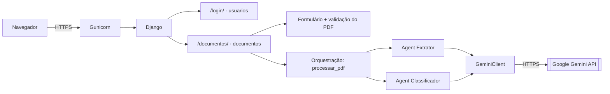
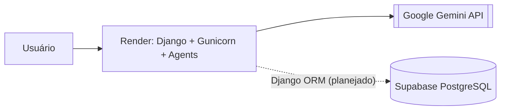
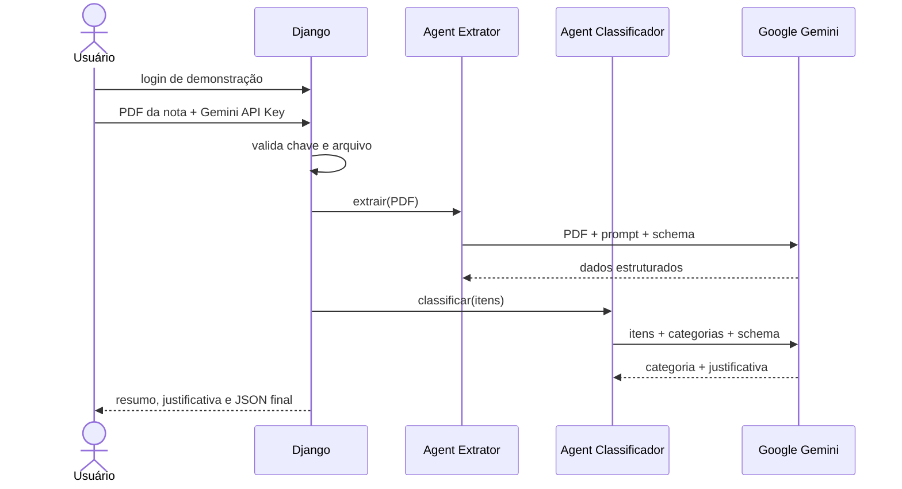
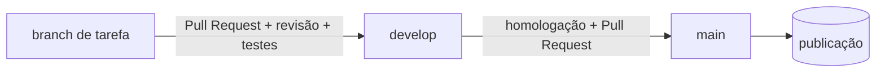

<div align="center">

# Gestão Rural

**Sistema de gestão administrativo-financeira rural com processamento inteligente de notas fiscais por Agents de IA.**


Projeto acadêmico da disciplina **ESW424 — Prática de Engenharia de Software** · UniRV — Universidade de Rio Verde

</div>

---

| Objetivo | Área de aplicação | Estágio atual |
| -------- | ----------------- | ------------- |
| Reduzir o preenchimento manual no controle financeiro de uma propriedade rural, usando IA para ler documentos fiscais | Gestão de despesas, receitas, documentos, pessoas e movimentações financeiras no meio rural | **N2 Etapa 1 concluída** (tag `n2-etapa1-final`) · **N2 Etapa 2 em preparação** |

## Sumário

- [Sobre o projeto](#sobre-o-projeto)
- [Funcionalidades](#funcionalidades)
- [Tecnologias](#tecnologias)
- [Arquitetura](#arquitetura)
- [Fluxo de funcionamento](#fluxo-de-funcionamento)
- [Estrutura de diretórios](#estrutura-de-diretórios)
- [Pré-requisitos](#pré-requisitos)
- [Instalação e execução local](#instalação-e-execução-local)
- [Variáveis de ambiente](#variáveis-de-ambiente)
- [Testes automatizados](#testes-automatizados)
- [Desenvolvimento e fluxo Git](#desenvolvimento-e-fluxo-git)
- [Hospedagem e publicação](#hospedagem-e-publicação)
- [Segurança](#segurança)
- [Documentação complementar](#documentação-complementar)
- [Equipe](#equipe)
- [Situação e próximos passos](#situação-e-próximos-passos)

---

## Sobre o projeto

Um produtor rural e sua família precisam controlar as **contas a pagar e a receber** da propriedade. As notas fiscais, contratos e comprovantes chegam em **PDF**. As compras e vendas costumam ser **parceladas**, e as despesas podem ser faturadas no nome de diferentes membros da família. Lançar tudo isso à mão é demorado e sujeito a erros, e os usuários pedem **a menor intervenção manual possível**.

O Gestão Rural ataca esse problema com **inteligência artificial**:

1. o usuário envia o PDF de uma nota fiscal;
2. um Agent de IA lê o documento e extrai os dados de forma estruturada: fornecedor, faturado, itens, parcelas e valores;
3. outro Agent classifica o tipo de despesa a partir dos itens comprados.

A versão atual (**N2 Etapa 1**) entrega esse processamento e **não grava dados**: cada processamento é independente e o resultado aparece na tela.

A próxima evolução (**N2 Etapa 2**) acrescenta a **persistência financeira**. O sistema passará a:

- consultar se fornecedor, faturado e classificação já existem no banco;
- criar os registros que faltarem;
- lançar a movimentação e suas parcelas.

---

## Funcionalidades

### Implementadas

Disponíveis no código atual (referência `f7786e8`, tag `n2-etapa1-final`):

| Funcionalidade | Descrição |
| -------------- | --------- |
| Login de demonstração | Acesso protegido por usuário e senha definidos em variáveis de ambiente; logout; sessão em cookie assinado |
| Upload de nota fiscal em PDF | Envio de um PDF por processamento |
| Validação do documento | Arquivo obrigatório e não vazio, extensão `.pdf`, tamanho máximo configurável, tipo `application/pdf` e assinatura `%PDF-` |
| Chave Gemini informada na tela | A Gemini API Key é digitada a cada processamento e **não é armazenada** |
| Extração de dados fiscais | **Agent Extrator**: fornecedor (razão social, nome fantasia, CNPJ), faturado (nome, CPF), número da nota, data de emissão, itens, parcelas e valor total |
| Validação estruturada | Schemas Pydantic. Conferência de dígitos verificadores de CPF/CNPJ (inclusive CNPJ alfanumérico), datas, valores monetários e numeração das parcelas |
| Classificação de despesa | **Agent Classificador**: atribui *Manutenção e operação* ou *Infraestrutura e utilidades*, com justificativa |
| Exibição do resultado | Resumo da nota, justificativa da classificação e **JSON final** na tela |
| Tratamento de erros | Mensagens de erro em português, com sugestão de ação e sem detalhes técnicos |

### Planejadas (N2 Etapa 2)

São requisitos da N2 Etapa 2 ou decisões da equipe. **Nenhum destes itens está implementado na versão auditada.**

- [ ] Banco de dados **PostgreSQL no Supabase** (decisão em [ADR-001](docs/arquitetura/ADR-001-supabase.md))
- [ ] Consulta de existência do **fornecedor**, do **faturado** e da **classificação de despesa**, com o resultado exibido na tela
- [ ] Criação dos registros ausentes somente após **confirmação manual do usuário**, com revalidação dos dados pelo backend antes da gravação (decisão da equipe sobre a dúvida Q-02)
- [ ] Lançamento da **movimentação financeira** e de suas **parcelas**, com confirmação ao usuário
- [ ] Cadastros de **pessoas** (fornecedores, clientes e faturados) e de **classificações** (tipos de receita e de despesa)
- [ ] Registro de **contas a pagar** e **contas a receber**
- [ ] **Inativação e reativação** de cadastros, sem exclusão física
- [ ] **Múltiplas classificações** e **múltiplas parcelas** por conta
- [ ] Exibição do **código da última atualização no GitHub** na tela principal

**Prioridade (decisão da equipe, 24/10/2026, dúvida Q-01):** primeiro o fluxo completo da nota fiscal e os cadastros necessários a ele. As demais funcionalidades administrativas continuam sendo requisitos oficiais ainda não atendidos. Essa prioridade é escolha da equipe e **não** representa dispensa concedida pelo professor.

O detalhamento, com critérios de aceite e dúvidas de escopo, está na [matriz de requisitos da N2 Etapa 2](docs/requisitos/matriz-n2-etapa2.md).

---

## Tecnologias

| Tecnologia | Versão | Finalidade | Situação |
| ---------- | ------ | ---------- | -------- |
| Python | 3.14 (`.python-version`: 3.14.7) | Linguagem principal | Em uso |
| Django | 6.1.1 | Backend Web, rotas, formulários, sessão e segurança | Em uso |
| Django Templates + HTML, CSS e JavaScript | — | Interface renderizada no servidor, sem framework de frontend | Em uso |
| Google Gemini API | modelo definido em `GEMINI_MODEL` | Extração e classificação por IA | Em uso |
| google-genai | 2.24.0 | SDK oficial do Gemini (structured output) | Em uso |
| Pydantic | 2.13.5 | Schemas das respostas de IA e validação | Em uso |
| python-dotenv | 1.2.3 | Leitura do arquivo `.env` | Em uso |
| Gunicorn | 26.2.0 | Servidor WSGI de produção | Em uso |
| WhiteNoise | 6.12.0 | Entrega de arquivos estáticos em produção | Em uso |
| Render | — | Hospedagem da aplicação | Em uso |
| Supabase PostgreSQL | — | Persistência dos dados financeiros | **Planejado** |
| Django ORM + Migrations | — | Modelos, consultas e versionamento do esquema | **Planejado** |
| Psycopg 3 | — | Driver PostgreSQL | **Proposto** (sujeito a validação) |

As versões vêm do `requirements.txt`, que fixa todas as dependências, inclusive as transitivas.

---

## Arquitetura

Monólito **Django** com renderização no servidor. A Etapa 1 (`f7786e8`) é **stateless**: não tem banco de dados, models nem armazenamento de arquivos. Na GR-33, a conexão com o PostgreSQL (Supabase) foi configurada, mas ainda não há models nem migrations, e nada é gravado: o processamento continua sem estado. A persistência da Etapa 2 está planejada. O processamento é **síncrono**: os dois Agents rodam em sequência dentro da mesma requisição.

| Camada | Componente | Responsabilidade |
| ------ | ---------- | ---------------- |
| Interface | `documentos/templates/`, `usuarios/templates/`, `static/` | Telas de login e de processamento |
| Acesso | `usuarios/demo.py` | Login de demonstração e proteção das views |
| Entrada e validação | `documentos/forms.py`, `documentos/validators.py` | Validação da chave e do PDF |
| Orquestração | `documentos/processamento.py` | Encadeia os Agents, normaliza erros e monta o JSON final |
| Agents | `agents/extrator/`, `agents/classificador/` | Prompts, schemas Pydantic e regras de cada etapa de IA |
| Integração | `agents/gemini_client.py` | Único ponto de contato com o Gemini (timeout e tentativas) |

**Agent Extrator.** Envia o PDF ao Gemini e recebe os dados da nota no schema `NotaFiscalExtraida`. Extrai só o que está escrito no documento. Campos ausentes ou ilegíveis ficam vazios (`null`). Recusa documentos que não sejam notas fiscais.

**Agent Classificador.** Recebe os itens já extraídos e escolhe **uma** das categorias de despesa suportadas, com justificativa. Se nenhuma categoria servir, o processamento termina com erro, sem gerar JSON.

### Arquitetura atual



### Arquitetura planejada (N2 Etapa 2)



O Supabase será usado **somente como PostgreSQL gerenciado**, acessado pelo Django. As regras de negócio, as validações e a orquestração continuam no backend. Supabase Auth e Supabase Storage **não** fazem parte da decisão. Detalhes em [ADR-001](docs/arquitetura/ADR-001-supabase.md).

---

## Fluxo de funcionamento

Fluxo **atualmente implementado**:



1. O usuário faz login com as credenciais de demonstração.
2. Seleciona o PDF da nota fiscal.
3. Informa a Gemini API Key.
4. O backend valida a chave e o arquivo.
5. O **Agent Extrator** interpreta a nota.
6. O **Agent Classificador** identifica o tipo de despesa.
7. O sistema monta o resultado final.
8. O usuário visualiza o resumo, a justificativa e o JSON.

Ao fim da requisição, o PDF, a chave e o resultado são descartados. **Nada é gravado em banco.** A consulta e o registro dos dados financeiros serão acrescentados na N2 Etapa 2.

---

## Estrutura de diretórios

```text
gestao-rural/
├── agents/                    # Agents de IA
│   ├── gemini_client.py       #   cliente único do Google Gemini
│   ├── extrator/              #   Agent Extrator: agent.py, schemas.py e testes
│   └── classificador/         #   Agent Classificador: agent.py, schemas.py e testes
├── cadastros/                 # Pessoa, PapelPessoa e Classificacao (models, validação de CPF/CNPJ, migrations e testes)
├── config/                    # projeto Django: settings, urls, wsgi e testes de configuração
├── financeiro/                # MovimentoConta, MovimentoClassificacao e ParcelaConta (models, serviço de registro, migrations e testes)
├── documentos/                # upload, validação, orquestração e tela de processamento
│   ├── forms.py · validators.py · processamento.py · views.py
│   ├── templates/documentos/  #   base.html, inicio.html
│   └── static/documentos/     #   documentos.css, documentos.js
├── usuarios/                  # login de demonstração (demo.py, views, formulário, tela)
├── docs/                      # documentação complementar (índice, requisitos, ADRs, organização)
├── manage.py                  # utilitário de linha de comando do Django
├── requirements.txt           # dependências com versões fixadas
├── .python-version            # versão de referência do Python
├── .env.example               # modelo das variáveis de ambiente (sem valores secretos)
├── build.sh                   # build de produção: dependências + collectstatic
├── start.sh                   # inicialização de produção com Gunicorn
├── ContextoProjeto.md         # fonte central de verdade técnica do projeto
└── ContextoFluxoGit.md        # fluxo Git oficial
```

---

## Pré-requisitos

| Requisito | Observação |
| --------- | ---------- |
| **Python 3.14** | Versão de referência em `.python-version` (3.14.7). O Django 6.1 exige Python 3.12 ou superior |
| **pip** e **venv** | Gerenciador de pacotes e ambiente virtual do Python |
| **Git** | Para clonar o repositório |
| **Conta e chave da Google Gemini API** | Necessária para processar notas. A chave é informada **na tela**, não no `.env` |
| Acesso à internet | Os Agents chamam a API do Gemini |

Um banco **PostgreSQL** acessível (o projeto usa o Supabase pelo Session Pooler) é pré-requisito: sem as variáveis `DB_*` preenchidas no `.env`, o Django não inicia. Ainda não há models nem migrations, e nada é gravado no banco.

---

## Instalação e execução local

### 1. Clonar o repositório

```bash
git clone https://github.com/PedroSimon1/gestao-rural.git
cd gestao-rural
```

### 2. Criar e ativar o ambiente virtual

**Linux / macOS**

```bash
python3 -m venv .venv
source .venv/bin/activate
```

**Windows (PowerShell)**

```powershell
py -3.14 -m venv .venv
.\.venv\Scripts\Activate.ps1
```

### 3. Instalar as dependências

```bash
python -m pip install -r requirements.txt
```

### 4. Configurar as variáveis de ambiente

**Linux / macOS**

```bash
cp .env.example .env
```

**Windows (PowerShell)**

```powershell
Copy-Item .env.example .env
```

Edite o `.env` e preencha, no mínimo:

- `DJANGO_SECRET_KEY`: um valor longo e aleatório. Sem ele, toda requisição falha.
- `DEMO_LOGIN` e `DEMO_PASSWORD`: as credenciais que você usará para entrar. Se ficarem vazias, o login recusa todo acesso.
- `GEMINI_MODEL`: o modelo do Gemini usado pelos Agents. O `.env.example` traz um valor sugerido.
- `DB_HOST`, `DB_NAME`, `DB_USER` e `DB_PASSWORD`: a conexão do PostgreSQL (Session Pooler do Supabase, porta 5432). Se alguma faltar, o Django não inicia. `DB_PORT` já vem com `5432`, e os comentários do `.env.example` explicam cada valor.

Mantenha `DJANGO_DEBUG=True` para desenvolvimento local. Para gerar uma chave secreta:

```bash
python -c "import secrets; print(secrets.token_urlsafe(50))"
```

### 5. Validar o ambiente

```bash
python manage.py check
```

Resultado esperado: `System check identified no issues (0 silenced).`

### 6. Executar

```bash
python manage.py runserver
```

Acesse **http://127.0.0.1:8000/**. A raiz redireciona para `/documentos/`, que exige login e leva a `/login/`. Depois de entrar, selecione o PDF, informe a sua Gemini API Key e clique em processar.

> **Não é necessário executar `python manage.py migrate`**: a conexão com o PostgreSQL está configurada, mas ainda não há models nem migrations, e o código não usa o banco. Estas instruções serão atualizadas quando a persistência da Etapa 2 for integrada.

---

## Variáveis de ambiente

Nomes conferidos em `config/settings.py`, `start.sh` e `.env.example`. **Nunca versione valores reais.**

| Variável | Obrigatória | Finalidade | Padrão no código |
| -------- | ----------- | ---------- | ---------------- |
| `DJANGO_SECRET_KEY` | **Sim** | Assinatura de sessão e proteção CSRF | — |
| `DJANGO_DEBUG` | Não | `True` ativa o modo de desenvolvimento | `False` |
| `DJANGO_ALLOWED_HOSTS` | Em produção | Hosts aceitos, separados por vírgula. Em desenvolvimento, vazio equivale a `localhost`/`127.0.0.1` | vazio |
| `DJANGO_CSRF_TRUSTED_ORIGINS` | Não | Origens HTTPS extras confiáveis para CSRF | vazio |
| `DEMO_LOGIN` / `DEMO_PASSWORD` | **Sim**, para entrar | Credenciais do login de demonstração | vazias: acesso negado |
| `GEMINI_MODEL` | **Sim**, para processar | Modelo do Gemini usado pelos dois Agents | — |
| `GEMINI_TIMEOUT_SEGUNDOS` | Não | Tempo limite de cada tentativa de chamada ao Gemini | `60` |
| `GEMINI_MAX_TENTATIVAS` | Não | Número total de tentativas por chamada | `3` |
| `MAX_PDF_UPLOAD_SIZE_MB` | Não | Tamanho máximo do PDF, em MB | `10` |
| `GUNICORN_TIMEOUT` | Não | Timeout do Gunicorn em produção (`start.sh`) | `420` |
| `PORT`, `WEB_CONCURRENCY` | Não | Porta e número de workers do Gunicorn (definidos pelo Render) | `8000`, `1` |
| `RENDER_EXTERNAL_HOSTNAME` | — | Fornecida automaticamente pelo Render; incluída em hosts e CSRF | — |

A **Gemini API Key não é uma variável de ambiente**: ela é informada na interface a cada processamento. A conexão com o banco usa `DB_HOST`, `DB_NAME`, `DB_USER` e `DB_PASSWORD` (obrigatórias) e `DB_PORT`, `DB_SSLMODE`, `DB_SSLROOTCERT` e `DB_CONNECT_TIMEOUT` (opcionais), descritas no `.env.example`.

---

## Testes automatizados

```bash
python manage.py test
```

Execute com `DJANGO_DEBUG=True` no `.env`.

| Arquivo | Testes | O que valida |
| ------- | -----: | ------------ |
| `agents/test_gemini_client.py` | 29 | Configuração do cliente, chamadas, falhas, tempo limite e sigilo da chave |
| `agents/extrator/test_schemas.py` | 52 | Campos, CPF/CNPJ, datas, valores, itens e parcelas |
| `agents/extrator/test_agent.py` | 29 | Extração bem-sucedida, entradas e respostas inválidas, falhas |
| `agents/classificador/test_schemas.py` | 11 | Categorias de despesa e schema da classificação |
| `agents/classificador/test_agent.py` | 15 | Classificação, entradas e respostas inválidas, falhas |
| `documentos/test_processamento.py` | 26 | Montagem do JSON final, erros por etapa, uso da chave da requisição |
| `documentos/test_interface.py` | 64 | Acesso, validação do PDF, processamento, XSS/CSRF, não persistência |
| `usuarios/tests.py` | 51 | Login, logout, sigilo das credenciais, configuração ausente, cookies; código das análises pendentes no login e descarte no logout (GR-43) |
| `config/test_sem_banco.py` | 24 | PostgreSQL configurado, models sem PDF nem segredos, migrations sem pendências e banco de teste só local |
| `cadastros/test_models.py` | 52 | Pessoa e PapelPessoa no PostgreSQL local: CPF/CNPJ (incluindo o alfanumérico), unicidade, papéis, inativação e reativação, cadastro incompleto e regularização, exclusão bloqueada, constraints |
| `cadastros/test_classificacao.py` | 22 | Classificacao no PostgreSQL local: código e tipo únicos, identidade imutável, inativação e reativação, exclusão bloqueada, constraints e categorias iniciais |
| `financeiro/test_models.py` | 53 | MovimentoConta e MovimentoClassificacao no PostgreSQL local: constraints, exclusão bloqueada, campos essenciais imutáveis (`save()`, `update()`, `bulk_update()`, upsert, `_base_manager` e gerenciadores reversos) |
| `financeiro/test_servicos.py` | 47 | `registrar_movimento()`: papéis vigentes, pessoas incompletas e inativas, classificações compatíveis e principal, valor, tipos da entrada, idempotência por `analise_origem_id`, transação com e sem autocommit |
| `cadastros/test_consultas.py` | 32 | Consultas de existência (GR-40) no PostgreSQL local: pessoa por CPF/CNPJ, situação da pessoa e do papel, documento ausente ou inválido sem consulta, classificação, somente leitura |
| `documentos/test_analises.py` | 45 | AnalisePendente (GR-43) no PostgreSQL local: criação, autorização por sessão, expiração, cancelamento, reutilização recusada, confirmação transacional com `registrar_movimento()`, constraints e concorrência com threads |
| `financeiro/test_parcelas.py` | 73 | ParcelaConta no PostgreSQL local: constraints, imutabilidade, regras do serviço (quantidade, numeração, vencimento, valor e soma), gatilho diferido da soma, teto de 120 parcelas, idempotência, rollback e concorrência com threads |
| `config/test_producao.py` | 25 | Hosts, HTTPS, cookies, estáticos, `check --deploy`, scripts sem `migrate` e variáveis `DB_*`/`DB_TEST_*` |

- **Sem chamadas reais à API:** os Agents são testados com clientes falsos ou com o SDK do Gemini substituído por dublês. A suíte não consome cota nem precisa de chave.
- **Sem acesso ao banco remoto:** os testes da Etapa 1 são `SimpleTestCase`, que recusam qualquer conexão. Desde a GR-35, `cadastros/test_models.py` usa `TestCase` e exige as variáveis `DB_TEST_*` (PostgreSQL local, a seguir); sem elas, a execução para antes de conectar. Para garantir isolamento total do Supabase, rode com um host inalcançável, por exemplo `DB_HOST=db-teste.invalid DB_NAME=teste DB_USER=teste DB_PASSWORD=teste python manage.py test` (variáveis já definidas no ambiente não são sobrescritas pelo `.env`).
- **Testes com banco (`TestCase`):** usam **só** o PostgreSQL local das variáveis `DB_TEST_*`, nunca o banco de `DB_*` (`config/banco_de_teste.py`). O host precisa ser local (socket Unix ou `localhost`/`127.0.0.1`/`::1`) e o nome precisa começar com `test_`, porque o banco é criado e apagado a cada execução. Sem essas variáveis, a execução para antes de abrir qualquer conexão. A proteção vale só para `python manage.py test`: não use `--testrunner`, outro `--settings` nem executores externos (IDE, `unittest`, `pytest`), que poderiam usar o banco de `DB_*`.
- **Resultado registrado:** `Ran 291 tests — OK` no commit `f7786e8`, auditado em 24/10/2026 e reexecutado em 24/10/2026 (Python 3.14.8). Na GR-33 (25/10/2026): `Ran 295 tests — OK`. Na branch da GR-34 (26/10/2026): `Ran 312 tests — OK`, com banco inalcançável. Na branch da GR-35 (26/10/2026): `Ran 364 tests — OK`, com os testes de `cadastros` no PostgreSQL local de teste. Na branch da GR-36 (26/10/2026): `Ran 386 tests — OK`. Na branch da GR-37 (26/10/2026): `Ran 486 tests — OK`, com os testes de `financeiro` no PostgreSQL local de teste. Na branch da GR-38 (26/10/2026): `Ran 559 tests — OK`. Na branch da GR-40 (27/10/2026): `Ran 591 tests — OK`. Na branch da GR-43 (27/10/2026): `Ran 650 tests — OK`.
- **Banco de teste validado (GR-34, 26/10/2026, ambiente de Pedro Simon):** no PostgreSQL local 18.6, via `127.0.0.1`, o Django criou o banco descartável `test_gestao_rural`, executou `SELECT 1` e o removeu ao final; o Supabase não foi usado. O `TestCase` dessa verificação foi temporário e não faz parte da suíte versionada. Junto com a suíte: `Ran 313 tests — OK`. Falta repetir a verificação no ambiente de Gustavo Lopes.
- **Limites:** não há medição de cobertura nem integração contínua (CI) configurada.

> Na GR-34, as proibições de models e migrations foram substituídas por garantias da Etapa 2: nenhum model ou migration guarda arquivo, bytes ou chave; nenhuma alteração de model fica sem migration; `build.sh` e `start.sh` não aplicam migrations. A escolha do banco de testes (T-06) foi aprovada pela equipe em 26/10/2026: PostgreSQL local de cada desenvolvedor para os testes, Supabase de homologação compartilhado para desenvolvimento e homologação, e projeto Supabase de produção independente, ainda não criado ([ADR-001](docs/arquitetura/ADR-001-supabase.md), seção 13.2).

### Migrations

As migrations ficam versionadas na pasta `migrations/` de cada app e **nunca** são aplicadas na publicação (`build.sh` e `start.sh` não executam `migrate`). A equipe aprovou em 26/10/2026 o fluxo manual (PT-06): gerar → revisar → validar no PostgreSQL local → aplicar em homologação, com coordenação (um integrante por vez) → homologar → aplicar em produção só com autorização e recuperação verificada → publicar pelo fluxo Git. Nenhuma migration existia até a GR-34. A GR-35 criou `cadastros/migrations/0001_initial.py`, validada só no banco local de teste e ainda não aplicada em homologação nem em produção. A GR-36 criou `0002_classificacao` (esquema) e `0003_categorias_iniciais` (dados: duas categorias iniciais de despesa), também validadas só no banco local de teste e não aplicadas em homologação nem em produção. A GR-37 criou `financeiro/migrations/0001_initial.py` (movimentos e suas classificações, dependente de `cadastros` `0003`), validada só no banco local de teste e não aplicada em homologação nem em produção.

- **Gerar:** `python manage.py makemigrations <app>` com as variáveis `DB_*` apontando para um banco local ou para um host inalcançável (ex.: `DB_HOST=db-teste.invalid`). O comando só lê o banco para conferir o histórico; um host inalcançável vira apenas um aviso. Não rode com o `.env` de homologação.
- **Conferir:** `python manage.py test config.test_sem_banco` falha se algum model estiver sem migration.
- **Aplicar em homologação ou produção:** só manualmente e de forma coordenada pelo responsável, conferindo antes o destino (`DB_HOST`) e o plano (`python manage.py migrate --plan`).

---

## Desenvolvimento e fluxo Git

O fluxo oficial está em [`ContextoFluxoGit.md`](ContextoFluxoGit.md). Resumo:

| Branch | Papel |
| ------ | ----- |
| `main` | **Produção**: versão publicada |
| `develop` | **Integração, testes e homologação** |
| `feature/*`, `fix/*`, `docs/*`, `refactor/*`, `test/*`, `chore/*` | Tarefas, criadas a partir da `develop` |
| `hotfix/*` | Correções urgentes de produção, criadas a partir da `main` e sincronizadas de volta com a `develop` |



- Nada de desenvolvimento nem push direto em `main` ou `develop`. Toda mudança passa por Pull Request revisado.
- Commits no padrão [Conventional Commits](https://www.conventionalcommits.org/pt-br/), por exemplo `feat(documentos): ...` ou `fix(extrator): ...`.
- Antes de cada PR: `python manage.py check`, `python manage.py test` e `git diff --check`, além do checklist da seção 12 do `ContextoFluxoGit.md`.

---

## Hospedagem e publicação

A aplicação é hospedada no **Render** como Web Service Python, publicando a branch `main`.

| Peça | Papel |
| ---- | ----- |
| [`build.sh`](build.sh) | Instala as dependências (`pip install -r requirements.txt`) e coleta os estáticos (`collectstatic`) |
| [`start.sh`](start.sh) | Inicia o **Gunicorn** em `0.0.0.0:$PORT`, com workers e timeout configuráveis |
| **Gunicorn** | Servidor WSGI de produção |
| **WhiteNoise** | Serve os arquivos estáticos com hash e compressão, sem servidor separado |
| HTTPS | Terminado no proxy do Render. O Django confia em `X-Forwarded-Proto` e usa cookies `Secure` quando `DJANGO_DEBUG=False` |

- O que chega à `main` vai para produção. Por isso, toda mudança precisa ser **homologada na `develop`** antes. Hoje a homologação é feita localmente.
- Não há ambiente de homologação no Render.
- A configuração do serviço (comandos, variáveis, branch) fica no painel do Render; o repositório não tem `render.yaml`, `Procfile` nem `Dockerfile`.
- O plano gratuito do Render suspende o serviço por inatividade, então o primeiro acesso pode demorar.

A URL pública **não está registrada neste README**: ela ainda precisa ser confirmada pela equipe. O serviço não foi reverificado desde 29/09/2026.

**Simular a produção localmente:**

```bash
./build.sh
PORT=8000 ./start.sh
```

Com `DJANGO_DEBUG=False`, os cookies são `Secure` e o login por `http://localhost` não funciona no navegador. Use a simulação apenas para verificar o build e a inicialização.

---

## Segurança

- **Variáveis de ambiente:** segredos ficam no `.env` local (ignorado pelo Git) ou no painel do Render, nunca no código. O `.env.example` contém apenas nomes e valores não secretos.
- **Chave do Gemini:** informada na tela a cada uso e nunca gravada. Os testes verificam que ela não aparece no resultado nem nos logs. Não compartilhe sua chave e prefira chaves que possam ser revogadas.
- **`README.md` × `README.txt`:**
  - este `README.md` é **público** e versionado;
  - o `README.txt`/`Readme.txt` da entrega acadêmica contém link, login, senha e chave da LLM. Ele é **privado**, entregue por canal restrito, e **nunca** deve ser commitado nem ter o conteúdo copiado para cá.
  - O `.gitignore` ignora esse arquivo em qualquer combinação de maiúsculas e minúsculas (`README.txt`, `Readme.txt`, `readme.txt`…). Mesmo assim, confira com `git check-ignore -v <arquivo>` antes de qualquer `git add`.
- **Arquivos não versionados:** `.env`, `README.txt` (todas as variações), `.venv/`, `staticfiles/`, `media/` e `uploads/`.
- **Documentos reais:** não versione notas fiscais nem CPF/CNPJ reais; use documentos de teste. O sistema não grava os PDFs enviados.
- **Proteções da aplicação:**
  - CSRF em todos os formulários;
  - escape de conteúdo nos templates;
  - validação de tipo e assinatura do PDF;
  - mensagens de erro sem detalhes internos;
  - cookies `HttpOnly` e `Secure` em produção.
- **Se um segredo vazar:** revogue ou troque o segredo imediatamente. Apagar o commit não basta.

---

## Documentação complementar

| Documento | Finalidade |
| --------- | ---------- |
| [`ContextoProjeto.md`](ContextoProjeto.md) | Fonte central de verdade: arquitetura detalhada, contratos internos, regras de negócio, estado da implementação, testes e pendências |
| [`ContextoFluxoGit.md`](ContextoFluxoGit.md) | Fluxo Git oficial: branches, commits, PRs, revisão, homologação, publicação, hotfix e regras para agentes de IA |
| [`docs/INDICE.md`](docs/INDICE.md) | Índice de todos os documentos do projeto e da autoridade de cada um |
| [`docs/requisitos/matriz-n2-etapa2.md`](docs/requisitos/matriz-n2-etapa2.md) | Matriz rastreável dos requisitos da N2 Etapa 2 |
| [`docs/arquitetura/ADR-001-supabase.md`](docs/arquitetura/ADR-001-supabase.md) | Decisão de arquitetura: Supabase PostgreSQL para a Etapa 2 |
| [`docs/organizacao/LEIA-ME-integracao.md`](docs/organizacao/LEIA-ME-integracao.md) | Como usar, manter e integrar a documentação |

---

## Equipe

| Integrante | GitHub |
| ---------- | ------ |
| Pedro Simon | [@PedroSimon1](https://github.com/PedroSimon1) |
| Gustavo Lopes | [@devlopes-lq](https://github.com/devlopes-lq) |

Projeto desenvolvido na disciplina **ESW424 — Prática de Engenharia de Software**, da **UniRV — Universidade de Rio Verde**, como parte da avaliação N2, dividida em duas etapas.

---

## Situação e próximos passos

| Item | Situação |
| ---- | -------- |
| N2 Etapa 1: processamento de notas com Agents | **Concluída** (tag `n2-etapa1-final`) |
| Documentação da N2 Etapa 2: requisitos, ADR e fluxo Git | Organizada; em revisão pela equipe |
| Banco de dados: Supabase PostgreSQL | **Definido para planejamento**; não implementado |
| Persistência financeira, cadastros e movimentações | **Pendente** |
| Divisão de responsabilidades e organização das tarefas no Jira | Próximo passo |

O acompanhamento detalhado está no [`ContextoProjeto.md`](ContextoProjeto.md) e na [matriz de requisitos](docs/requisitos/matriz-n2-etapa2.md).
