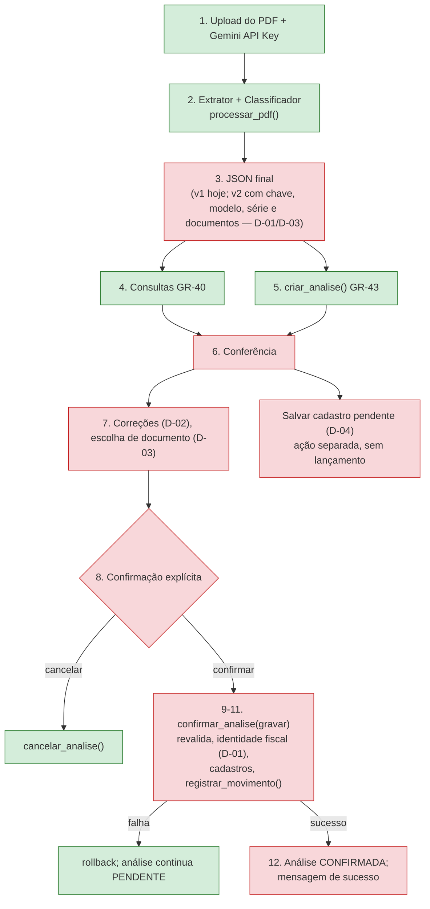

# Contrato de Integração GR-51 — Gestão Rural, N2 Etapa 2

| Item | Valor |
| ---- | ----- |
| Versão | **MINUTA 0.4 — D-01 A D-05, T-01 A T-04, T-06, T-07 E G-03 APROVADAS; DEMAIS DECISÕES AGUARDANDO RATIFICAÇÃO** |
| Data | 27/10/2026 |
| Autores | Pedro Simon (redação), Gustavo Lopes (revisão) |
| Finalidade | Definir como os serviços de backend (Pedro Simon) e a integração com Agents e interface (Gustavo Lopes) se conectam na GR-51, sem duplicar funções nem sobrescrever trabalho |
| Branch | `docs/gr-51-contrato-integracao`, criada a partir da `develop` em `a6f929f` (depois do merge do PR #29). As minutas 0.1 e 0.2 foram redigidas em `feature/gr-43-analise-pendente` e separadas do PR da GR-43 antes do commit: o contrato tem PR próprio |
| Base verificada | `develop` = `origin/develop` em `a6f929f`: GR-33 a GR-38, GR-40 e GR-43 integradas (PRs #22 a #29). A GR-43 entrou pelo PR #29 (commit `54897d5`, merge `a6f929f`, 27/10/2026); as assinaturas da seção 4 foram reconferidas nesse commit |
| Natureza | Documental. Nada aqui implementa comportamento. As decisões D-01 a D-05 foram aprovadas pela equipe; os contratos técnicos que as implementam (seção 5) e as decisões da seção 6.2 continuam pendentes de aprovação |

### Histórico de versões

| Versão | Data | Mudança |
| ------ | ---- | ------- |
| 0.1 | 27/10/2026 | minuta inicial: contratos existentes, propostas e 10 decisões pendentes |
| 0.2 | 27/10/2026 | incorpora as decisões de negócio D-01 a D-05, aprovadas pela equipe (informadas por Pedro Simon); separa cláusulas implementadas e pendentes; lista os bloqueios efetivos da GR-51 e as decisões técnicas restantes |
| 0.2 (revisão documental) | 27/10/2026 | atualiza branch e estado de integração após o PR #29 (GR-43 integrada, merge `a6f929f`); B-01 resolvido; nenhuma decisão, alternativa ou recomendação alterada |
| 0.3 | 27/10/2026 | T-01, T-04, T-06 e T-07 aprovadas por Pedro Simon (matriz DQ-15 a DQ-18); F-1 (identidade fiscal) implementada na branch `feature/gr-22-confirmacao-transacional`, não integrada (seção 4.6); B-03 resolvido no backend |
| 0.4 | 27/10/2026 | T-02, T-03 e G-03 aprovadas por Pedro Simon (matriz DQ-19 a DQ-21); F-2 (correções em `AnalisePendente`) implementada na branch `feature/gr-22-confirmacao-transacional`, não integrada (seção 4.3.1); B-04 resolvido no backend; `confirmar_analise` ganha só um parâmetro nomeado opcional |
| 1.0 | — | só depois da ratificação completa (seção 10) |

**Como ler os estados:**

| Estado | Significado |
| ------ | ----------- |
| **APROVADA** | decisão de negócio aprovada pela equipe; não significa implementada |
| **INTEGRADO** | implementado, testado e presente na `develop` (`a6f929f`) |
| **IMPLEMENTADO, NÃO INTEGRADO** | implementado e testado só no PostgreSQL local, numa branch ainda não integrada (nenhum componente nesta situação em `a6f929f`; a GR-43 esteve até o PR #29) |
| **PENDENTE** | não implementado |
| **PENDENTE DE APROVAÇÃO** | proposta deste contrato; não é regra nem implementação |

**Limitações desta versão:**
- O **Jira não foi consultado** (sem acesso nesta sessão). Não há no repositório nenhuma descrição das tarefas **GR-41, GR-42, GR-44 e GR-45**, e a GR-22 aparece só como "pagamento e cancelamento ou tarefa a definir". Os escopos dessas tarefas não são atribuídos aqui (seção 6.2, P-07).
- O **trabalho local do Gustavo Lopes não foi verificado**: em 27/10/2026 não havia branch dele no remoto. Qualquer adaptação já feita dos Agents ou da interface precisa ser confrontada com este contrato na revisão.
- Nenhuma migration foi aplicada no Supabase de homologação por Pedro Simon; a integração em homologação não foi exercitada.

---

## 1. Escopo e responsabilidades

### 1.1 Pedro Simon — backend e persistência

| Responsabilidade | Entregas | Estado |
| ---------------- | -------- | ------ |
| Models, migrations e persistência | `cadastros` (GR-35, GR-36), `financeiro` (GR-37, GR-38), `documentos.AnalisePendente` (GR-43) | GR-35 a GR-38 **INTEGRADO**; GR-43 **INTEGRADO** (PR #29) |
| Pessoas, classificações, movimentos e parcelas | `Pessoa`, `PapelPessoa`, `Classificacao`, `MovimentoConta`, `MovimentoClassificacao`, `ParcelaConta`, `registrar_movimento()` | **INTEGRADO** |
| GR-40: consultas de existência | `cadastros/consultas.py` | **INTEGRADO** (PR #28) |
| GR-43: armazenamento oficial da análise (D-05) | `documentos/models.py`, `documentos/analises.py`, login/logout em `usuarios/demo.py` | **INTEGRADO** (PR #29) |
| Identidade fiscal e proteção contra duplicidade (D-01) | persistência e constraints da identidade da nota | **PENDENTE** (seção 5.3) |
| Correções da conferência (D-02) | armazenamento separado de extraído e corrigido, revalidação | **PENDENTE** (seção 5.4) |
| Cadastro pendente (D-04) | serviço "Salvar cadastro pendente" e listagem de incompletos para seleção | **PENDENTE** (seção 5.6) |
| Confirmação transacional | `confirmar_analise()` (GR-43) + serviço de lançamento a partir da análise (seção 5.7) | infraestrutura **INTEGRADO** (PR #29); serviço **PENDENTE** |

### 1.2 Gustavo Lopes — Agents, interface e integração

| Responsabilidade | Entregas | Estado |
| ---------------- | -------- | ------ |
| Adaptação dos Agents (D-01, D-03) | extrair chave de acesso, modelo e série; documentos de cada parte sem tipo fixo por papel (seção 5.2) | **PENDENTE** (trabalho local não verificado) |
| Consultas pela interface | chamar `consultar_nota()`/`consultar_pessoa()` (GR-40), sem reimplementar a busca | **PENDENTE** |
| Integração com a análise pendente (D-05) | chamar `criar_analise`, `obter_analise`, `cancelar_analise` e `confirmar_analise` | **PENDENTE** |
| Conferência e correções (D-02, D-03, D-04) | tela "EXISTE – ID: n / NÃO EXISTE" (FLU-04), edição dos campos permitidos, escolha de documento, ação "Salvar cadastro pendente", seleção de incompleto existente | **PENDENTE** |
| Mensagens e confirmação (FLU-10) | tradução dos códigos de erro, sucesso só após o commit | **PENDENTE** |

### 1.3 Compartilhadas

| Item | Quem |
| ---- | ---- |
| Ratificação deste contrato e das decisões da seção 6.2 | os dois |
| Formato do JSON versão 2 (D-01, D-03) | Gustavo propõe e implementa no Extrator; Pedro adapta `CHAVES_DOS_DADOS`/`VERSAO_DADOS` e os serviços (seção 5.2) |
| Testes de integração ponta a ponta (P07) e homologação (P09) | os dois |
| Aplicação manual das migrations em homologação (PT-06) | uma pessoa por vez, combinada antes |
| `ContextoProjeto.md`, matriz e este contrato | quem fizer a mudança, na mesma branch dela |

### 1.4 Arquivos e donos

| Arquivo | Dono | Regra |
| ------- | ---- | ----- |
| `cadastros/*`, `financeiro/*`, `documentos/models.py`, `documentos/analises.py`, `documentos/migrations/*`, `documentos/management/*` | Pedro Simon | Gustavo usa pela interface pública (seção 4); mudança de assinatura só com revisão do Gustavo |
| `agents/*`, `documentos/processamento.py` | Gustavo Lopes | o JSON final é contrato: mudar exige versão nova, combinada com Pedro (seção 5.2) |
| `documentos/views.py`, `documentos/forms.py`, `documentos/urls.py`, `documentos/templates/*`, `documentos/static/*`, `documentos/test_interface.py` | Gustavo Lopes | arquivos da GR-51; Pedro não altera sem combinar |
| `usuarios/demo.py`, `usuarios/tests.py` | Pedro Simon (alterados na GR-43) | login/logout ligados à análise; mudar exige revisão conjunta |
| `usuarios/testing.py`, `documentos/testing.py` | compartilhados (apoio a testes) | mudanças combinadas |
| `config/settings.py`, `requirements.txt`, `build.sh`, `start.sh` | sensíveis | só com autorização específica |
| `ContextoProjeto.md`, matriz, este contrato | compartilhados | edições pontuais, sem reescrever o histórico |

Regra para evitar edição concorrente: **novos serviços de backend ficam em arquivos novos** (por exemplo, `financeiro/lancamento_nota.py`, `documentos/correcoes.py`); a view só os chama. Assim Pedro não toca `views.py` e Gustavo não toca `models.py`/`migrations`.

---

## 2. Regras de negócio

### 2.1 Decisões aprovadas pela equipe em 27/10/2026 (D-01 a D-05)

Registradas na matriz como DQ-10 a DQ-14. Cada cláusula mostra o que já existe no código e o que falta.

#### D-01 — Duplicidade de notas (resolve T-03, C-09)

| Cláusula | Situação no código | Falta |
| -------- | ------------------ | ----- |
| Chave de acesso válida é a identificação prioritária | **parcial**: o Extrator não extrai chave de acesso e o JSON final não tem o campo; validação e persistência existem na F-1 (`NotaFiscalLancada`, não integrada) | extrair (Gustavo); validação (44 posições, NT 2025.001) e persistência feitas na F-1 (Pedro) |
| Sem chave: CNPJ do emitente + modelo + série + número | **parcial**: o JSON tem `fornecedor.cnpj` e `numero_nota`, sem modelo nem série; `identificar_nota()` e a persistência da combinação existem na F-1 (não integrada) | extrair modelo e série (Gustavo) ou permitir informá-los (G-01) |
| Dados insuficientes bloqueiam o lançamento | **implementado na F-1** (não integrada): `identidade_fiscal_insuficiente` | chamar no serviço de lançamento (F-5) |
| Proteção contra duplicados, inclusive concorrentes | **implementado na F-1** (não integrada): índice único da combinação e da chave; testado com threads; hoje, na `develop`, só existe a proteção por `analise_origem_id` | integrar no serviço de lançamento (F-5) |

#### D-02 — Campos editáveis (resolve T-02)

| Cláusula | Situação no código | Falta |
| -------- | ------------------ | ----- |
| Editáveis: documentos, nomes, classificação, número, série, data, valor total e parcelas | **não existe**: não há API para alterar uma análise; `confirmar_analise` entrega a `gravar` só os dados extraídos | contrato de correções (seção 5.4) |
| Valores extraídos e corrigidos guardados separadamente | **parcial**: `AnalisePendente.dados` guarda o extraído; não há lugar para o corrigido | armazenamento separado; duração da rastreabilidade (seção 6.2, T-03) |
| Tudo revalidado na confirmação | **parcial**: `registrar_movimento()` revalida pessoas, papéis, classificações, valor e parcelas; documentos corrigidos são revalidados por `Pessoa.save()`/`validar_documento`; série, número e chave **não** têm validação | validações novas no serviço de lançamento |

#### D-03 — CPF e CNPJ simultâneos

| Cláusula | Situação no código | Falta |
| -------- | ------------------ | ----- |
| Quando houver CPF e CNPJ para a mesma parte, o usuário escolhe explicitamente | **não existe**: o Extrator só extrai `fornecedor.cnpj` e `faturado.cpf` | extrair os documentos de cada parte sem fixar o tipo (Gustavo); escolha na conferência |
| Sem associação automática de tipo de documento ao papel | **backend atende**: `consultar_pessoa` e `Pessoa` aceitam CPF ou CNPJ em qualquer papel. **Extrator não atende**: o schema associa CNPJ ao fornecedor e CPF ao faturado | schema do Extrator (seção 5.2) |

#### D-04 — Cadastro incompleto (completa C-02/DQ-05)

| Cláusula | Situação no código | Falta |
| -------- | ------------------ | ----- |
| Ação separada "Salvar cadastro pendente", com consentimento explícito | **parcial**: `Pessoa(situacao_documental=INCOMPLETO)` e `atribuir_papel` existem; não há serviço nem tela para a ação | serviço (Pedro) e botão com consentimento (Gustavo) (seção 5.6) |
| Lançamento financeiro bloqueado até a regularização | **atende**: `registrar_movimento()` recusa com `pessoa_incompleta`; `Pessoa.regularizar(documento)` completa o mesmo registro | tradução da mensagem na tela |
| Seleção manual de cadastro incompleto existente | **parcial**: `Pessoa.objects.incompletas()` existe; não há listagem para a tela | serviço de listagem (Pedro) e seleção (Gustavo) |
| Sem mesclagem automática por nome | **atende**: a GR-40 só busca por documento (DQ-08) | — |

#### D-05 — `AnalisePendente` como armazenamento oficial (formaliza DQ-09 para a GR-51)

| Cláusula | Situação no código | Falta |
| -------- | ------------------ | ----- |
| Armazenamento oficial entre processamento e confirmação | **INTEGRADO** (GR-43, PR #29) | uso na view |
| Vínculo à sessão | **INTEGRADO**: código no cookie, `dono_hash` no banco, código novo a cada login | — |
| Validade de 30 minutos | **INTEGRADO**: `VALIDADE = timedelta(minutes=30)` | limpeza física fora do prazo continua pendente (P-06) |
| Confirmação transacional e idempotente | **INTEGRADO**: `confirmar_analise` (bloqueio, mesma transação, rollback); `analise_origem_id` = id da análise | o serviço de lançamento (seção 5.7) e a idempotência por nota (D-01) |
| Contratos exatos respeitando o código | seção 4.3 | correções (D-02) exigem extensão da GR-43 (seção 5.4) |

### 2.2 Regras anteriores, aprovadas e confirmadas no código

| # | Regra | Fonte | Onde está garantida |
| - | ----- | ----- | ------------------- |
| R-01 | Nenhuma gravação financeira antes da confirmação humana | DQ-02 | `registrar_movimento()` só dentro de `confirmar_analise()` (tela **PENDENTE**) |
| R-02 | Consultas de existência somente leitura | P03, DQ-08 | `cadastros/consultas.py` |
| R-03 | Pessoa identificada só por CPF/CNPJ normalizado, sem busca por nome | DQ-08 | `consultar_pessoa()` |
| R-04 | Documento ausente ou inválido não é consultado | DQ-08 | `DOCUMENTO_AUSENTE`, `DOCUMENTO_INVALIDO` |
| R-05 | ATIVO, INATIVO e AUSENTE informados; nada reativado ou atribuído automaticamente | DQ-07, DQ-08 | `status`, `status_papel`; recusas `pessoa_inativa`, `papel_inativo`, `classificacao_inativa` |
| R-06 | Sem documento fictício; documento inválido não é guardado | DQ-05 | `Pessoa` |
| R-07 | Papéis vigentes: APAGAR exige FORNECEDOR e FATURADO; ARECEBER exige CLIENTE | GR-37 | `registrar_movimento()` |
| R-08 | APAGAR ↔ DESPESA, ARECEBER ↔ RECEITA; ≥ 1 classificação, sem repetição, uma principal | GR-37 | `registrar_movimento()` |
| R-09 | 1 a 120 parcelas, numeradas 1..n, com vencimento, valor > 0 com 2 casas, soma = `valor_total` | GR-38 | serviço + gatilho diferido |
| R-10 | Movimento, classificações e parcelas numa única transação | GR-37/GR-38 | `registrar_movimento()` |
| R-11 | Idempotência por `analise_origem_id` | GR-37 | `registrar_movimento()` |
| R-12 | `analise_origem_id` = UUID da análise | DQ-09 | `confirmar_analise()` |
| R-13 | Exclusão física proibida em cadastros e financeiro | RN-01 | `ExclusaoNaoPermitida` |

### 2.3 Ainda não aprovadas

Ver seção 6.2: decisões técnicas que implementam D-01 a D-04 e as decisões da minuta 0.1 que não foram ratificadas (parcelas ausentes, formato do adaptador, retenção, GR-41/42/44, dono do serviço de lançamento, versionamento do JSON, sessão e logout). Herdadas: Q-05, Q-06, Q-10, C-06.

---

## 3. Fluxo completo da integração



Legenda: verde = INTEGRADO (inclui a GR-43, PR #29); vermelho = PENDENTE.

| Etapa | Descrição | Componente | Estado |
| ----- | --------- | ---------- | ------ |
| 1 | Upload do PDF e da chave (só em memória) | `documento_inicio`, `DocumentoUploadForm` | **INTEGRADO** (Etapa 1) |
| 2 | Extração e classificação | `processar_pdf()` | **INTEGRADO** |
| 3 | JSON final | `montar_resultado()` | v1 **INTEGRADO**; campos de D-01/D-03 **PENDENTE** (v2) |
| 4 | Consultas de existência | `consultar_nota()` / `consultar_pessoa()` | serviço **INTEGRADO**; chamada **PENDENTE**; consulta por documento escolhido (D-03) usa `consultar_pessoa` |
| 5 | Análise pendente | `criar_analise()` | serviço **INTEGRADO** (PR #29); chamada na view **PENDENTE**; aceita só o JSON v1 |
| 6 | Conferência (FLU-04) | template | **PENDENTE** |
| 7 | Correções e escolha de documento | contrato da seção 5.4 | **PENDENTE** (D-02, D-03 aprovadas) |
| — | Salvar cadastro pendente / selecionar incompleto | seção 5.6 | **PENDENTE** (D-04 aprovada) |
| 8 | Confirmação explícita | POST com `analise_id` | **PENDENTE** |
| 9 | Revalidação no servidor | `confirmar_analise()` + serviço de lançamento + `registrar_movimento()` | GR-43 **INTEGRADO**; validações de D-01/D-02 **PENDENTE** |
| 10 | Criar ou reutilizar cadastros | serviço de lançamento | **PENDENTE** |
| 11 | Identidade fiscal + movimento, classificações e parcelas na mesma transação | serviço de lançamento + `registrar_movimento()` | `registrar_movimento()` **INTEGRADO**; identidade fiscal **PENDENTE** |
| 12 | Finalização e sucesso após a persistência (FLU-10) | `confirmar_analise()` + tela | marcação **INTEGRADO**; tela **PENDENTE** |

---

## 4. Contratos técnicos existentes (verificados no código)

Assinaturas conferidas com `inspect` em 27/10/2026, sem conexão a banco.

### 4.1 Agents e processamento — **INTEGRADO**

`documentos/processamento.py`:

```python
def processar_pdf(pdf_bytes, gemini_api_key, *, extrator=None, classificador=None) -> ResultadoProcessamento

@dataclass(frozen=True)
class ResultadoProcessamento:
    resultado: dict        # JSON final (montar_resultado)
    justificativa: str     # fora do JSON

class ProcessamentoError(Exception):
    etapa: str             # "configuracao" | "extracao" | "classificacao" | "processamento"
    codigo: str
    mensagem: str          # segura para a tela
```

Códigos: `servico_indisponivel`, `erro_extracao`, `documento_ilegivel`, `resposta_invalida`, `erro_classificacao`, `classificacao_invalida`, `classificacao_inconclusiva`, `erro_interno`.

**JSON final, versão 1** (`montar_resultado`, 10 chaves; `ContextoProjeto.md` 17.3):

| Chave | Tipo | Observação |
| ----- | ---- | ---------- |
| `fornecedor` | `{razao_social, nome_fantasia, cnpj}` | só CNPJ (tipo fixo pelo papel: diverge de D-03) |
| `faturado` | `{nome, cpf}` | só CPF (idem) |
| `numero_nota` | texto ou `null` | |
| `data_emissao` | `"AAAA-MM-DD"` ou `null` | |
| `itens` | lista de `{descricao, quantidade, valor_unitario, valor_total}` | |
| `quantidade_parcelas` | inteiro | pode ser 0 |
| `parcelas` | lista de `{numero, data_vencimento, valor}` | `data_vencimento` pode ser `null`; sem teto |
| `valor_total` | texto decimal | > 0 e < R$ 10 bilhões |
| `tipo_despesa` | valor do Enum `TipoDespesa` | nunca `null` |
| `validacoes` | `{fornecedor_cnpj, faturado_cpf}` com `status` ∈ `valido`/`invalido`/`ausente` | informativo |

**Não existem** no JSON nem no Extrator: chave de acesso, modelo, série, CPF do fornecedor, CNPJ do faturado (D-01, D-03).

### 4.2 GR-40 — consultas de existência — **INTEGRADO** (PR #28)

`cadastros/consultas.py`:

```python
class Situacao(StrEnum):
    EXISTE, NAO_EXISTE, DOCUMENTO_AUSENTE, DOCUMENTO_INVALIDO, CLASSIFICACAO_AUSENTE
PAPEL_AUSENTE = "AUSENTE"

def consultar_pessoa(documento, papel, nome=None) -> ConsultaPessoa
def consultar_classificacao(codigo, tipo=TipoClassificacao.DESPESA) -> ConsultaClassificacao
def consultar_nota(resultado) -> ResultadoConsultas

@dataclass(frozen=True)
class ConsultaPessoa:
    papel; situacao; nome; documento; tipo_documento     # dados da nota (documento normalizado)
    id=None; razao_social=None; status=None; status_papel=None   # só quando EXISTE
    existe  # propriedade

@dataclass(frozen=True)
class ConsultaClassificacao:
    tipo; situacao; codigo; id=None; descricao=None; status=None
    existe  # propriedade

@dataclass(frozen=True)
class ResultadoConsultas: fornecedor; faturado; classificacao
```

- `consultar_pessoa` aceita CPF ou CNPJ para qualquer papel: atende D-03 no backend. Para D-03, a view chama `consultar_pessoa(documento_escolhido, papel, nome)` em vez de depender só de `consultar_nota`.
- `consultar_nota` lê `fornecedor.cnpj`, `faturado.cpf` e `tipo_despesa` do JSON **v1**; para a v2 precisa de adaptação (seção 5.2).
- Entrada fora do contrato: `TypeError`/`ValueError`. Resultado não serializável em JSON (dataclasses com `StrEnum`).

### 4.3 GR-43 — análise pendente — **INTEGRADO** (PR #29, merge `a6f929f`)

`documentos/models.py` (`analises_pendentes`, migration `documentos` `0001`): `id` (UUID), `dono_hash`, `status` (`PENDENTE`, `CONFIRMADA`, `CANCELADA`, `EXPIRADA`), `versao_dados` (1), `dados` (JSON; `None` fora de PENDENTE), `criado_em`, `expira_em`, `finalizado_em`.

`documentos/analises.py`:

```python
VALIDADE = timedelta(minutes=30); VERSAO_DADOS = 1; CHAVE_DA_SESSAO = "analise_dono"
CHAVES_DOS_DADOS = (10 chaves do JSON v1); LIMITE_DOS_DADOS = 256 * 1024

class AnaliseError(Exception): codigo; mensagem

def garantir_dono(session)                          # login
def criar_analise(session, resultado) -> AnalisePendente
def obter_analise(session, analise_id) -> AnalisePendente
def cancelar_analise(session, analise_id) -> None
def confirmar_analise(session, analise_id, gravar)  # -> retorno de gravar(dados, analise_id)
def descartar_analises(session) -> int              # logout
def expirar_analises(agora=None) -> int             # e: python manage.py expirar_analises
```

| `AnaliseError.codigo` | Quando |
| --------------------- | ------ |
| `sessao_sem_codigo` | sessão sem código (cookie anterior à GR-43 ou `autenticar_demo`) |
| `dados_invalidos` | `resultado` fora do JSON v1 (exatamente as 10 chaves), não JSON puro ou > 256 KB |
| `analise_nao_encontrada` | id inexistente, inválido ou de outra sessão (mesma resposta) |
| `analise_expirada` | prazo vencido (EXPIRADA gravada antes do erro) |
| `analise_confirmada` | já confirmada |
| `analise_cancelada` | cancelada |

- `obter_analise`, `cancelar_analise` e `confirmar_analise` usam `transaction.atomic(durable=True)`: não podem ser chamados dentro de outra transação.
- `confirmar_analise` bloqueia a linha, executa `gravar(analise.dados, analise.id)` e marca CONFIRMADA no mesmo commit; exceção em `gravar` desfaz tudo e a análise continua PENDENTE.
- **Limite em relação a D-02:** `gravar` recebe só os dados extraídos; não há correções.
- **Limite em relação a D-01/D-03:** `criar_analise` recusa um JSON com chaves além das 10 da v1.
- Sem revogação completa do cookie; expirar não é apagar (ver `ContextoProjeto.md` 15.1.7.1).

#### 4.3.1 Correções da conferência (GR-22, F-2) — **IMPLEMENTADO, NÃO INTEGRADO** (branch `feature/gr-22-confirmacao-transacional`, sem commit)

Decisões: T-02 (DQ-19), T-03 (DQ-20) e G-03 (DQ-21). Migration `documentos` `0002_correcoes_da_conferencia` (só adiciona; a `0001` não muda). **Depende da F-1** (`documentos/correcoes.py` usa `NUMERO_MAXIMO` e `SERIE_MAXIMA` de `financeiro/models.py`): versionar a F-1 antes.

Campos novos de `AnalisePendente`: `correcoes` (JSON; `None` sem correção e sempre `None` fora de PENDENTE; constraint `analise_correcoes_so_pendente`), `versao_correcoes` (inteiro, começa em 0), `campos_corrigidos` (lista de nomes; **fica** depois da finalização). `dados` nunca muda.

```python
# documentos/correcoes.py
CAMPOS_CORRIGIVEIS = {"fornecedor.documento", "fornecedor.razao_social", "faturado.documento",
                      "faturado.nome", "tipo_despesa", "numero_nota", "serie", "data_emissao",
                      "valor_total", "parcelas"}   # chave_acesso e modelo ficam fora (G-01)
def validar_correcoes(correcoes) -> tuple[dict, list[str]]   # (normalizadas, campos inválidos)

# documentos/analises.py
def registrar_correcoes(session, analise_id, correcoes, versao) -> AnalisePendente
def correcoes_da_confirmacao(analise_id) -> dict          # só dentro do gravar da confirmação
def confirmar_analise(session, analise_id, gravar, *, versao_correcoes=None)   # gravar(dados, analise_id) NÃO muda
```

| Campo | Aceita | Grava |
| ----- | ------ | ----- |
| `fornecedor.documento`, `faturado.documento` | CPF ou CNPJ (numérico ou alfanumérico) válido, formatado ou não; qualquer tipo em qualquer papel (D-03) | normalizado |
| `fornecedor.razao_social`, `faturado.nome` | texto de 1 a 255 caracteres, sem caracteres de controle | espaços compactados |
| `tipo_despesa` | código no formato de `Classificacao` (`^[A-Z0-9]+(_[A-Z0-9]+)*$`, até 60) | maiúsculas; existência conferida na F-3 |
| `numero_nota` | inteiro 1 a 999.999.999 (texto com até 10 dígitos aceito) | inteiro |
| `serie` | inteiro 0 a 999 | inteiro |
| `data_emissao` | `"AAAA-MM-DD"` válida | texto ISO |
| `valor_total` | texto `^[0-9]{1,10}(\.[0-9]{1,2})?$` (ponto decimal, **sem** separador de milhar) ou `Decimal`; `float` recusado; > 0 e < R$ 10 bilhões | texto com 2 casas |
| `parcelas` | lista de 1 a 120 itens `{numero, data_vencimento, valor}` | normalizada; numeração e soma conferidas na F-3/`registrar_movimento` |

- `registrar_correcoes`: recebe o **conjunto completo** (`{}` apaga); `versao` é a `versao_correcoes` que a tela leu: diferente → `correcoes_desatualizadas`, sem gravar; sucesso incrementa a versão. Mesmas regras de dono, prazo, estado e `durable` de `obter_analise`. Erros: `AnaliseError` `correcao_invalida` (com `erro.campos`: nomes dos campos inválidos; campo fora da lista vira `"campo_nao_autorizado"`), `correcoes_desatualizadas`, e os da seção 4.3; `TypeError` se `versao` não for `int`.
- `correcoes_da_confirmacao(analise_id)`: cópia das correções (`{}` sem correção) da análise que está sendo confirmada; `RuntimeError` fora do `gravar` dessa confirmação.
- `confirmar_analise(..., versao_correcoes=n)`: diferente da versão atual → `correcoes_desatualizadas`, sem chamar `gravar`. Chamadas sem o parâmetro funcionam como antes (GR-43).
- **Obrigações da view (GR-45/GR-51):** sempre passar `versao_correcoes` na confirmação (sem ele, uma aba pode confirmar correções que não viu) e converter a versão do POST para `int` (texto → `TypeError`); exibir `erro.mensagem` e marcar `erro.campos` na tela; nunca reenviar ao navegador valores de outra sessão.
- Mensagens, `erro.campos` e `repr` nunca trazem valores; nada é gravado na sessão.
- Ciclo de vida: confirmar, cancelar, expirar (acesso, limpeza em massa) e logout apagam `correcoes` e mantêm `campos_corrigidos` e `versao_correcoes`.

### 4.4 Financeiro — **INTEGRADO** (GR-37 PR #26, GR-38 PR #27)

`financeiro/servicos.py`:

```python
@dataclass(frozen=True)
class ItemClassificacao: classificacao: Classificacao; principal: bool = False
@dataclass(frozen=True)
class ItemParcela: numero: int; data_vencimento: date; valor: Decimal
@dataclass(frozen=True)
class DadosMovimento:
    tipo: str; origem: str; contraparte: Pessoa; valor_total: Decimal
    classificacoes: tuple[ItemClassificacao, ...] = ()
    faturado: Pessoa | None = None
    analise_origem_id: UUID | None = None
    parcelas: tuple[ItemParcela, ...] = ()

MAXIMO_DE_PARCELAS = 120
def registrar_movimento(dados) -> tuple[MovimentoConta, bool]   # (movimento, criado)
```

- Atomicidade, revalidação com `select_for_update`, idempotência por `analise_origem_id` (`analise_ja_lancada`).
- Códigos de `ValidationError`: entrada — `tipo`, `origem`, `valor_tipo`, `valor`, `valor_centavos`, `contraparte`, `faturado`, `analise_origem`, `sem_classificacao`, `classificacao`, `principal_tipo`, `classificacao_repetida`, `principal`, `sem_parcela`, `parcela`, `parcela_quantidade`, `parcela_numero`, `parcela_vencimento`, `parcela_valor_tipo`, `parcela_valor`, `parcela_valor_centavos`, `parcela_repetida`, `parcela_numeracao`, `parcela_soma`; banco — `pessoa_inexistente`, `pessoa_inativa`, `pessoa_incompleta`, `papel_ausente`, `papel_inativo`, `classificacao_inexistente`, `classificacao_inativa`, `classificacao_incompativel`; idempotência — `analise_ja_lancada`.
- `MovimentoConta` **não** tem campos de identidade fiscal (chave, CNPJ do emitente, modelo, série, número) nem de data de emissão.

### 4.6 Identidade fiscal (GR-22, F-1) — **IMPLEMENTADO, NÃO INTEGRADO** (branch `feature/gr-22-confirmacao-transacional`, sem commit)

`financeiro/identidade_fiscal.py` e `financeiro/models.py::NotaFiscalLancada` (tabela `notas_fiscais_lancadas`, migration `financeiro` `0003`):

```python
@dataclass(frozen=True)
class IdentidadeFiscal: emitente_cnpj: str; modelo: str; serie: int; numero: int; chave_acesso: str | None = None

def validar_chave_acesso(chave) -> str                       # normalizada; ValidationError chave_acesso_invalida
def identificar_nota(*, chave_acesso=None, emitente_cnpj=None, modelo=None, serie=None, numero=None) -> IdentidadeFiscal
def nota_lancada(identidade) -> NotaFiscalLancada | None       # só leitura
def registrar_identidade_fiscal(movimento, identidade) -> tuple[NotaFiscalLancada, bool]
```

- Códigos de `identificar_nota`: `chave_acesso_invalida`, `identidade_fiscal_divergente`, `identidade_fiscal_insuficiente`, `identidade_fiscal_nao_suportada`, `emitente_invalido`, `serie_invalida`, `numero_invalido`.
- Códigos de `registrar_identidade_fiscal`: os anteriores (revalida a identidade) + `nota_ja_lancada`, `movimento_ja_identificado`, `origem_incompativel`, `movimento`, `identidade_fiscal`; `RuntimeError` fora de transação.
- Uso previsto (F-5): dentro de `confirmar_analise`, `registrar_movimento(...)` e depois `registrar_identidade_fiscal(movimento, identificar_nota(...))` na mesma transação.

### 4.5 Cadastros — **INTEGRADO**

| Operação | API real |
| -------- | -------- |
| Buscar por documento (qualquer status) | `Pessoa.objects.por_documento(documento)` |
| Listar incompletos | `Pessoa.objects.incompletas()` |
| Criar completa | `Pessoa.objects.create(documento=..., razao_social=...)` (valida DV no `save()`) |
| Criar incompleta | `Pessoa.objects.create(razao_social=..., situacao_documental=SituacaoDocumental.INCOMPLETO)` |
| Regularizar | `pessoa.regularizar(documento)` (mesmo registro; recusa duplicata) |
| Papel | `pessoa.atribuir_papel(papel)` → `(PapelPessoa, criado)` (não reativa) |
| Reativar | `pessoa.reativar()`, `papel.reativar()`, `classificacao.reativar()` |
| Classificação | `Classificacao.objects.por_codigo(tipo, codigo)` |

---

## 5. Contratos técnicos propostos — **PENDENTES DE APROVAÇÃO**

Implementam D-01 a D-05. Nada desta seção existe no código; nomes são sugestões.

### 5.1 Adaptador Agents → GR-40/GR-43

A view usa o mesmo `resultado` de `processar_pdf()` para `criar_analise(request.session, resultado)` e para as consultas. Não há um segundo formato (P-05 continua pendente, mas esta é a proposta).

### 5.2 JSON final versão 2 (D-01, D-03)

Proposta de mudanças no Extrator e em `montar_resultado` (Gustavo), acompanhadas por Pedro em `CHAVES_DOS_DADOS`, `VERSAO_DADOS = 2`, `consultar_nota` e no serviço de lançamento:

| Chave | v1 | v2 proposta |
| ----- | -- | ----------- |
| `documento_fiscal` | — | `{chave_acesso, modelo, serie, numero}` (texto ou `null`); `numero_nota` passa a `documento_fiscal.numero` ou é mantido por compatibilidade (**decidir**) |
| `fornecedor` | `{razao_social, nome_fantasia, cnpj}` | `{razao_social, nome_fantasia, cpf, cnpj}` (os dois opcionais, como impressos) |
| `faturado` | `{nome, cpf}` | `{nome, cpf, cnpj}` |
| `validacoes` | `fornecedor_cnpj`, `faturado_cpf` | uma entrada por documento extraído, mais `chave_acesso` |

- Quando uma parte tiver CPF **e** CNPJ, a conferência exige a escolha (D-03); com um só documento válido, ele é usado; sem nenhum, D-04.
- Análises v1 em andamento na troca de versão: recusadas na leitura (`versao_dados` diferente) ou convertidas (**decidir**, P-09).

### 5.3 Identidade fiscal e duplicidade (D-01) — Pedro

> **Atualização 0.3:** esta proposta foi implementada na F-1 com ajustes (seção 4.6): tabela `notas_fiscais_lancadas`, campo `emitente_cnpj`; a chave segue a NT Conjunta 2025.001 (44 posições, letras nas posições 7 a 18, DV módulo 11 com ASCII − 48), e não "44 dígitos"; divergência decidida em T-04 (bloquear). O texto abaixo fica como HISTÓRICO da minuta 0.2.

Proposta (alternativas na seção 6.2, T-01):

- Nova tabela `notas_lancadas` (model `NotaFiscalLancada`, app `financeiro`), 1:1 com `MovimentoConta` (`PROTECT`), campos `chave_acesso` (44 dígitos, opcional), `emitente_documento`, `modelo`, `serie`, `numero`.
- Constraints: `chave_acesso` única quando presente; (`emitente_documento`, `modelo`, `serie`, `numero`) única; CHECK de formato. A unicidade no banco garante a proteção contra lançamentos concorrentes.
- Chave válida: 44 dígitos e DV módulo 11. Se a chave for válida, CNPJ, modelo, série e número também são lidos dela e devem bater com os informados (**decidir** o que fazer na divergência).
- Sem chave: exige CNPJ do emitente válido, modelo, série e número; faltando algum → `ValidationError(code="identidade_fiscal_insuficiente")`, sem gravar nada.
- Duplicada → `ValidationError(code="nota_ja_lancada")`, inclusive quando a outra transação ganha a corrida (`IntegrityError` traduzido).
- Gravada na mesma transação de `registrar_movimento()` (dentro de `confirmar_analise`).

### 5.4 Correções da conferência (D-02) — Pedro (backend) e Gustavo (tela)

> **Atualização 0.4:** implementada na F-2 conforme T-02, T-03 e G-03 (seção 4.3.1): `registrar_correcoes` tem 4 argumentos (com `versao`), e a assinatura de `gravar` **não** mudou (G-03). O texto abaixo fica como HISTÓRICO da minuta 0.2.

Proposta (alternativas em T-02 e T-03):

- `AnalisePendente` ganha `correcoes` (JSON, `None` fora de PENDENTE), separado de `dados` (extraído, imutável). Nova função em `documentos/analises.py`: `registrar_correcoes(session, analise_id, correcoes) -> AnalisePendente`, com as mesmas regras de dono, estado, prazo e bloqueio.
- Campos aceitos (lista fechada): documento e nome de fornecedor e faturado, `tipo_despesa`, número, série, data de emissão, valor total e parcelas. Qualquer outra chave → `AnaliseError("correcao_invalida")`.
- `confirmar_analise` passa a chamar `gravar(dados, correcoes, analise_id)` (mudança de assinatura, revisada pelos dois) ou `gravar` recebe os dados já combinados (**decidir**).
- Revalidação na confirmação: documentos (`validar_documento`), datas, `Decimal` com 2 casas, parcelas (regras de `registrar_movimento`), identidade fiscal (5.3).
- Rastreabilidade após a confirmação: ver T-03.

### 5.5 Escolha de documento (D-03) — Gustavo (tela), Pedro (validação)

- A conferência mostra os documentos extraídos de cada parte e exige a escolha quando houver dois; a escolha vai nas correções (5.4) como o documento da parte.
- O backend não deduz o tipo pelo papel; só valida o documento escolhido e consulta com `consultar_pessoa(documento, papel, nome)`.

### 5.6 Cadastro pendente (D-04) — Pedro (serviço), Gustavo (tela)

- `salvar_cadastro_pendente(razao_social, papel) -> Pessoa` (sugestão: `cadastros/servicos.py`): cria `Pessoa` INCOMPLETA e atribui o papel, numa transação; não toca a análise nem cria movimento.
- `listar_incompletos(papel=None)` → lista para seleção manual (id, razão social, papéis), sem filtro por semelhança de nome.
- A seleção manual de um incompleto existente vai nas correções (5.4) como `pessoa_id`. O lançamento continua bloqueado (`pessoa_incompleta`) até `regularizar()`.
- Se a análise continua PENDENTE depois de salvar o cadastro pendente (para regularizar e lançar em 30 minutos) ou é cancelada: **decidir** (T-05).

### 5.7 Confirmação financeira (D-05) — dono a decidir (P-08)

```python
# Proposta — nada disto existe ainda
def lancar_nota(dados, correcoes, analise_id):            # financeiro/lancamento_nota.py
    nota = combinar_e_revalidar(dados, correcoes)          # D-02, D-03
    fornecedor = obter_ou_criar_pessoa(nota.fornecedor, Papel.FORNECEDOR)   # D-04: incompleta → recusa
    faturado = obter_ou_criar_pessoa(nota.faturado, Papel.FATURADO)
    movimento, _ = registrar_movimento(DadosMovimento(
        tipo="APAGAR", origem="NOTA_FISCAL", contraparte=fornecedor, faturado=faturado,
        valor_total=nota.valor_total,
        classificacoes=(ItemClassificacao(nota.classificacao, principal=True),),
        analise_origem_id=analise_id, parcelas=nota.parcelas,
    ))
    registrar_identidade_fiscal(movimento, nota.documento_fiscal)   # D-01, mesma transação
    return movimento

movimento = confirmar_analise(request.session, analise_id, lancar_nota)   # view
```

- Tudo no mesmo rollback de `confirmar_analise`. Duplo clique → `analise_confirmada`; mesma nota em outra análise → `nota_ja_lancada`.

### 5.8 Tratamento de erros

| Origem | Exceção | Exibição |
| ------ | ------- | -------- |
| Processamento | `ProcessamentoError` | `mensagem` + sugestão por `codigo` (existente) |
| GR-40 | `TypeError`, `ValueError` | mensagem genérica |
| GR-43 | `AnaliseError` | `erro.mensagem` |
| Financeiro, cadastros e novas validações | `ValidationError` | mensagem fixa por `code` (tabela do Gustavo, revisada pelo Pedro), incluindo `nota_ja_lancada`, `identidade_fiscal_insuficiente`, `pessoa_incompleta` |
| Banco | `IntegrityError`, `OperationalError` | mensagem genérica; log sem valores |
| Uso indevido | `RuntimeError` (transação externa) | erro de programação |

---

## 6. Decisões

### 6.1 Aprovadas

| # | Decisão | Data | Registro |
| - | ------- | ---- | -------- |
| D-01 | Duplicidade: chave de acesso válida prioritária; sem ela, CNPJ do emitente + modelo + série + número; dados insuficientes bloqueiam; proteção contra duplicados concorrentes | 27/10/2026 | matriz DQ-10 |
| D-02 | Campos editáveis: documentos, nomes, classificação, número, série, data, valor total e parcelas; extraído e corrigido separados; tudo revalidado na confirmação | 27/10/2026 | DQ-11 |
| D-03 | CPF e CNPJ simultâneos: escolha explícita; sem associação automática de tipo ao papel | 27/10/2026 | DQ-12 |
| D-04 | Cadastro incompleto: ação "Salvar cadastro pendente" com consentimento; lançamento bloqueado até regularizar; seleção manual de incompleto existente; sem mesclagem por nome | 27/10/2026 | DQ-13 |
| D-05 | `AnalisePendente` como armazenamento oficial, com sessão, 30 minutos, confirmação transacional e idempotente | 27/10/2026 | DQ-14 |

Decisões da minuta 0.1 resolvidas por elas: item 1 (duplicidade) → D-01; item 2 (campos editáveis) → D-02; item 3 (cadastro incompleto) → D-04.

### 6.2 Pendentes de aprovação

**Decisões técnicas para implementar D-01 a D-04:**

| # | Decisão | Alternativas | Riscos | Recomendação técnica |
| - | ------- | ------------ | ------ | -------------------- |
| T-01 | Onde guardar a identidade fiscal (D-01) | **APROVADA (DQ-15):** tabela própria `NotaFiscalLancada`, 1:1 com `MovimentoConta` | — | implementada na F-1 (4.6) |
| T-02 | Onde e como guardar as correções (D-02) | **APROVADA (DQ-19):** campo `correcoes` em `AnalisePendente`, separado de `dados`; cada gravação substitui o conjunto inteiro, com controle otimista por `versao_correcoes` | — | implementada na F-2 (4.3.1) |
| T-03 | Rastreabilidade depois da confirmação (D-02) | **APROVADA (DQ-20):** ficam só os nomes dos campos corrigidos (`campos_corrigidos`), sem valores; correções apagadas nos estados finais | perde os valores extraídos depois da finalização (como já acontecia) | implementada na F-2 |
| T-04 | Chave inválida ou divergente dos campos informados (D-01) | **APROVADA (DQ-16):** bloquear os dois (`chave_acesso_invalida`, `identidade_fiscal_divergente`) | correção da chave depende de G-01 | implementada na F-1 |
| T-05 | Análise depois de "Salvar cadastro pendente" (D-04) | (a) continua PENDENTE (regulariza e confirma em 30 min); (b) é cancelada | (a) prazo curto; (b) reprocessamento com o Gemini | (a) |
| T-06 | Documentos aceitos (D-01) | **APROVADA (DQ-17):** só NF-e (55) e NFC-e (65) com emitente CNPJ; NFS-e, outros modelos e emitente CPF → `identidade_fiscal_nao_suportada` | notas de serviço e de produtor PF não são lançadas | implementada na F-1 |
| T-07 | Movimento CANCELADO libera a identidade fiscal? | **APROVADA (DQ-18):** não libera | relançamento depende de decisão futura com o cancelamento | implementada na F-1 (unicidade incondicional) |

**Decisões da minuta 0.1 ainda não ratificadas:**

| # | Decisão | Alternativas | Riscos | Recomendação técnica |
| - | ------- | ------------ | ------ | -------------------- |
| P-04 | Parcelas com informações ausentes (T-01 antiga) | (a) usuário completa na conferência (possível com D-02); (b) 1 parcela = valor total, vencimento = emissão; (c) recusar | (b) inventa data | (a); nunca inventar data |
| P-05 | Formato único de saída do adaptador | (a) JSON final + consultas (5.1); (b) DTO novo | (b) duplica o contrato | (a) |
| P-06 | Limpeza e retenção das análises | (a) como está; (b) Cron com `expirar_analises`; (c) expurgo das finalizadas | (a) dados vencidos ficam até o próximo evento | (b) + política de expurgo |
| P-07 | Compatibilidade com GR-41, GR-42, GR-44 (e GR-22, GR-45) | conferir no Jira | sobreposição de escopo | revisar com o Jira aberto |
| P-08 | Dono do serviço de lançamento e arquivos compartilhados | (a) view; (b) serviço de backend (Pedro) | (a) regra de negócio na view | (b) |
| P-09 | Versionamento do JSON | (a) `VERSAO_DADOS` + `CHAVES_DOS_DADOS` + `montar_resultado` juntos; v1 em andamento recusada | (b) sem versão | (a); **necessária** para D-01/D-03 |
| P-10 | Sessão e logout | (a) como está; (b) reduzir `SESSION_COOKIE_AGE`; (c) sessão no servidor (ADR); (d) logout só por POST | cópia do cookie autentica até 2 semanas | (b) + (d) |
| P-11 | Significado de `campos_corrigidos` (T-03) | (a) a tela envia só os campos diferentes do extraído; (b) o backend compara com `dados` (exige o mapeamento da F-3: `fornecedor.documento` ↔ `fornecedor.cnpj`; `serie` não existe no JSON v1); (c) aceitar como está (chaves enviadas) | (c) exagera a rastreabilidade se a tela mandar o formulário inteiro | (a) agora; (b) na F-3 |

Herdadas: Q-05, Q-06, Q-10, C-06.

### 6.3 Bloqueios efetivos para a GR-51

| # | Bloqueio | Bloqueia | Alternativas objetivas |
| - | -------- | -------- | ---------------------- |
| B-01 | ~~GR-43 sem commit e não integrada~~ **RESOLVIDO em 27/10/2026**: PR #29, merge `a6f929f` | — | — |
| B-02 | Extrator e JSON sem chave de acesso, modelo, série e documentos sem tipo fixo | D-01, D-03 | JSON v2 (5.2) numa tarefa do Gustavo, antes da view; ou D-01 só com CNPJ + número até a v2 (contraria D-01: exige nova aprovação) |
| B-03 | ~~Sem persistência da identidade fiscal~~ **RESOLVIDO no backend** (F-1, branch `feature/gr-22-confirmacao-transacional`, não integrada) | D-01 | falta a origem dos campos: JSON v2 (B-02) ou correções (B-04, G-01); uso no serviço de lançamento (B-06) |
| B-04 | ~~Sem armazenamento de correções~~ **RESOLVIDO no backend** (F-2, migration `documentos` `0002`, branch `feature/gr-22-confirmacao-transacional`, não integrada) | D-02 | falta a tela (GR-45) e a combinação/revalidação entre campos (F-3) |
| B-05 | Sem serviço de cadastro pendente e listagem de incompletos | D-04 | serviço pequeno em `cadastros` (Pedro), após T-05 |
| B-06 | Sem serviço de lançamento a partir da análise | confirmação | Pedro implementa (P-08 b) após B-03 e B-04 |
| B-07 | Migrations da Etapa 2 não aplicadas em homologação | homologação | aplicar manualmente, uma pessoa por vez, depois do merge |

---

## 7. Critérios de aceite da GR-51

- [ ] A view usa `processar_pdf`, `criar_analise`, `consultar_pessoa`/`consultar_nota`, `confirmar_analise` e o serviço de lançamento, sem reimplementar consulta, validação de documento, armazenamento ou regra financeira.
- [ ] Consultas e conferência não gravam nada além da própria análise e das correções (teste que captura as escritas).
- [ ] Tela mostra nome, documento e "EXISTE – ID: n" / "NÃO EXISTE" para fornecedor, faturado e classificação (FLU-04), com INATIVO, papel AUSENTE e INCOMPLETO.
- [ ] D-02: os campos aprovados podem ser corrigidos; extraído e corrigido ficam separados; tudo é revalidado na confirmação.
- [ ] D-03: com CPF e CNPJ para a mesma parte, a confirmação exige a escolha; nenhum tipo é deduzido pelo papel.
- [ ] D-04: "Salvar cadastro pendente" só com consentimento explícito e sem movimento; seleção manual de incompleto sem mesclagem por nome; lançamento com pessoa incompleta recusado.
- [ ] D-01: chave válida identifica a nota; sem chave, CNPJ + modelo + série + número; dados insuficientes bloqueiam; a mesma nota em duas análises não gera dois movimentos, inclusive em concorrência (teste com threads).
- [ ] Nenhum cadastro, movimento ou parcela antes da confirmação; falha em qualquer passo não deixa nada e a análise continua PENDENTE.
- [ ] Duplo clique e reenvio não criam dois movimentos.
- [ ] Outra sessão não vê nem confirma; `sessao_sem_codigo` tratado; mensagens sem dados internos.
- [ ] Sucesso (FLU-10) só depois do commit.
- [ ] Testes de interface convertidos para `TestCase` onde gravam, com sessão com código; suíte completa no PostgreSQL local sem regressão.
- [ ] Etapa 1 preservada: chave Gemini e PDF nunca gravados.
- [ ] `ContextoProjeto.md`, matriz e este contrato atualizados.

---

## 8. Ordem de integração

| Passo | O quê | Quem | Depende de | Paralelo com |
| ----- | ----- | ---- | ---------- | ------------ |
| 1 | Ratificar T-01 a T-07 e P-04 a P-10 (versão 1.0 do contrato) | os dois | — | — |
| 2 | ~~Commit e PR da GR-43 (B-01)~~ **CONCLUÍDO**: PR #29 (`a6f929f`). Este contrato segue em PR próprio | Pedro (Gustavo revisa o contrato) | — | 3 |
| 3 | JSON v2 no Extrator e em `montar_resultado` (B-02) | Gustavo | P-09 | 2, 4 |
| 4 | Identidade fiscal (B-03), correções (B-04), cadastro pendente (B-05) | Pedro | T-01 a T-05; B-04 como migration `documentos` `0002` (a GR-43 já está integrada) | 3 |
| 5 | Adaptar `CHAVES_DOS_DADOS`, `VERSAO_DADOS` e `consultar_nota` à v2 | Pedro | 3 | 6 |
| 6 | Serviço de lançamento a partir da análise (B-06) | Pedro | 4 | 5, 7 |
| 7 | Tela de conferência, correções, escolha de documento, cadastro pendente (dados simulados no formato v2) | Gustavo | 1 | 6 |
| 8 | Ligar a view aos serviços reais | Gustavo | 5, 6, 7 integrados à `develop` | — |
| 9 | Testes ponta a ponta e de concorrência (P07) | os dois | 8 | — |
| 10 | Migrations em homologação (B-07), homologação (P09), PR `develop` → `main` | os dois | 9 | — |

Antes de cada passo de código, cada integrante atualiza a própria `develop` local; os passos 3 e 4/5/6 não editam os mesmos arquivos (seção 1.4).

---

## 9. Regras de Git e documentação

- Fluxo: `feature/*` → Pull Request → `develop` → homologação → `main` ([`ContextoFluxoGit.md`](../../ContextoFluxoGit.md)). `qa` não é usada.
- Um PR por tarefa; não misturar implementações não relacionadas. Este contrato tem **PR próprio**, da branch `docs/gr-51-contrato-integracao` para a `develop`, separado do PR da GR-43 (#29).
- Commit, push, merge, criação de PR, deploy e migrations remotas são feitos **somente pelos integrantes**, nunca por agente de IA.
- Mudança em contrato público (seção 4) atualiza este documento no mesmo PR, com revisão do outro integrante.
- `ContextoProjeto.md` é atualizado em toda tarefa, na mesma branch, sem apagar o histórico.

---

## 10. Aprovação

| Item | Situação |
| ---- | -------- |
| Versão do contrato | **MINUTA 0.4** (27/10/2026). A 1.0 exige: T-05, P-11 e P-04 a P-10 decididos, aprovação dos dois, seção 5 revisada |
| Aprovação de Pedro Simon | decisões D-01 a D-05 aprovadas; contrato completo pendente |
| Aprovação de Gustavo Lopes | decisões D-01 a D-05 aprovadas pela equipe (informado por Pedro Simon); revisão do contrato pendente |
| Contratos verificados | seção 4 conferida no working tree da GR-43 antes do merge e reconferida em `develop` `a6f929f` (assinaturas idênticas); trabalho local do Gustavo **não** verificado |
| Decisões pendentes | T-01 a T-07, P-04 a P-10, Q-05, Q-06, Q-10, C-06 |
| Testes | nenhum teste da GR-51; base: `Ran 650 tests — OK` na branch da GR-43 antes do commit (27/10/2026, PostgreSQL local); suíte **não** reexecutada nesta revisão documental |
| Integração com `develop` | GR-43 **integrada** (PR #29, `a6f929f`); este contrato **não integrado** (branch `docs/gr-51-contrato-integracao`, sem commit) |
| Homologação | não iniciada |
