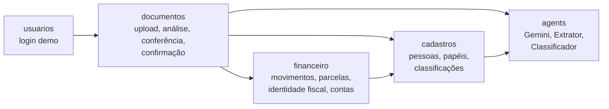

# 02 — Arquitetura

## 1. Características

- **Monólito Django** com Django Templates, CSS e JavaScript locais. Sem API REST e sem front-end separado.
- **Persistência relacional** em PostgreSQL, acessado só pelo Django ORM (Psycopg 3). Não há banco substituto: sem `DB_*` o Django não inicia.
- **Duas chamadas síncronas ao Gemini** por PDF (Extrator, depois Classificador), na mesma requisição.
- **Sem usuários**: autenticação de demonstração em cookie assinado (sem tabela, sem `django.contrib.auth`).
- **Sessão em cookie assinado** (`signed_cookies`): não há tabela de sessões.
- **Apps instalados**: `django.contrib.staticfiles`, `cadastros`, `documentos`, `financeiro`, `usuarios`. Não há admin, auth, contenttypes nem messages.
- **PDF e chave Gemini nunca são gravados**; só existem durante a requisição.

## 2. Camadas e responsabilidades

| Camada | Responsabilidade | Onde |
| --- | --- | --- |
| **Views** | HTTP: autenticação, método, CSRF, montar contexto, redirecionar, traduzir erros em mensagens | `*/views*.py` |
| **Serviços** | Regras de aplicação e de negócio; transações | `documentos/processamento.py`, `documentos/analises.py`, `documentos/conferencia.py`, `cadastros/consultas.py`, `cadastros/resolucao.py`, `cadastros/pendentes.py`, `financeiro/servicos.py`, `financeiro/manual.py`, `financeiro/lancamento_nota.py`, `financeiro/identidade_fiscal.py` |
| **Models** | Persistência e proteções de integridade (constraints, imutabilidade, sem exclusão) | `cadastros/models.py`, `financeiro/models.py`, `documentos/models.py` |
| **Forms** | Validação de entrada de tela | `*/forms*.py` |
| **Schemas Pydantic** | Validação da resposta dos Agents | `agents/*/schemas*.py` |
| **Agents** | Extração e classificação via Gemini | `agents/` |
| **Templates** | Apresentação | `*/templates/` |

Regra de ouro: **a tela nunca decide regra financeira**. Formulários só validam entrada; quem decide
(e revalida tudo no servidor) são os serviços. A tela monta uma solicitação explícita e delega.

## 3. Apps e responsabilidades



| App | Conteúdo principal |
| --- | --- |
| `agents` | `GeminiClient`; `extrator/` (schemas v1 e v2, prompt, `AgentExtrator`); `classificador/` (`TipoDespesa`, `AgentClassificador`) |
| `cadastros` | Models `Pessoa`, `PapelPessoa`, `Classificacao`; validação de CPF/CNPJ; consultas de existência; resolução de pessoas da nota (F-4); cadastro pendente (F-6); telas de Pessoas e Classificações |
| `documentos` | Upload e validação do PDF; `processar_pdf`; `AnalisePendente`; correções; `conferir_nota` (F-3); telas de envio, conferência, confirmação; comando `expirar_analises`; tag do SHA publicado |
| `financeiro` | Models `MovimentoConta`, `MovimentoClassificacao`, `ParcelaConta`, `NotaFiscalLancada`; `registrar_movimento`; `lancar_nota` (F-5); identidade fiscal (F-1); contas manuais; consultas e telas de Contas |
| `usuarios` | Login/logout de demonstração e `demo_login_required` |
| `config` | `settings.py`, `urls.py`, executor de testes com banco local, middleware de privacidade |

**Dependências reais entre módulos** (importante para não criar ciclos):

- `usuarios.demo` importa `documentos.analises` (garante/descarta o código das análises no login e logout).
- `documentos` importa `cadastros`, `financeiro`, `agents` e `usuarios`.
- `financeiro` importa `cadastros`. `cadastros` **não** importa `financeiro` nem `documentos`.
- `cadastros.validators` reutiliza `agents.extrator.schemas` (`cpf_dv_valido`, `cnpj_dv_valido`): a regra do dígito verificador é uma só.
- `agents.extrator.schemas_v2` importa `financeiro.identidade_fiscal` **dentro de função** (validação da chave de acesso), para evitar ciclo.

## 4. Estrutura de diretórios

```text
.
├── agents/                 Gemini + Extrator + Classificador
│   ├── gemini_client.py
│   ├── extrator/           agent.py, schemas.py (v1), schemas_v2.py
│   └── classificador/      agent.py, schemas.py
├── cadastros/              pessoas, papéis, classificações
│   ├── models.py  validators.py  consultas.py  resolucao.py  pendentes.py
│   ├── forms.py  forms_classificacoes.py  views.py  views_classificacoes.py  urls.py
│   ├── migrations/         0001 a 0003
│   └── templates/ static/
├── documentos/             nota fiscal: da entrada à confirmação
│   ├── processamento.py  analises.py  conferencia.py  correcoes.py
│   ├── interface_conferencia.py  mensagens_conferencia.py  pendencias_conferencia.py
│   ├── forms*.py  views.py  views_analises.py  views_confirmacao.py  urls.py
│   ├── uploads.py  validators.py  models.py
│   ├── management/commands/expirar_analises.py
│   ├── templatetags/versao_publicada.py
│   ├── migrations/         0001 e 0002
│   └── templates/ static/
├── financeiro/             movimentos, parcelas, notas lançadas
│   ├── models.py  servicos.py  lancamento_nota.py  identidade_fiscal.py  manual.py
│   ├── forms_manuais.py  forms_consultas.py  views_manuais.py  views_consultas.py  urls.py
│   ├── migrations/         0001 a 0004
│   └── templates/ static/
├── usuarios/               login demo
├── config/                 settings, urls, privacidade, banco_de_teste
├── docs/                   documentação (esta pasta em docs/documentacao/)
├── build.sh  start.sh      publicação (Render)
├── requirements.txt  .python-version  .env.example
└── ContextoProjeto.md  ContextoFluxoGit.md  README.md
```

Cada app tem seus testes ao lado do código (`test_*.py`).

## 5. Decisões de arquitetura relevantes

| Decisão | Motivo | Onde |
| --- | --- | --- |
| Banco **PostgreSQL gerenciado (Supabase)**, acesso só pelo ORM, Session Pooler, TLS obrigatório | ADR-001; a Etapa 2 exige persistência relacional | `config/settings.py`, `docs/arquitetura/ADR-001-supabase.md` |
| **Sem `migrate` no build/start** | Migrations são geradas, revisadas, validadas localmente, aplicadas manualmente em homologação e só depois em produção (DQ-04) | `build.sh`, `start.sh` |
| **Análise no servidor**, não no cookie | O cookie assinado não é criptografado nem revogável; o JSON da nota contém CPF/CNPJ (DQ-09) | `documentos/analises.py` |
| **Confirmação manual** antes de qualquer gravação financeira | Decisão DQ-02 (Q-02): nada é gravado antes do clique, sucesso só após o COMMIT | `documentos/views_confirmacao.py`, `financeiro/lancamento_nota.py` |
| **Transação única** na confirmação | Cadastros, movimento, parcelas e identidade fiscal ou entram juntos ou não entram | `confirmar_analise` + `lancar_nota` |
| **Sem exclusão física** | Regra do professor (RN-01) e preservação do histórico | `SemExclusaoQuerySet`, FKs `PROTECT` |
| **Pessoa identificada só pelo CPF/CNPJ** | Evitar duplicidade e associações por nome (DQ-08) | `cadastros/consultas.py`, `cadastros/resolucao.py` |
| **Pessoa sem papel fixo de documento** | Qualquer papel aceita CPF ou CNPJ (D-03, DQ-12) | `cadastros/models.py` |
| **Integridade no banco, não só na aplicação** | Constraints, índices únicos e gatilho diferido valem para qualquer caminho de escrita | `financeiro/migrations/0002_parcelas_contas.py` |
| **Chave Gemini sem fallback de ambiente** | Evita usar chave do servidor por engano e evita guardá-la | `agents/gemini_client.py` |
| **Dois contratos JSON coexistindo** (v1 e v2) | Uma análise v1 continua v1 até o fim; nada é convertido silenciosamente | `documentos/analises.py` |

## 6. Ambientes

| Ambiente | Banco | Observação |
| --- | --- | --- |
| **TEST** | PostgreSQL **local** de cada desenvolvedor (`DB_TEST_*`, banco `test_*` descartável) | O executor de testes recusa host remoto e nome sem prefixo `test_` |
| **DEV** | `DB_*` — preparar banco próprio com TLS, ou o Supabase de homologação compartilhado (coordenado) | Não reutilizar o banco de TEST |
| **QA / homologação** | Supabase `gestao-rural-homologacao`, dados **fictícios** | Alterações de esquema coordenadas |
| **PROD** | Projeto Supabase independente, credenciais próprias | Esquema e deploy só com autorização humana |

Detalhes e comandos em [10](10-configuracao-e-operacao.md).

## 7. Capacidade e desempenho (limites de projeto)

- `start.sh` usa Gunicorn `gthread`: `WEB_CONCURRENCY` padrão **1** worker com `WEB_THREADS` padrão **4** threads, e `GUNICORN_TIMEOUT` padrão **420 s** (prazo de vida do worker, que nas threads não limita cada requisição).
- Cada processamento de PDF faz **duas** chamadas ao Gemini em sequência (timeout padrão 60 s por tentativa, até 3 tentativas). No pior caso, ≈ 7 minutos.
- Uma chamada longa ao Gemini ocupa **uma** thread; o login e as demais telas seguem atendendo nas outras. Com 4 pessoas processando PDFs ao mesmo tempo, as threads se esgotam e o resto espera.
- `GET /saude/` (sem login) responde 200 com o banco no ar e 503 sem ele; é o endereço para o health check do Render.
- Cada requisição abre e fecha a própria conexão (`CONN_MAX_AGE = 0`), porque o Session Pooler limita as conexões simultâneas.
