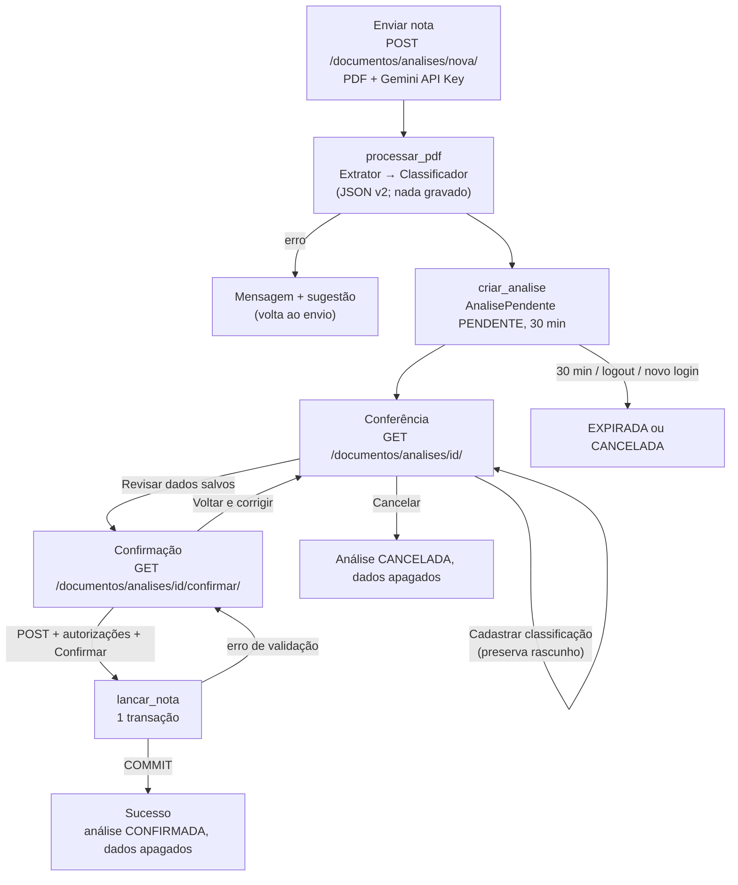
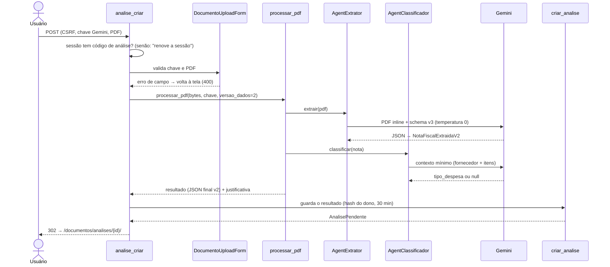
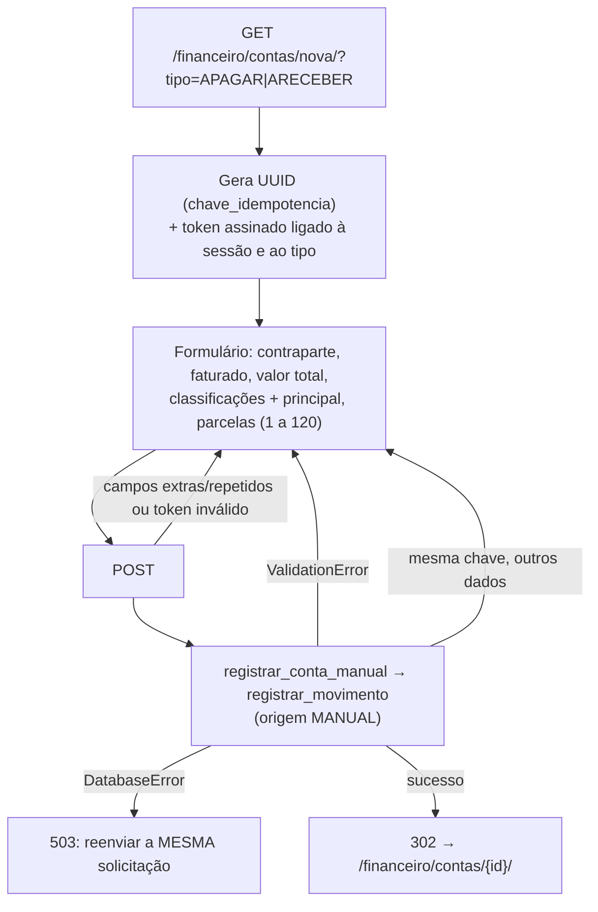

# 05 — Fluxos

Todos os fluxos (exceto `/login/`) exigem a sessão de demonstração. Rotas de escrita exigem **POST + CSRF**.
URLs e telas em [08](08-interface-e-rotas.md); regras em [04](04-regras-de-negocio.md).

## 1. Visão geral do fluxo da nota fiscal



## 2. Autenticação (`usuarios/`)

```text
GET  /                 → 302 /documentos/ (se não autenticado, o decorador manda para /login/)
GET  /login/           → formulário (se já autenticado → /documentos/)
POST /login/ sem DEMO_* configurados → "Login indisponível no momento..." (WARNING no log, sem valores)
POST /login/ credenciais erradas     → "Login ou senha inválidos."
POST /login/ corretas                → descarta as análises pendentes do código anterior,
                                       cria um código novo, session["demo_autenticado"]=True → /documentos/
GET  /logout/          → página de confirmação (GET não cancela nada)
POST /logout/          → cancela as análises pendentes da sessão, session.flush() → /login/
```

- A comparação é em **tempo constante** e sem curto-circuito (`&`).
- Sem `DEMO_LOGIN`/`DEMO_PASSWORD`, **nem uma sessão antiga** libera o acesso.
- Erro de banco no login/logout **não impede** a operação (as análises que sobrarem expiram em 30 minutos).
- Não há revogação no servidor: uma cópia do cookie feita antes do logout continua autenticando até expirar (8 horas, `SESSION_COOKIE_AGE`).

## 3. Processamento do PDF



Pontos importantes:

- **Um único `GeminiClient`** (com a chave da requisição) é compartilhado pelos dois Agents.
- **Classificação inconclusiva** (`tipo_despesa = null`) **não é erro**: a extração segue para a conferência ("aguardando classificação") e o usuário escolhe a classificação.
- Falhas viram `ProcessamentoError` com `etapa`, `codigo` e mensagem segura; a tela mostra mensagem + sugestão:

| Código | Sugestão mostrada |
| --- | --- |
| `documento_ilegivel` | Envie o arquivo PDF novamente. |
| `servico_indisponivel` | Confira se a Gemini API Key informada é válida. Tente novamente mais tarde. |
| `resposta_invalida` | Confira se o arquivo enviado é uma nota fiscal válida. |
| `classificacao_invalida` | Tente novamente. |
| `classificacao_inconclusiva` | Os itens não se encaixaram nas categorias disponíveis (mantida por compatibilidade; na rota atual a inconclusão preserva a extração) |
| `erro_interno` e demais | Tente novamente. Se o problema persistir, avise a equipe. |

- **Etapa, código interno, traceback, status HTTP e resposta bruta da API não aparecem** na tela. Os logs trazem só código e texto fixo.
- O PDF e a chave são descartados ao fim da requisição. Reenviar reprocessa e consome cota do Gemini.
- Falha ao gravar a análise (banco): "Não foi possível guardar a análise agora. Tente novamente." (503).

> **Rota legada.** `GET/POST /documentos/` (`documento_inicio`) ainda processa o PDF **sem guardar análise** (comportamento da Etapa 1,
> com consultas diretas). A tela de envio atual (`inicio.html`) posta para `analise_criar`. Ao alterar o processamento,
> confira os dois caminhos.

## 4. Ciclo de vida da análise

```mermaid
stateDiagram-v2
    [*] --> PENDENTE: criar_analise
    PENDENTE --> PENDENTE: registrar_correcoes (versão +1; não renova prazo)
    PENDENTE --> CONFIRMADA: confirmar_analise (COMMIT do lançamento)
    PENDENTE --> CANCELADA: cancelar / logout / novo login
    PENDENTE --> EXPIRADA: passou de 30 minutos
    CONFIRMADA --> [*]
    CANCELADA --> [*]
    EXPIRADA --> [*]
```



| Código (`AnaliseError`) | Mensagem ao usuário | HTTP |
| --- | --- | --- |
| `sessao_sem_codigo` | Sua sessão precisa ser renovada. Saia e entre novamente. | 409 |
| `analise_nao_encontrada` | Análise não encontrada. Envie a nota novamente. | 404 |
| `analise_expirada` | O prazo para conferir esta análise terminou. Envie a nota novamente. | 409 |
| `analise_confirmada` | Esta análise já foi confirmada. | 409 |
| `analise_cancelada` | Esta análise foi cancelada. Envie a nota novamente. | 409 |
| `correcao_invalida` | Revise os campos corrigidos: há valores inválidos. (também quando as correções excedem 256 KiB) | 409 |
| `correcoes_desatualizadas` | Os dados desta análise foram alterados em outra janela. Recarregue a conferência. | 409 |
| `dados_invalidos` | Não foi possível guardar a análise da nota. (dados acima de 256 KiB ou com estrutura inesperada) | 409 |

A limpeza das vencidas ocorre no acesso, na criação de qualquer análise, no login/logout e no comando
`python manage.py expirar_analises` (**não há agendamento instalado**).

## 5. Conferência

`GET /documentos/analises/{id}/` (e `…/salva/` após salvar):

1. `obter_analise`: só a sessão dona, `PENDENTE` e no prazo.
2. `conferir_nota(dados, correcoes)` — monta a nota final, consulta o banco e lista pendências.
3. A tela mostra: formulário editável (fornecedor, faturado, classificação, número, série, data, valor total, campos fiscais, parcelas), **consultas** (Fornecedor / Faturado / Classificação com "EXISTE – ID n", status, status do papel), **pendências** e o **JSON original**.

`POST` com `acao`:

| Ação | Efeito | Observações |
| --- | --- | --- |
| `salvar` (padrão) | Valida e grava o **conjunto inteiro** de correções, com a `versao_correcoes` da tela | Versão diferente → 409 "outra aba alterou as correções". Sucesso → redireciona para `…/salva/` |
| `criar_classificacao` | Cria uma classificação de **DESPESA** (cadastro administrativo independente), preserva o rascunho dos demais campos e **não salva** correções nem confirma | Já existe tipo+código → 409; a classificação permanece no catálogo mesmo se a análise encerrar |
| (qualquer outra) | 400 "Ação de conferência inválida." | |

Proteções: campos repetidos → 400; campos fora do formulário → 400 ("campos não autorizados"); versão não numérica → 400.
Uma classificação nova só entra na nota quando o usuário **salva** as correções e depois **confirma** (etapas separadas).

`POST /documentos/analises/{id}/cancelar/` cancela a análise e apaga os dados.

## 6. Confirmação

`GET /documentos/analises/{id}/confirmar/` mostra o resumo salvo, as pendências, a avaliação de cada parte
(`avaliar_partes`: o que falta decidir) e o formulário de autorizações.

```mermaid
sequenceDiagram
    actor U as Usuário
    participant V as analise_confirmar
    participant L as lancar_nota
    participant C as confirmar_analise
    participant N as conferir_nota (F-3)
    participant R as resolver_partes (F-4)
    participant M as registrar_movimento
    participant I as registrar_identidade_fiscal (F-1)
    U->>V: POST (versao_correcoes, decisões, "Confirmar")
    V->>V: só campos do formulário
    V->>L: SolicitacaoLancamento
    L->>C: transação atomic(durable)
    C->>C: trava a análise; confere versão das correções; prazo
    C->>N: dados + correções → problemas?
    N-->>C: problemas → ValidationError (conferencia_pendente)
    C->>R: cria/reativa/atribui/regulariza conforme as decisões
    C->>M: APAGAR + NOTA_FISCAL + classificação principal + parcelas
    C->>I: grava NotaFiscalLancada
    C->>C: marca CONFIRMADA e apaga dados
    C-->>V: LancamentoNota (depois do COMMIT)
    V-->>U: "Lançamento realizado com sucesso"
```

- **Autorizações** (por parte): criar o cadastro, reativar pessoa, atribuir papel, reativar papel, regularizar o cadastro incompleto selecionado; mais o checkbox **"Conferi os dados salvos e confirmo este lançamento financeiro"** (obrigatório).
- Cadastros incompletos existentes são oferecidos **por ID**, sem busca por nome.
- Erro de validação: a tela volta (400) com **uma mensagem por problema**, nunca com valores. Exemplos: "Autorize a criação do cadastro que ainda não existe.", "A soma das parcelas deve ser igual ao total da nota.", "Esta nota fiscal já foi lançada." (mensagens fiscais em `forms_fiscais.py`).
- Erro de banco: "Não foi possível confirmar o lançamento agora. Recarregue a análise e confira seu estado antes de tentar novamente." (503).
- **Duas confirmações simultâneas**: a segunda espera o bloqueio e recebe `analise_confirmada`; nunca há dois movimentos.
- Depois do sucesso, o resultado mostra os IDs do movimento e da nota fiscal lançada.

## 7. Conta manual (a pagar ou a receber)



- Reenviar a mesma solicitação **não duplica** (mesma chave e mesmos dados devolvem o movimento existente). Nova conta = formulário novo = UUID novo.
- Contas a **receber** só têm opções se houver ao menos uma classificação de RECEITA ativa (**a carga inicial não traz nenhuma**).
- A tela esconde/mostra linhas de parcela por JavaScript (`conta_manual.js`); sem JS, o formulário continua enviável com as linhas existentes.

## 8. Consulta de contas

`GET /financeiro/contas/` abre **vazia**. `modo=todos` lista os `CONFIRMADO`; `modo=buscar` aplica filtros combinados
(tipo, origem, situação do lançamento, contraparte, classificação, por página 10/30/100). Ordem fixa do mais recente ao mais antigo;
página fora do intervalo vira a mais próxima. `GET /financeiro/contas/{id}/` mostra o detalhe (classificações com a principal primeiro e todas as parcelas).
Os filtros incluem cadastros **inativos** para preservar o histórico. Falha de banco: 503 com mensagem.

## 9. Manutenção de cadastros

**Pessoas** (`/cadastros/pessoas/`) e **Classificações** (`/cadastros/classificacoes/`):

- A tabela abre **vazia**; carrega por **Pesquisar** (`modo=buscar`) ou por **TODOS** (`modo=todos`, só ATIVOS).
- Busca de pessoas: nome ou documento (cada termo é um filtro `AND`), papel, situação (`ATIVO`, `INATIVO`, `TODOS`). Busca de classificações: código/descrição, tipo, situação.
- Ordenação por cabeçalho (pessoas: nome, documento, situação; classificações: tipo, código, descrição, situação). Paginação de 30.
- **Nova pessoa**: nome + documento + um ou mais papéis; passa por `resolver_partes` com `CRIAR_PESSOA` e `ATRIBUIR_PAPEL`.
- **Editar pessoa**: nome e documento (documento só se o cadastro estiver completo; incompleto usa **Regularizar documento**). O status **não** é editável aqui.
- **Papéis**: atribuir outro papel; inativar/reativar **cada** papel; se já existe, a tela orienta a usar "Reativar" do próprio papel.
- **Inativar/reativar** (pessoa, papel, classificação): GET mostra confirmação; POST com o checkbox "Confirmo esta alteração" altera **só** o status, preservando vínculos e movimentos.
- **Nova classificação**: tipo + código + descrição; **editar** só a descrição.
- Campos fora do formulário ou repetidos no POST são recusados ("Pedido inválido").
- Com o banco indisponível, as telas de `cadastros` respondem 503 com mensagem em português (decorador `config/erros_banco.py`).

## 10. Erros e mensagens: regra de ouro

Mensagens ao usuário são **fixas, em português, por código de erro**, sem valores, documentos, traceback nem detalhes de infraestrutura.
Ao criar um novo erro: defina um **código estável** no serviço, e traduza para a mensagem na view/tabela (`MENSAGENS` em
`documentos/views_confirmacao.py`, `SUGESTOES_ERRO` em `documentos/views.py`, `MENSAGENS` em `documentos/analises.py`).
