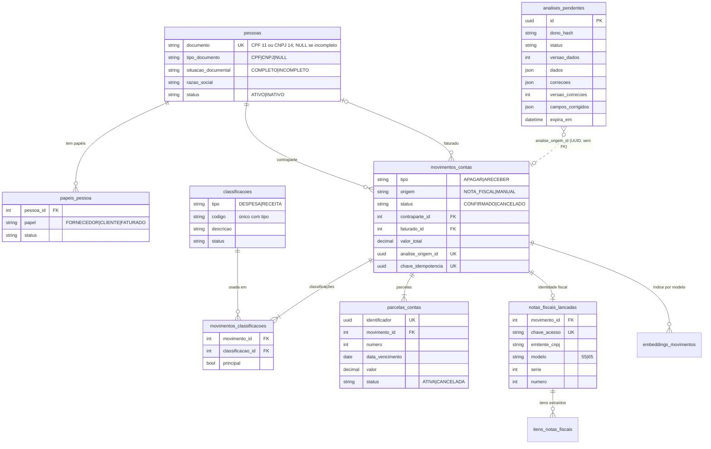

# 06 — Modelo de dados

PostgreSQL, Django ORM, migrations versionadas. Referência: `cadastros/models.py`, `financeiro/models.py`, `documentos/models.py`, `consulta/models.py`.
Todas as tabelas usam `id` inteiro automático como chave, exceto `analises_pendentes` (UUID).

## 1. Diagrama

`analises_pendentes.id` vira o `movimentos_contas.analise_origem_id`, mas **não há chave estrangeira**: a análise perde os dados
depois da finalização e o movimento é permanente.

## 2. Tabelas

### 2.1 `pessoas` (`Pessoa`)

| Campo | Tipo | Regra |
| --- | --- | --- |
| `documento` | varchar(14), **único**, nulo | CPF (11 dígitos) ou CNPJ (14 caracteres, alfanumérico aceito), normalizado. **NULL só no cadastro incompleto** (o índice único do PostgreSQL ignora NULLs) |
| `tipo_documento` | varchar(4), nulo, não editável | `CPF`/`CNPJ`, derivado do documento |
| `situacao_documental` | varchar(10) | `COMPLETO` (padrão) ou `INCOMPLETO`; independente do `status` |
| `razao_social` | varchar(255) | Obrigatória (regex `\S`); espaços colapsados |
| `status` | varchar(7) | `ATIVO` (padrão) / `INATIVO` |
| `criado_em`, `atualizado_em` | datetime | automáticos |

Constraints: `pessoa_documento_coerente_com_situacao` (COMPLETO ⇒ documento + tipo coerentes com o regex; INCOMPLETO ⇒ sem documento nem tipo),
`pessoa_razao_social_preenchida`, `pessoa_status_valido`. Ordenação padrão: `razao_social`, `id`.

Comportamento: `save()` valida o documento (incluindo DV) e normaliza; **inativar/reativar não revalidam**; `regularizar(documento)` completa o cadastro no mesmo
registro e é atômico; `delete()` levanta `ExclusaoNaoPermitida`.

### 2.2 `papeis_pessoa` (`PapelPessoa`)

| Campo | Tipo | Regra |
| --- | --- | --- |
| `pessoa` | FK `PROTECT` | `related_name="papeis"` |
| `papel` | varchar(10) | `FORNECEDOR`, `CLIENTE`, `FATURADO` |
| `status` | varchar(7) | independente do status da pessoa |

Constraints: `papel_pessoa_unico` (pessoa + papel), `papel_pessoa_papel_valido`, `papel_pessoa_status_valido`.
Queryset `vigentes()` = papel ATIVO de pessoa ATIVA.

### 2.3 `classificacoes` (`Classificacao`)

| Campo | Tipo | Regra |
| --- | --- | --- |
| `tipo` | varchar(7) | `DESPESA` / `RECEITA`; **imutável** |
| `codigo` | varchar(60) | `^[A-Z0-9]+(_[A-Z0-9]+)*$`; **imutável**; maiúsculo |
| `descricao` | varchar(255) | Obrigatória; editável |
| `status` | varchar(7) | `ATIVO` / `INATIVO` |

Constraints: `classificacao_tipo_codigo_unico`, `classificacao_tipo_valido`, `classificacao_codigo_valido`, `classificacao_descricao_preenchida`, `classificacao_status_valido`.
Imutabilidade de `tipo`/`codigo` é checada em `save()` e `clean()`; `QuerySet.update()` e fixtures **não** passam por essa proteção (a aplicação não os usa para isso).

### 2.4 `movimentos_contas` (`MovimentoConta`)

| Campo | Tipo | Regra |
| --- | --- | --- |
| `tipo` | varchar(8) | `APAGAR` / `ARECEBER` |
| `origem` | varchar(11) | `NOTA_FISCAL` / `MANUAL` |
| `status` | varchar(10) | `CONFIRMADO` (padrão) / `CANCELADO` |
| `contraparte` | FK `Pessoa` `PROTECT` | fornecedor (APAGAR) ou cliente (ARECEBER) — o papel é conferido no serviço |
| `faturado` | FK `Pessoa` `PROTECT`, nulo | **obrigatório no APAGAR** (constraint) |
| `valor_total` | decimal(12,2) | `> 0` e `< 10.000.000.000` |
| `analise_origem_id` | UUID, **único**, nulo | idempotência da nota |
| `chave_idempotencia` | UUID, **único**, nulo | idempotência manual; **só origem MANUAL** (constraint) |
| `criado_em`, `atualizado_em` | datetime | |

Constraints: `movimento_tipo_valido`, `movimento_origem_valida`, `movimento_status_valido`, `movimento_valor_total_positivo`,
`movimento_apagar_com_faturado`, `movimento_chave_idempotencia_so_manual`.
**Imutáveis:** `tipo`, `origem`, `status`, `contraparte`, `faturado`, `valor_total`, `analise_origem_id`, `chave_idempotencia`, `criado_em`.
Ordenação padrão: `-criado_em`, `-id`. **Não há campo de data de emissão nem de pagamento.**

### 2.4.1 `movimentos_classificacoes` (`MovimentoClassificacao`)

`movimento` (FK `PROTECT`, `related_name="classificacoes"`), `classificacao` (FK `PROTECT`), `principal` (bool). Imutáveis: os três.
Constraints: `movimento_classificacao_unica` (movimento + classificação) e `movimento_uma_classificacao_principal` (no máximo uma principal por movimento).
"Exatamente uma" é garantido pelo serviço.

### 2.5 `parcelas_contas` (`ParcelaConta`)

| Campo | Tipo | Regra |
| --- | --- | --- |
| `identificador` | UUID, único, não editável | |
| `movimento` | FK `PROTECT` | `related_name="parcelas"` |
| `numero` | smallint | `>= 1`; único por movimento |
| `data_vencimento` | date | |
| `valor` | decimal(12,2) | `> 0` e `< 10 bi` |
| `status` | varchar(9) | `ATIVA` (nasce assim) / `CANCELADA` — o cancelamento **não tem contrato aprovado** |

Imutáveis: `identificador`, `movimento`, `numero`, `data_vencimento`, `valor`, `status`, `criado_em`.
`pago_em` (date, nulo) é a **baixa**: a data em que a parcela foi paga (a pagar) ou recebida (a receber); nulo = em aberto. É o único campo da
parcela que muda (`financeiro/pagamentos.py`, com bloqueio da linha). O `status` continua `ATIVA`, então o gatilho da soma não muda.
A "Identificação" do professor ("ÚNICA" quando há uma só) é **apresentação**; o registro guarda o número.

### 2.6 `notas_fiscais_lancadas` (`NotaFiscalLancada`)

| Campo | Tipo | Regra |
| --- | --- | --- |
| `movimento` | OneToOne `PROTECT` | `related_name="nota_fiscal"` |
| `chave_acesso` | varchar(44), **único**, nulo | formato `^[0-9]{6}[0-9A-Z]{12}[0-9]{26}$`; o DV é conferido no serviço |
| `emitente_cnpj` | varchar(14) | formato de CNPJ |
| `modelo` | varchar(2) | `55` NF-e / `65` NFC-e |
| `serie` | smallint positivo | `<= 999` |
| `numero` | inteiro positivo | `1..999.999.999` |

Constraints: `nota_fiscal_identidade_unica` (CNPJ + modelo + série + número), `nota_fiscal_chave_coerente` (com chave, os 4 campos são os da chave),
formatos e limites. Todos os campos são imutáveis. **Um movimento cancelado não libera a identidade.**
`data_emissao` (date, nula) vem da conferência na confirmação; notas lançadas antes da migration 0006 ficam sem ela.

### 2.7 `analises_pendentes` (`AnalisePendente`)

| Campo | Tipo | Regra |
| --- | --- | --- |
| `id` | UUID, PK | também é o `analise_origem_id` |
| `dono_hash` | varchar(64) | SHA-256 do código da sessão (`^[0-9a-f]{64}$`) |
| `status` | varchar(10) | `PENDENTE`, `CONFIRMADA`, `CANCELADA`, `EXPIRADA` |
| `versao_dados` | smallint | 1 ou 2 (formato de `dados`) |
| `dados` | JSON, nulo | JSON final; **só enquanto PENDENTE** |
| `correcoes` | JSON, nulo | correções da conferência; só enquanto PENDENTE |
| `versao_correcoes` | inteiro | conta as gravações (controle otimista) |
| `campos_corrigidos` | JSON (lista) | só os **nomes** dos campos corrigidos; permanece após a finalização |
| `criado_em`, `expira_em`, `finalizado_em` | datetime | `expira_em > criado_em`; estado final ⇒ `finalizado_em` preenchido |

Índice `analise_status_expira_idx` (status, expira_em) para a limpeza. Constraints `analise_dados_coerentes_com_status` e
`analise_correcoes_so_pendente` garantem que **estado final nunca guarda dados**. Linhas nunca são excluídas fisicamente.

### 2.8 `itens_notas_fiscais` (`ItemNotaFiscal`)

| Campo | Tipo | Regra |
| --- | --- | --- |
| `nota_fiscal` | FK `NotaFiscalLancada` `PROTECT` | `related_name="itens"` |
| `ordem` | inteiro positivo | ≥ 1; única por nota; ordenação padrão |
| `descricao` | varchar(500) | Obrigatória, com conteúdo não branco |
| `quantidade` | decimal(20,6), nulo | Não negativa |
| `valor_unitario`, `valor_total` | decimal(12,2), nulos | Não negativos e < 10 bilhões |
| `criado_em` | datetime | Automático |

Todos os campos são imutáveis; sem exclusão física. `financeiro/itens_nota.registrar_itens_nota` bloqueia a nota e grava os itens uma vez, na ordem recebida; descrições vazias são ignoradas, textos longos truncados e números ilegíveis ficam nulos.
O lançamento de notas novas persiste os itens extraídos; **notas anteriores não recebem itens retroativamente**, pois o PDF não é guardado.

### 2.9 `embeddings_movimentos` (`EmbeddingMovimento`)

| Campo | Tipo | Regra |
| --- | --- | --- |
| `movimento` | FK `MovimentoConta` `PROTECT` | `related_name="embeddings"`; único com `modelo` |
| `modelo` | varchar(100) | Obrigatório, com conteúdo não branco |
| `dimensao` | inteiro positivo | ≥ 1 |
| `vetor` | JSON | `clean()` valida lista de números finitos com a dimensão indicada |
| `hash_texto` | varchar(64) | SHA-256 hexadecimal do texto de indexação |
| `criado_em`, `atualizado_em` | datetime | Automáticos |

Índice derivado e **regravável**, separado dos registros financeiros imutáveis. A indexação valida todo o lote antes de gravar e atualiza por movimento/modelo; a situação do índice considera também dimensão e hash do texto.
As migrations `financeiro/0008` e `consulta/0002` habilitam **RLS sem políticas e sem `FORCE RLS`** nas duas tabelas novas; o Django continua usando o papel dono. Existência da migration não comprova aplicação remota.

## 3. Proteções comuns

- **Sem exclusão física:** `ComStatus` (cadastros) e `RegistroFinanceiro` (financeiro) recusam `delete()`; os querysets recusam `delete()`.
- **Imutabilidade (financeiro):** `RegistroFinanceiro.save()` compara com o banco e levanta `AlteracaoNaoPermitida` (`campo_imutavel`).
  Também bloqueados: `update()`, `bulk_update()`, `bulk_create(update_conflicts=True)` e os métodos `add/remove/clear/set` dos gerenciadores reversos
  (que só trocariam a FK). Registros novos com `pk` de registro existente também são recusados.
- **`PROTECT` em todas as FKs**: nada some se houver vínculo.
- **Checks com `IS NOT NULL` explícito**: no PostgreSQL, um `CHECK` com resultado `NULL` passa; os checks foram escritos para não depender disso.

## 4. Gatilho diferido das parcelas (migration `financeiro/0002`)

Regra que não cabe numa constraint por linha, porque movimento e parcelas são gravados em comandos separados:
**movimento `CONFIRMADO` ⇒ pelo menos uma parcela `ATIVA` e soma das `ATIVAS` = `valor_total`.**

- Funções PL/pgSQL `financeiro_conferir_parcelas(bigint)` e `financeiro_gatilho_parcelas()`, com `search_path` fixo (uma tabela temporária homônima não engana a conferência).
- Dois *constraint triggers* `DEFERRABLE INITIALLY DEFERRED`: `movimento_confere_parcelas` (em `movimentos_contas`) e `parcela_confere_movimento` (em `parcelas_contas`). Conferem **no COMMIT**, para qualquer caminho de escrita (ORM ou SQL).
- A conferência bloqueia o movimento (`FOR NO KEY UPDATE`) para serializar conferências do mesmo movimento.
- Uma parcela nova precisa nascer `ATIVA` (`parcela_nasce_ativa`).
- Erros: `movimento_com_parcela_ativa`, `movimento_soma_das_parcelas` (SQLSTATE `check_violation`).

## 5. Migrations

| App | Arquivo | Conteúdo |
| --- | --- | --- |
| `cadastros` | `0001_initial` | `Pessoa`, `PapelPessoa` |
| | `0002_classificacao` | `Classificacao` |
| | `0003_categorias_iniciais` | Carga idempotente: DESPESA `MANUTENCAO_E_OPERACAO` ("MANUTENÇÃO E OPERAÇÃO") e `INFRAESTRUTURA_E_UTILIDADES`. Não reativa nem sobrescreve; reversão não apaga |
| `financeiro` | `0001_initial` | `MovimentoConta`, `MovimentoClassificacao` |
| | `0002_parcelas_contas` | `ParcelaConta` + gatilho diferido |
| | `0003_nota_fiscal_lancada` | `NotaFiscalLancada` |
| | `0004_chave_idempotencia` | `chave_idempotencia` (nula, única) + constraint "só manual" |
| | `0005_habilitar_rls` | RLS ligado, sem políticas, nas tabelas dos apps |
| | `0006_baixa_de_parcela_e_data_de_emissao` | `ParcelaConta.pago_em` e `NotaFiscalLancada.data_emissao` (só campos novos, nulos) |
| | `0007_itens_notas_fiscais` | `ItemNotaFiscal`, vínculo à nota e constraints |
| | `0008_habilitar_rls_itens` | RLS sem políticas em `itens_notas_fiscais` |
| `consulta` | `0001_embeddings_movimentos` | `EmbeddingMovimento`, vetor JSON e constraints |
| | `0002_habilitar_rls` | RLS sem políticas em `embeddings_movimentos` |
| `documentos` | `0001_initial` | `AnalisePendente` |
| | `0002_correcoes_da_conferencia` | `correcoes`, `versao_correcoes`, `campos_corrigidos` |

**Regras de trabalho com migrations** (DQ-04):

1. Gerar e revisar a migration; validar no PostgreSQL local (testes).
2. **Aplicar manualmente** em homologação (QA), homologar, e só então em produção, com autorização.
3. **Nunca** colocar `migrate` em `build.sh` ou `start.sh`.
4. Não aplicar em banco remoto sem autorização do responsável pelo ambiente.

Estado de aplicação em QA/PROD: **não verificado** nesta documentação (inclusive `financeiro/0004`).

## 6. Consultas úteis ao evoluir o modelo

- Papéis vigentes por tipo: `PapelPessoa.objects.vigentes().filter(papel=...)`.
- Classificações ativas por tipo: `Classificacao.objects.ativos().filter(tipo=...)`.
- Pessoa por documento (qualquer status): `Pessoa.objects.por_documento(...)`.
- Classificação por código (qualquer status): `Classificacao.objects.por_codigo(tipo, codigo)`.
- Incompletas: `Pessoa.objects.incompletas()`.
- Parcelas ativas: `ParcelaConta.objects.ativas()`.
