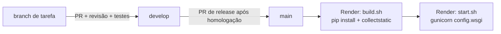

# 10 — Configuração e operação

Complementa o [`README.md`](../../README.md) (instalação) e o [Guia de Operação](../operacao/GuiaOperacaoN2.md).
**Nunca** registre valores de variáveis aqui: só nomes.

## 1. Variáveis de ambiente

O `config/settings.py` lê o `.env` com `python-dotenv` **sem sobrescrever** variáveis já presentes no ambiente. Modelo: `.env.example`.

| Variável | Obrigatória | Padrão / formato | Uso |
| --- | --- | --- | --- |
| `DJANGO_SECRET_KEY` | **Sim** | valor longo e aleatório | Assinatura de sessão e CSRF |
| `DJANGO_DEBUG` | Não | `False`; `true` (sem diferenciar maiúsculas) liga o *debug* | Em produção, `False`; local em HTTP, `True` |
| `DJANGO_ALLOWED_HOSTS` | Em produção | lista separada por vírgula | Hosts aceitos |
| `DJANGO_CSRF_TRUSTED_ORIGINS` | Se houver domínio próprio | lista de origens `https://…` | Origens extras de CSRF |
| `RENDER_EXTERNAL_HOSTNAME` | (Render define) | hostname | Entra sozinho em hosts e CSRF |
| `RENDER_GIT_COMMIT` | (Render define) | SHA de 40 caracteres hexadecimais | Mostrado no rodapé; outro formato é ignorado |
| `DEMO_LOGIN`, `DEMO_PASSWORD` | Para entrar | texto | Login de demonstração; vazios, o login recusa tudo |
| `DB_HOST`, `DB_NAME`, `DB_USER`, `DB_PASSWORD` | **Sim** | — | Banco da aplicação; sem elas o Django **não inicia** |
| `DB_PORT` | Não | `5432` | Porta do Session Pooler |
| `DJANGO_PROXIES_CONFIAVEIS` | Não | `1` | Proxies da plataforma que acrescentam o cliente a `X-Forwarded-For`; define a origem do limite de login (`0` ignora o cabeçalho) |
| `DB_SSLMODE` | Não | `require`; aceita `require`, `verify-ca`, `verify-full` | TLS obrigatório; outros valores são recusados. Em produção use `verify-full`: `check --deploy` avisa (`config.W001`) com `require` |
| `DB_SSLROOTCERT` | Para `verify-*` | caminho do certificado da CA | |
| `DB_CONNECT_TIMEOUT` | Não | `10` (segundos, inteiro ≥ 1) | |
| `DB_TEST_HOST`, `DB_TEST_NAME`, `DB_TEST_USER` | Para rodar testes com banco | host **local**; nome começa com `test_` e ≠ `DB_NAME` | PostgreSQL **local** descartável |
| `DB_TEST_PORT`, `DB_TEST_PASSWORD`, `DB_TEST_CONNECT_TIMEOUT` | Não | `5432`, vazia (peer), `10` | |
| `GEMINI_MODEL` | **Sim**, para processar PDFs | nome do modelo | Validada quando o `GeminiClient` é criado |
| `GEMINI_TIMEOUT_SEGUNDOS` | Não | `60` | Por tentativa |
| `GEMINI_MAX_TENTATIVAS` | Não | `3` | |
| `MAX_PDF_UPLOAD_SIZE_MB` | Não | `10` (inteiro; inválido impede a inicialização) | Limite do PDF |
| `GUNICORN_TIMEOUT` | Não | `420` | `start.sh` |
| `WEB_CONCURRENCY` | Não | `1` | Número de workers (`start.sh`) |
| `PORT` | (Render define) | `8000` se ausente | Porta do Gunicorn |

A **Gemini API Key não é uma variável de ambiente**: é digitada na tela a cada processamento.

## 2. Executar localmente

Pré-requisitos: Python da versão de `.python-version` (3.14.7), PostgreSQL e um banco da aplicação **autorizado**.
Não copie credenciais de outro integrante.

```bash
python3 -m venv .venv && source .venv/bin/activate
python -m pip install -r requirements.txt
cp -n .env.example .env          # só se ainda não existir; preencha localmente
python manage.py check
python manage.py migrate --plan  # confira o destino ANTES de aplicar
python manage.py runserver 127.0.0.1:8000
```

- A conexão normal **exige TLS**. O PostgreSQL local usado em TEST **não** é automaticamente um DEV com TLS: para DEV local, prepare um banco próprio com TLS compatível; para DEV/QA compartilhado, siga o ADR e a coordenação da equipe.
- **Nunca** use o banco descartável dos testes como banco da aplicação.
- `migrate` só em banco local próprio e autorizado; em QA/PROD, só pelo responsável (ver seção 4).

## 3. Comandos do dia a dia

| Objetivo | Comando | Observações |
| --- | --- | --- |
| Verificar a configuração | `python manage.py check` | |
| Rodar todos os testes | `DJANGO_DEBUG=True python manage.py test` | Exige `DB_TEST_*`; com `DJANGO_DEBUG=False` há erros de manifesto de estáticos (ver [11](11-testes.md)) |
| Rodar testes de um módulo | `DJANGO_DEBUG=True python manage.py test financeiro.test_manual` | |
| Detectar migrations faltando, sem tocar bancos remotos | `DB_HOST=db-teste.invalid python manage.py makemigrations --check --dry-run` | Esperado: aviso de conexão ao host fictício e `No changes detected` |
| Checagem de produção | `DJANGO_DEBUG=False python manage.py check --deploy` | Hoje aponta W004 (HSTS) e W008 (redirecionamento HTTPS), delegados ao Render |
| Espaços em branco | `git diff --check` | |
| Expirar análises vencidas | `python manage.py expirar_analises` | Idempotente; no ambiente explicitamente autorizado |
| Coletar estáticos (produção) | `python manage.py collectstatic --noinput` | Já está no `build.sh` |

`makemigrations --check` pode consultar o histórico do banco padrão; por isso o host fictício acima.
Não use `--keepdb` ou `--noinput` para reutilizar ou excluir um banco de teste sem conferir o destino.

## 4. Migrations

Estado: `cadastros` 0001–0003, `documentos` 0001–0002, `financeiro` 0001–0004 (nove migrations).

Processo (DQ-04, PT-06):

1. Gerar a migration no PostgreSQL local e **revisar o SQL** (ex.: `python manage.py sqlmigrate app 000X`).
2. Rodar a suíte local; confirmar que `makemigrations --check` não detecta mais nada.
3. O responsável confere host, banco, papel, ambiente e `migrate --plan`; registra a evidência **sem** segredos nem strings de conexão.
4. Aplicar em **QA** (homologação) apenas com autorização/coordenação; homologar.
5. Preparar recuperação; só então aplicar em **PROD**, com autorização.
6. **Não** adicionar `migrate` ao `build.sh`/`start.sh`.

Migrations com gatilho ou SQL (`financeiro/0002`) têm reversão própria; a `cadastros/0003` (carga) **não apaga** nada ao reverter.

## 5. Ambientes

| Ambiente | Banco | Controle |
| --- | --- | --- |
| TEST | PostgreSQL **local**, banco `test_*` descartável criado e apagado pelo executor | Só variáveis `DB_TEST_*` |
| DEV | `DB_*` apontando para banco próprio com TLS ou para o de homologação (coordenado) | Não reutilizar TEST |
| QA | Supabase de homologação, dados **fictícios**, credenciais próprias | Testes automatizados **não** o usam |
| PROD | Projeto/banco e credenciais **separados** de QA | Esquema e deploy só com autorização |

Conexão com o Supabase: **Session Pooler** (porta 5432, compatível com IPv4), usuário no formato `postgres.<referência-do-projeto>`.

## 6. Publicação (Render)



- `build.sh`: `pip install -r requirements.txt` e `collectstatic --noinput`. **Sem banco, sem migrate.**
- `start.sh`: `gunicorn config.wsgi:application --bind 0.0.0.0:$PORT --workers ${WEB_CONCURRENCY:-1} --timeout ${GUNICORN_TIMEOUT:-420}`. O timeout alto cobre as duas chamadas sequenciais ao Gemini.
- O Render injeta `PORT`, `RENDER_EXTERNAL_HOSTNAME` e `RENDER_GIT_COMMIT`.

**Verificação humana após publicar** (nada disso é feito pelo código):

1. A URL responde, com HTTPS; `DEBUG=False`; credenciais próprias do ambiente.
2. O rodapé mostra o SHA igual ao do commit publicado.
3. Migrations aplicadas no banco do ambiente (inclusive `financeiro/0004`).
4. Login, envio de PDF fictício, conferência, confirmação e conta manual funcionam.
5. HSTS/redirecionamento HTTPS efetivos (W004/W008) e Data API do Supabase **desativada** (ou RLS habilitada).
6. `WEB_CONCURRENCY` ≥ 2 se houver mais de um usuário.

## 7. Rotinas operacionais

| Rotina | Estado |
| --- | --- |
| **Expirar análises** (`expirar_analises`) | Comando existe; o bloqueio por prazo ocorre em 30 min, mas a **limpeza** das abandonadas sem atividade exige executar o comando. Proposta: a cada 5 minutos por executor autorizado. **Agendamento não instalado** (GR-50) |
| Backups do Supabase | Controlados pelo provedor; retenção/WAL **não** são afetadas pelos mecanismos de limpeza da aplicação |
| Rotação de `DJANGO_SECRET_KEY` / `DEMO_PASSWORD` | Trocar a `DJANGO_SECRET_KEY` invalida os cookies assinados (todos saem do sistema). Trocar a `DEMO_PASSWORD` **não** invalida sessões existentes (o cookie guarda só o indicador de login). Sem procedimento formal documentado |

## 8. Entrega acadêmica (contexto)

- Link do GitHub e do site no Classroom; o **código da última atualização** aparece na tela principal (rodapé).
- O `Readme.txt` com login, senha e chave de LLM é **privado**: não vai ao Git; combine o canal restrito antes de enviar.
- Estado de homologação, URL pública e envio ao Classroom: **sem evidência** nas auditorias.

## 9. Fluxo Git (resumo)

Referência oficial: [`ContextoFluxoGit.md`](../../ContextoFluxoGit.md).

- Branches de tarefa: `feature/*`, `fix/*`, `docs/*`, `refactor/*`, `test/*`, `chore/*` — criadas a partir de `develop` atualizada.
- `develop` (integração/homologação) e `main` (produção): **ninguém desenvolve nem faz push direto**; tudo entra por **Pull Request** com revisão e testes.
- `hotfix/*` nasce da `main`, vai por PR para `main`, e depois sincroniza `main → develop`.
- A branch `qa` foi excluída e não deve ser recriada.
- Commit, push, merge e deploy são decisões do responsável; não os automatize.
