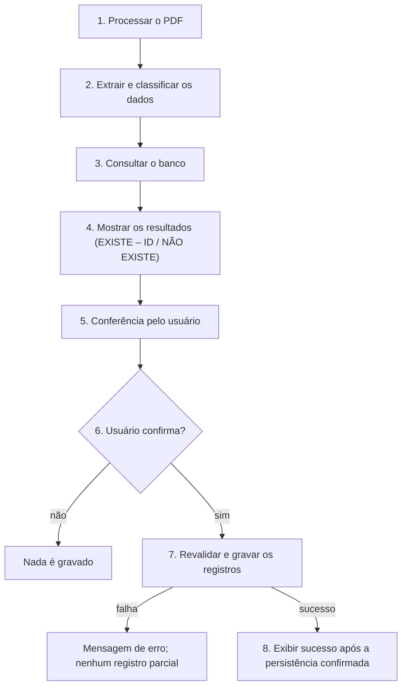
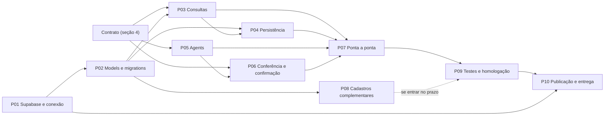

# Plano de Responsabilidades — Gestão Rural, N2 Etapa 2

| Item               | Valor                                                                                         |
| ------------------ | --------------------------------------------------------------------------------------------- |
| Data               | 24/10/2026                                                                                    |
| Fase               | **Fase 2 — Escopo e responsabilidades** (depois da organização documental, antes da implementação) |
| Escopo             | somente documentação; nenhuma alteração em código, dependências, configuração, banco, Jira ou deploy |
| Branch de trabalho | `docs/n2-etapa2-escopo-responsabilidades` (a partir da `develop` em `0374292`, PR #20)        |
| Estado             | **APROVADO PARA PLANEJAMENTO — NADA IMPLEMENTADO**. Em revisão pela equipe                     |
| Entrega            | 27/10/2026, 23h59 ([matriz](../requisitos/matriz-n2-etapa2.md), DEL-06)                        |

Este plano não substitui os documentos donos de cada assunto (ver [plano de organização](Plano_Organizacao_Documental_Gestao_Rural_N2_Etapa2.md), seção 7):

- requisitos e situação de cada item: [matriz da Etapa 2](../requisitos/matriz-n2-etapa2.md);
- decisão de banco: [ADR-001](../arquitetura/ADR-001-supabase.md);
- estado real do código: [`ContextoProjeto.md`](../../ContextoProjeto.md);
- fluxo Git: [`ContextoFluxoGit.md`](../../ContextoFluxoGit.md).

Aqui ficam só as **decisões de escopo**, a **divisão de responsabilidades**, os **pacotes de trabalho**, o **contrato a acordar** entre os integrantes e a **preparação do Jira**.

---

## 1. Decisões de escopo (decisões da equipe, 24/10/2026)

As duas decisões abaixo foram tomadas **pela equipe** (Pedro Simon e Gustavo Lopes). **Não** são respostas do professor. O registro oficial está na [matriz, seção 8.1](../requisitos/matriz-n2-etapa2.md#81-decisões-da-equipe).

### 1.1 Q-01 — Prioridade do fluxo da nota fiscal

**Prioridade 1 (núcleo da entrega):**

1. processamento completo da nota fiscal (Etapa 1, já existente);
2. consultas de existência no banco (fornecedor, faturado, classificação de despesa);
3. criação dos cadastros ausentes;
4. movimento financeiro;
5. parcelas;
6. confirmação do lançamento.

**Cadastros administrativos completos** (FUN-01 a FUN-07, RN-05, UI-01 a UI-09):

- **não** foram dispensados pelo professor;
- continuam catalogados na matriz como requisitos **ainda não atendidos**;
- têm priorização própria, no pacote [P08](#p08--cadastros-e-funcionalidades-complementares), depois do núcleo.

### 1.2 Q-02 — Lançamento com confirmação manual

O lançamento financeiro **só é gravado depois da confirmação do usuário**.

Regras derivadas:

- nenhum cadastro, movimento ou parcela é gravado nas etapas 1 a 6;
- a etapa 7 **revalida** os dados no servidor, porque o banco pode ter mudado entre a consulta e a confirmação;
- a mensagem de sucesso (FLU-10) só aparece depois que **toda** a gravação foi concluída.

**Relação com o texto do professor:** o documento diz "após mostrar a mensagem, o sistema deve-se: criar…". A confirmação manual é uma **interpretação da equipe**, compatível com esse texto, e não uma exigência do professor.

## 2. Divisão de responsabilidades

Aprovada pela equipe **para planejamento** em 24/10/2026. "Responsável principal" significa quem conduz e responde pelo item. O outro integrante colabora e revisa.

### 2.1 Pedro Simon — Backend e persistência

| Área                                      | Pacotes        |
| ----------------------------------------- | -------------- |
| Supabase PostgreSQL                       | P01            |
| Configuração da conexão Django            | P01            |
| Models e migrations                       | P02            |
| Entidades `PESSOAS`, `CLASSIFICACAO`, `MOVIMENTOCONTAS`, `PARCELACONTAS` | P02 |
| Relacionamentos e integridade             | P02            |
| Consultas de existência                   | P03            |
| Criação de cadastros ausentes             | P04            |
| Movimentos e parcelas                     | P04            |
| Transações e prevenção de duplicidade     | P04            |
| Testes de models e serviços               | P02, P03, P04  |

### 2.2 Gustavo Lopes — Agents, frontend e integração

| Área                                      | Pacotes        |
| ----------------------------------------- | -------------- |
| Integração dos Agents existentes          | P05            |
| Adaptação do processamento aos contratos financeiros | P05 |
| Tela de resultados das consultas          | P06            |
| Interface de conferência                  | P06            |
| Confirmação do usuário                    | P06            |
| Navegação e mensagens                     | P06            |
| Integração frontend/backend               | P07            |
| Tratamento visual de erros                | P06, P07       |
| Testes de interface e fluxo               | P06, P07       |
| Identificador da versão publicada na tela principal (DEL-05) | P10 |

### 2.3 Responsabilidades compartilhadas

| Área                                       | Pacotes           |
| ------------------------------------------ | ----------------- |
| Definição dos contratos entre componentes  | [seção 4](#4-contrato-entre-pedro-e-gustavo) |
| Revisão de PRs (cada um revisa o PR do outro) | todos          |
| Validação de requisitos                    | P09               |
| Testes integrados                          | P07, P09          |
| Documentação                               | todos             |
| Homologação                                | P09               |
| Publicação e entrega acadêmica             | P10               |

### 2.4 Arquivos de maior risco de conflito

Conforme o trabalho paralelo descrito no [`ContextoFluxoGit.md`, seção 8](../../ContextoFluxoGit.md), os arquivos abaixo exigem combinação prévia quando os dois integrantes trabalham em paralelo:

| Arquivo                                   | Quem tende a alterar                              |
| ----------------------------------------- | ------------------------------------------------- |
| `config/settings.py`                      | Pedro (P01, P02); Gustavo (P10, se a versão vier de configuração) |
| `requirements.txt`                        | Pedro (P01)                                       |
| migrations                                | Pedro (P02); qualquer mudança de model passa por ele |
| `documentos/views.py`                     | Gustavo (P06, P07); Pedro só pelos serviços que a view chama |
| templates base                            | Gustavo (P06, P08, P10)                           |
| `config/test_sem_banco.py`, `config/test_producao.py` | Pedro (P01, P02), na mesma tarefa que introduzir o banco |
| `ContextoProjeto.md`                      | ambos, só ao integrar mudanças                    |

## 3. Pacotes de trabalho

Situação de todos os pacotes em 24/10/2026: **NÃO INICIADO** (planejado). A situação de cada requisito só muda na matriz com evidência (commit, PR ou teste).

### Visão geral das dependências

Caminhos que podem andar em paralelo desde o início, depois de acordado o contrato:

- **Pedro:** P01 → P02 → P03 → P04;
- **Gustavo:** P05 → P06 (com dados simulados que respeitem o contrato) e a parte de DEL-05 em P10.

### Resumo

| Pacote | Nome                                            | Principal         | Colaborador / revisor | Depende de              | Prioridade |
| ------ | ----------------------------------------------- | ----------------- | --------------------- | ----------------------- | ---------- |
| P01    | Supabase e conexão                              | Pedro Simon       | Gustavo Lopes         | ADR-001                 | Crítica    |
| P02    | Models e migrations                             | Pedro Simon       | Gustavo Lopes         | P01; contrato C-02, C-03, C-04 | Crítica |
| P03    | Consultas financeiras                           | Pedro Simon       | Gustavo Lopes         | P02; contrato C-05, C-06 | Crítica   |
| P04    | Persistência de cadastros, movimentos e parcelas | Pedro Simon      | Gustavo Lopes         | P02, P03; contrato C-08, C-09 | Crítica |
| P05    | Integração dos Agents                           | Gustavo Lopes     | Pedro Simon           | contrato C-01 a C-04    | Crítica    |
| P06    | Interface de conferência e confirmação          | Gustavo Lopes     | Pedro Simon           | P05; contrato C-05 a C-10 | Crítica  |
| P07    | Integração ponta a ponta                        | Gustavo Lopes     | Pedro Simon           | P03, P04, P05, P06      | Crítica    |
| P08    | Cadastros e funcionalidades complementares      | compartilhado     | ambos                 | P02 (backend); P07 (prioridade) | Média (Q-01) |
| P09    | Testes e homologação                            | compartilhado     | ambos                 | P07 (e P08, se entrar)  | Crítica    |
| P10    | Publicação e entrega                            | compartilhado     | ambos                 | P01, P09                | Crítica    |

### P01 — Supabase e conexão

| Campo                 | Conteúdo |
| --------------------- | -------- |
| Objetivo              | Ligar o Django a um PostgreSQL gerenciado no Supabase, com credenciais fora do Git e um banco por ambiente |
| Responsável principal | Pedro Simon |
| Colaborador / revisor | Gustavo Lopes |
| Requisitos            | PT-01, PT-03, PT-05, PT-06; apoio a DEL-01 |
| Dependências          | [ADR-001](../arquitetura/ADR-001-supabase.md) (pendências ADR1-P1 a ADR1-P4, ADR1-P6, ADR1-P8) |
| Critérios de aceite   | 1. `python manage.py check` passa com a conexão configurada por variáveis de ambiente. 2. O driver escolhido (Psycopg 3 é o candidato) instala e funciona com Python 3.14 e Django 6.1, localmente e no build do Render. 3. `.env.example` contém só **nomes** de variáveis. 4. Nenhuma credencial aparece no diff. 5. O modo de conexão (direta ou pooler) está registrado no ADR-001. |
| Entregáveis           | conexão configurada; dependência do driver; `.env.example` atualizado; decisão do modo de conexão registrada; bancos de desenvolvimento e produção criados (com autorização) |
| Situação atual        | EM ANDAMENTO (GR-33, 25/10/2026; branch `feature/gr-33-configurar-supabase`, não integrada). Conexão PostgreSQL configurada por variáveis `DB_*` com Psycopg 3 e Session Pooler; `.env.example` atualizado; modo de conexão registrado no ADR-001 (seção 13.1). Existe só o projeto Supabase de homologação; bancos de DEV/testes e de produção pendentes (T-06); build e variáveis no Render pendentes (GR-20); `migrate` na publicação pendente. Antes: NÃO INICIADO. **Atualização de 26/10/2026 (GR-34, branch não integrada):** T-06 aprovada (testes no PostgreSQL local, já implementado; DEV/QA no Supabase de homologação; produção a criar) e PT-06 aprovada (migrations manuais, sem `migrate` na publicação), conforme o [ADR-001](../arquitetura/ADR-001-supabase.md), seção 13.2 |

### P02 — Models e migrations

| Campo                 | Conteúdo |
| --------------------- | -------- |
| Objetivo              | Modelar as quatro entidades da Etapa 2 com status ATIVO/INATIVO, N classificações e N parcelas por movimento |
| Responsável principal | Pedro Simon |
| Colaborador / revisor | Gustavo Lopes |
| Requisitos            | ENT-01 a ENT-04, RN-01, RN-02, RN-03 (suporte no modelo), RN-04, RN-06, PT-02, PT-04 |
| Dependências          | P01 (para aplicar migrations); contrato C-02, C-03, C-04; Q-03, Q-05, Q-11 |
| Critérios de aceite   | 1. `makemigrations --check` não gera migration pendente. 2. `migrate` aplica num banco de teste. 3. Testes de model comprovam: status padrão ATIVO, ausência de exclusão física pela aplicação, movimento com mais de uma classificação, movimento com mais de uma parcela com vencimentos distintos. 4. `config/test_sem_banco.py` e `config/test_producao.py` substituídos pelo novo contrato, de forma justificada, sem enfraquecer as garantias de segurança que não dependem de banco. |
| Entregáveis           | app(s) com models; migrations; testes de model; diagrama da seção 15.2 do `ContextoProjeto.md` atualizado ao integrar |
| Situação atual        | NÃO INICIADO. Nenhum model ou migration |

### P03 — Consultas financeiras

| Campo                 | Conteúdo |
| --------------------- | -------- |
| Objetivo              | Dado o resultado da extração e da classificação, responder se fornecedor, faturado e classificação existem, com o ID quando existirem |
| Responsável principal | Pedro Simon |
| Colaborador / revisor | Gustavo Lopes |
| Requisitos            | FLU-01, FLU-02, FLU-03 |
| Dependências          | P02; contrato C-02, C-03, C-05, C-06 |
| Critérios de aceite   | 1. Para cada um dos três itens, o serviço devolve "existe com ID" ou "não existe", no formato acordado em C-05. 2. A consulta **não grava nada**. 3. Testes cobrem: existente, inexistente, documento ausente, documento com DV inválido e registro INATIVO (comportamento acordado em C-02). |
| Entregáveis           | serviço de consulta em camada de serviço (não na view); testes de serviço |
| Situação atual        | IMPLEMENTADO E INTEGRADO À `develop` (GR-40, 27/10/2026, PR #28): `cadastros/consultas.py` e 32 testes no PostgreSQL local; regras na matriz (DQ-08). Formato do resultado a confirmar em C-05; uso no fluxo da nota na GR-51 ([`ContextoProjeto.md`](../../ContextoProjeto.md), 15.1.6). Antes: NÃO INICIADO |

### P04 — Persistência de cadastros, movimentos e parcelas

| Campo                 | Conteúdo |
| --------------------- | -------- |
| Objetivo              | Depois da confirmação, revalidar e gravar numa única transação os cadastros ausentes, o movimento APAGAR e as parcelas |
| Responsável principal | Pedro Simon |
| Colaborador / revisor | Gustavo Lopes |
| Requisitos            | FLU-05, FLU-06, FLU-07, FLU-08, FLU-09, RN-04, RN-06; parte de FUN-06 |
| Dependências          | P02, P03; contrato C-04, C-06, C-07, C-08, C-09 |
| Critérios de aceite   | 1. Cadastros existentes não são duplicados. 2. Os ausentes são criados com o tipo correto. 3. O movimento fica ligado a fornecedor, faturado e classificação(ões). 4. Todas as parcelas são gravadas com vencimento e valor. 5. Uma falha em qualquer passo não deixa registro parcial (transação). 6. Confirmar duas vezes a mesma nota não cria dois movimentos (regra de C-09). 7. Testes de serviço cobrem os casos acima. |
| Entregáveis           | serviço de lançamento; testes de serviço, inclusive de falha e de duplicidade |
| Situação atual        | NÃO INICIADO. O Extrator já entrega a lista de parcelas (FLU-09 e RN-06 PARCIAL na matriz); nada é gravado |

### P05 — Integração dos Agents

| Campo                 | Conteúdo |
| --------------------- | -------- |
| Objetivo              | Entregar os dados extraídos e classificados no formato do contrato financeiro, sem quebrar os contratos atuais dos Agents |
| Responsável principal | Gustavo Lopes |
| Colaborador / revisor | Pedro Simon |
| Requisitos            | BASE-01 (preservar), FLU-03 (mapeamento da classificação), FLU-09 (formato das parcelas), RN-04 (se Q-06 for decidida a favor) |
| Dependências          | contrato C-01 a C-04; Q-05, Q-06 |
| Critérios de aceite   | 1. Os testes atuais dos Agents e da orquestração continuam passando, ou são adaptados com justificativa, sem enfraquecer. 2. O JSON final, `ProcessamentoError` e os schemas dos Agents são preservados ou mudam só por decisão registrada. 3. Existe uma conversão testada do resultado do processamento para a estrutura acordada em C-01. 4. A chave Gemini continua sem ser armazenada. |
| Entregáveis           | adaptação do processamento; testes da conversão |
| Situação atual        | NÃO INICIADO. Extração e classificação IMPLEMENTADAS na Etapa 1 (`documentos/processamento.py`, `agents/`) |

### P06 — Interface de conferência e confirmação

| Campo                 | Conteúdo |
| --------------------- | -------- |
| Objetivo              | Mostrar o resultado das consultas, permitir a conferência, pedir confirmação e exibir sucesso ou erro |
| Responsável principal | Gustavo Lopes |
| Colaborador / revisor | Pedro Simon |
| Requisitos            | FLU-04, FLU-10; fluxo da decisão Q-02 |
| Dependências          | P05; contrato C-05 a C-10. Pode começar com dados simulados no formato de C-05 antes de P03 existir |
| Critérios de aceite   | 1. Para fornecedor, faturado e classificação, a tela mostra nome ou razão social, CNPJ ou CPF quando houver, e "EXISTE – ID: n" ou "NÃO EXISTE", como no exemplo do professor. 2. A tela mostra o movimento e as parcelas que serão gravados. 3. Nada é gravado antes do clique em confirmar. 4. Cancelar não grava nada. 5. A mensagem de sucesso só aparece depois da gravação. 6. Erros aparecem em português, sem detalhes internos. 7. Testes de view/template cobrem os estados da tela. |
| Entregáveis           | templates e ajustes de view; mensagens; testes de interface |
| Situação atual        | NÃO INICIADO. A tela atual mostra só resumo, avisos, justificativa e JSON |

### P07 — Integração ponta a ponta

| Campo                 | Conteúdo |
| --------------------- | -------- |
| Objetivo              | Ligar interface, processamento, consultas e persistência no fluxo completo nota → consulta → conferência → confirmação → gravação → sucesso |
| Responsável principal | Gustavo Lopes |
| Colaborador / revisor | Pedro Simon |
| Requisitos            | FLU-01 a FLU-10 (em conjunto), FUN-06 (lançamento a partir da nota) |
| Dependências          | P03, P04, P05, P06 |
| Critérios de aceite   | 1. Teste integrado com Agents simulados (sem chamar o Gemini) percorre o fluxo inteiro e verifica os registros gravados. 2. Teste de nota já lançada não duplica o movimento. 3. Teste de falha na gravação não deixa registro parcial e mostra erro. 4. Os dados entre a consulta e a confirmação são preservados como acordado em C-10. |
| Entregáveis           | integração da view com os serviços; testes integrados |
| Situação atual        | NÃO INICIADO |

### P08 — Cadastros e funcionalidades complementares

| Campo                 | Conteúdo |
| --------------------- | -------- |
| Objetivo              | Atender as funcionalidades "Manter/Registrar" e as recomendações de layout, que **continuam exigidas** e não foram dispensadas |
| Responsável principal | compartilhado: Pedro Simon (regras de inativação e reativação, consultas de listagem); Gustavo Lopes (telas, busca, ordenação, ações) |
| Colaborador / revisor | revisão cruzada |
| Requisitos            | FUN-01 a FUN-07, RN-01, RN-02, RN-03, RN-05, UI-01 a UI-09 |
| Dependências          | P02 (models); prioridade abaixo de P07 (decisão Q-01); Q-04, Q-10, Q-11 |
| Critérios de aceite   | os critérios de cada ID na [matriz](../requisitos/matriz-n2-etapa2.md), seções 5.A, 5.C e 5.E. Mínimo: nenhum cadastro é excluído fisicamente; "excluir" inativa; existe caminho para reativar |
| Entregáveis           | a definir na priorização interna do pacote (ordem sugerida: inativação/reativação → Manter Fornecedor e Faturado → Tipo de Despesa → demais) |
| Situação atual        | NÃO INICIADO. Requisitos **não atendidos**, catalogados na matriz |

### P09 — Testes e homologação

| Campo                 | Conteúdo |
| --------------------- | -------- |
| Objetivo              | Validar a Etapa 2 na `develop` antes da publicação, com evidência para a matriz |
| Responsável principal | compartilhado |
| Colaborador / revisor | ambos |
| Requisitos            | todos os itens da matriz atendidos em P01 a P08; PT-04 |
| Dependências          | P07 (e P08, se entrar no prazo) |
| Critérios de aceite   | 1. `python manage.py check` e `python manage.py test` passam na `develop` (com `DJANGO_DEBUG=True` no `.env`). 2. `git diff --check` sem erros. 3. Roteiro de homologação manual executado com as notas de teste (não com dados reais do cliente). 4. Matriz atualizada com situação e evidência de cada item. |
| Entregáveis           | resultado real dos testes; roteiro de homologação executado; matriz atualizada |
| Situação atual        | NÃO INICIADO. 291 testes OK em 24/10/2026 é referência histórica (`f7786e8`) |

### P10 — Publicação e entrega

| Campo                 | Conteúdo |
| --------------------- | -------- |
| Objetivo              | Publicar a Etapa 2 no Render com o banco de produção e cumprir a entrega acadêmica |
| Responsável principal | compartilhado; DEL-05 (versão na tela) é de Gustavo Lopes |
| Colaborador / revisor | ambos |
| Requisitos            | DEL-01 a DEL-06, PT-06 |
| Dependências          | P01 (banco de produção), P09; Q-07, Q-08, Q-09 |
| Critérios de aceite   | 1. `migrate` executado no processo de publicação. 2. A URL pública mostra a Etapa 2 funcionando com o banco de produção. 3. A tela principal mostra o identificador da versão publicada, igual ao do GitHub (formato definido em Q-09). 4. Links do GitHub e do site postados no Classroom. 5. `Readme.txt` entregue **por canal privado**, fora do Git. 6. Tudo até 27/10/2026, 23h59. |
| Entregáveis           | PR `develop` → `main`; publicação; identificador de versão na tela; entrega no Classroom (ações manuais da equipe) |
| Situação atual        | NÃO INICIADO. Etapa 1 publicada no Render (registro de 29/09/2026, não reverificado) |

## 4. Contrato entre Pedro e Gustavo

O contrato precisa ser **acordado antes da implementação** de P03 a P07. Este plano só lista **o que** deve ser acordado e o que já existe. **Não** define nomes de APIs, funções, tabelas, campos ou endpoints: eles serão escolhidos pela equipe e registrados aqui ou num ADR quando forem decididos.

| ID   | Tema                                   | O que precisa ser acordado                                                                                  | Base existente (Etapa 1)                                                     | Questões em aberto |
| ---- | -------------------------------------- | ----------------------------------------------------------------------------------------------------------- | ---------------------------------------------------------------------------- | ------------------ |
| C-01 | Estrutura dos dados extraídos          | quais campos do resultado do processamento o backend recebe, em que tipos (texto, `Decimal`, data) e quem converte | JSON final de 10 chaves (`ContextoProjeto.md`, 17.3); `NotaFiscalExtraida`  | se o backend recebe o JSON final ou um objeto tipado; se `itens` e `numero_nota` são gravados |
| C-02 | Identificação de fornecedor e faturado | chave de busca (CNPJ/CPF normalizado, razão social ou os dois); o que fazer sem documento ou com DV inválido; se um registro INATIVO conta como "existe" | CNPJ e CPF já normalizados e com DV conferido localmente (17.1)              | Q-03, Q-11 |
| C-03 | Classificação de despesa               | como o valor do Enum do Classificador corresponde à descrição gravada em `CLASSIFICACAO`; tratamento de classificação inconclusiva | Enum `TipoDespesa` com 2 valores (`agents/classificador/schemas.py`)        | Q-05, Q-06 |
| C-04 | Formato de parcelas                    | parcelas sem número ou sem vencimento; nota sem parcelas (`quantidade_parcelas = 0`); identificação "ÚNICA" do exemplo; regra entre soma das parcelas e valor total | lista `parcelas` com `numero`, `data_vencimento`, `valor` (17.3)            | T-01 (seção 5) |
| C-05 | Resultado das consultas de existência  | o que o backend devolve para cada item: situação (existe / não existe), ID quando existir e dados para exibição | nenhuma                                                                       | formato de exibição de CPF/CNPJ (com ou sem máscara) |
| C-06 | Identificadores retornados             | quais IDs o backend devolve após a consulta e após a gravação, e quais a tela exibe                          | nenhuma                                                                       | se o ID exibido é o identificador interno do banco |
| C-07 | Validações e mensagens de erro         | quais validações rodam antes e depois da confirmação; quais erros o backend sinaliza; quem escreve as mensagens ao usuário | `ProcessamentoError` com `etapa` e `codigo`, mensagens fixas e seguras (12.1–12.2) | se os erros de persistência seguem a mesma hierarquia |
| C-08 | Fluxo de confirmação                   | os estados da tela (resultado, conferência, confirmado, cancelado, erro); o que o usuário pode alterar na conferência; o que é revalidado no servidor na confirmação | decisão Q-02 (seção 1.2)                                                     | T-02 (seção 5) |
| C-09 | Proteção contra lançamento duplicado   | o critério de "mesma nota" e o comportamento quando ela já foi lançada; proteção contra duplo clique e reenvio do formulário | nenhuma                                                                       | T-03 (seção 5) |
| C-10 | Preservação segura dos dados entre requisições | onde ficam os dados entre a consulta e a confirmação, sem confiar no que volta do navegador e sem reprocessar com o Gemini | sessão em **cookie assinado** (`SESSION_ENGINE` em `config/settings.py`): o conteúdo é assinado, mas **não é cifrado** e o tamanho é limitado; a chave Gemini nunca é armazenada (decisão D6) | T-04 (seção 5) |

## 5. Questões que dependem de decisão técnica

Questões novas desta fase (T-*) e questões herdadas da matriz que bloqueiam pacotes. Ninguém deve decidi-las sozinho ou por agente de IA; a decisão é da equipe e deve ser registrada.

| ID   | Questão                                                                                                       | Bloqueia      |
| ---- | ------------------------------------------------------------------------------------------------------------- | ------------- |
| T-01 | Como tratar nota sem parcelas, parcelas sem vencimento ou soma das parcelas diferente do valor total?          | C-04, P04, P06 |
| T-02 | Na conferência, o usuário só confirma ou também pode corrigir dados (por exemplo, a classificação)? Se puder corrigir, o que é revalidado? | C-08, P06, P04 |
| T-03 | Qual o critério de nota já lançada (por exemplo, documento do fornecedor + número da nota)? O que fazer quando a nota não tem número? | C-09, P02, P04 |
| T-04 | Onde guardar os dados entre a consulta e a confirmação? Opções a avaliar: sessão no servidor (exige banco de sessões), registro provisório no banco, ou dados reenviados pelo formulário com assinatura e revalidação completa. O cookie assinado atual expõe o conteúdo ao navegador e tem limite de tamanho **DECIDIDA em 27/10/2026 (DQ-09, GR-43):** registro provisório no banco (`AnalisePendente`), ligado à sessão por código aleatório; ver [`ContextoProjeto.md`](../../ContextoProjeto.md), 15.1.7 | C-10, P06, P07 |
| T-05 | Um registro INATIVO encontrado na consulta é exibido como "EXISTE" e reutilizado, é reativado ou gera um novo? | C-02, P03, P04 |
| T-06 | Os bancos de desenvolvimento e de testes automatizados: Supabase de desenvolvimento, PostgreSQL local ou outro? Testes com banco nunca rodam contra produção. **APROVADA em 26/10/2026:** testes no PostgreSQL local de cada desenvolvedor (`DB_TEST_*`); DEV e QA no Supabase de homologação compartilhado; produção em projeto Supabase independente, a criar ([ADR-001](../arquitetura/ADR-001-supabase.md), seção 13.2) | P01, P02, P09 |
| Q-03 | Identificação de pessoa existente (matriz)                                                                     | C-02, P03     |
| Q-05 | Mapeamento Enum → `Descricao` e categorias do cliente (matriz)                                                 | C-03, P03, P04 |
| Q-06 | Mais de uma classificação por nota no Classificador (matriz)                                                   | C-03, P05     |
| Q-09 | Formato e obtenção do identificador da versão no Render (matriz)                                               | P10 (DEL-05)  |
| Q-11 | `CLIENTE-FORNECEDOR` como um ou dois valores de `Tipo` (matriz)                                                | P02           |

Q-04, Q-07, Q-08 e Q-10 continuam abertas na [matriz](../requisitos/matriz-n2-etapa2.md#8-dúvidas-de-escopo-em-aberto) e afetam P08 e P10.

## 6. Preparação do Jira (projeto `GR`)

**O Jira não foi consultado nem alterado.** A tabela abaixo é uma proposta para cadastro futuro, depois da revisão deste documento. Os números das issues serão atribuídos pelo próprio Jira; a coluna "Ref." é só uma referência interna deste plano.

Prioridade: **Crítica** (núcleo da entrega, decisão Q-01), **Alta**, **Média**, **Baixa**.

| Ref.  | Nome                                                        | Descrição curta                                                                 | Responsável planejado | Pacote | Requisitos | Prioridade | Dependências | Critérios de aceite |
| ----- | ----------------------------------------------------------- | ------------------------------------------------------------------------------- | --------------------- | ------ | ---------- | ---------- | ------------ | ------------------- |
| J-01  | Acordar o contrato entre backend e interface                | Decidir C-01 a C-10 e T-01 a T-05 e registrar neste plano                        | Pedro + Gustavo       | —      | FLU-01..10 | Crítica    | —            | todos os itens da seção 4 com decisão registrada |
| J-02  | Validar o driver PostgreSQL                                 | Confirmar Psycopg 3 com Python 3.14, Django 6.1 e build do Render               | Pedro                 | P01    | PT-03      | Crítica    | —            | instalação e conexão de teste bem-sucedidas; resultado no ADR-001 |
| J-03  | Criar os bancos Supabase por ambiente                       | Desenvolvimento e produção (e homologação, se decidido), com acesso da equipe. Após T-06 (26/10/2026): falta só o projeto de produção; DEV usa o de homologação | Pedro                 | P01    | PT-01, PT-05 | Crítica  | J-02, T-06   | bancos acessíveis; credenciais só em variáveis de ambiente |
| J-04  | Configurar a conexão do Django                              | Ler a conexão de variáveis de ambiente; documentar os nomes no `.env.example`   | Pedro                 | P01    | PT-01, PT-05 | Crítica  | J-02, J-03   | `manage.py check` passa; nenhum segredo no diff |
| J-05  | Modelar PESSOAS e CLASSIFICACAO                             | Models com tipo, descrição/razão social e status                                | Pedro                 | P02    | ENT-01, ENT-02, RN-01..03 | Crítica | J-01, J-04, Q-03, Q-05, Q-11 | migration aplica; testes de model passam |
| J-06  | Modelar MOVIMENTOCONTAS e PARCELACONTAS                     | Movimento com N classificações e N parcelas                                     | Pedro                 | P02    | ENT-03, ENT-04, RN-04, RN-06 | Crítica | J-05, T-03 | testes comprovam N classificações e N parcelas |
| J-07  | Substituir os testes que proíbem banco                      | Adaptar `config/test_sem_banco.py` e `config/test_producao.py` ao novo contrato | Pedro                 | P02    | PT-04      | Crítica    | J-04         | suíte passa; garantias de segurança sem banco preservadas |
| J-08  | Implementar as consultas de existência                      | Fornecedor, faturado e classificação: existe com ID ou não existe               | Pedro                 | P03    | FLU-01..03 | Crítica    | J-05, J-01   | testes de serviço dos casos da seção P03 |
| J-09  | Implementar a gravação do lançamento                        | Cadastros ausentes, movimento e parcelas numa transação                          | Pedro                 | P04    | FLU-05..09 | Crítica    | J-06, J-08   | sem duplicar cadastros; sem registro parcial em falha |
| J-10  | Proteger contra lançamento duplicado                        | Aplicar o critério de T-03 e bloquear duplo envio                               | Pedro                 | P04    | FLU-08     | Crítica    | J-09, T-03   | confirmar duas vezes não cria dois movimentos |
| J-11  | Adaptar o processamento ao contrato financeiro              | Converter o resultado dos Agents para a estrutura de C-01 a C-04                | Gustavo               | P05    | BASE-01, FLU-03, FLU-09 | Crítica | J-01 | testes atuais preservados; conversão testada |
| J-12  | Tela de resultado das consultas                             | Exibir EXISTE – ID / NÃO EXISTE com nome e documento                            | Gustavo               | P06    | FLU-04     | Crítica    | J-11, J-01   | tela igual ao exemplo do professor; testes de template |
| J-13  | Conferência e confirmação do lançamento                     | Mostrar movimento e parcelas; confirmar ou cancelar sem gravar antes             | Gustavo               | P06    | FLU-04, FLU-10 | Crítica | J-12, T-02, T-04 | nada gravado antes da confirmação; cancelar não grava |
| J-14  | Mensagens de sucesso e de erro                              | Sucesso só após a gravação; erros em português sem detalhes internos             | Gustavo               | P06    | FLU-10     | Crítica    | J-13, C-07   | testes cobrem sucesso e cada erro acordado |
| J-15  | Integrar a interface aos serviços                           | Ligar a view às consultas e à gravação, preservando os dados como em C-10        | Gustavo               | P07    | FLU-01..10 | Crítica    | J-08, J-09, J-13 | fluxo completo funciona com Agents simulados |
| J-16  | Testes integrados do fluxo da nota                          | Fluxo completo, duplicidade e falha de gravação                                  | Gustavo + Pedro       | P07    | FLU-01..10 | Crítica    | J-15, J-10   | testes integrados passam sem chamar o Gemini |
| J-17  | Inativar e reativar cadastros                               | Exclusão lógica e reativação de pessoas e classificações                        | Pedro                 | P08    | RN-01..03  | Média      | J-05, Q-04   | nenhuma exclusão física; reativação possível |
| J-18  | Telas Manter Fornecedor, Cliente e Faturado                 | Busca, TODOS, ordenação, editar e excluir lógico                                | Gustavo               | P08    | FUN-01..03, UI-01..09 | Média | J-17, Q-11 | critérios da matriz, seções 5.A e 5.E |
| J-19  | Telas Manter Tipo de Despesa e de Receita                   | Cadastro de classificações com o mesmo padrão                                   | Gustavo               | P08    | FUN-04, FUN-05, UI-01..09 | Média | J-17 | critérios da matriz |
| J-20  | Registrar contas a pagar e a receber manualmente            | Lançamento fora do fluxo da nota                                                | Pedro + Gustavo       | P08    | FUN-06, FUN-07, RN-05 | Baixa | J-09, Q-10 | critérios da matriz |
| J-21  | Exibir a versão publicada na tela principal                 | Mostrar o identificador da última atualização do GitHub                         | Gustavo               | P10    | DEL-05     | Crítica    | Q-09         | identificador exibido igual ao do GitHub no ambiente publicado |
| J-22  | ~~Incluir `migrate` na publicação~~ Aplicar migrations manualmente (PT-06, 26/10/2026) | Substituída: em vez de `migrate` no build ou pre-deploy, aplicação manual em homologação e depois em produção, conforme o fluxo do [ADR-001](../arquitetura/ADR-001-supabase.md), seção 13.2 | Pedro                 | P10    | PT-06      | Crítica    | J-06         | migrations aplicadas manualmente em cada ambiente, com destino conferido; `build.sh` e `start.sh` sem `migrate` |
| J-23  | Homologar a Etapa 2 na `develop`                            | Roteiro manual com notas de teste e suíte completa                              | Pedro + Gustavo       | P09    | todos      | Crítica    | J-16         | roteiro executado; matriz atualizada com evidências |
| J-24  | Publicar a Etapa 2 em produção                              | PR `develop` → `main` e publicação no Render com o banco de produção             | Pedro + Gustavo       | P10    | DEL-01, DEL-02 | Crítica | J-23, J-22, J-03 | URL pública com a Etapa 2 e o banco de produção |
| J-25  | Entregar no Classroom                                       | Links do GitHub e do site; `Readme.txt` por canal privado                       | Pedro + Gustavo       | P10    | DEL-03, DEL-04, DEL-06 | Crítica | J-24, Q-07, Q-08 | entrega até 27/10/2026, 23h59, sem segredos no Git |

Sugestão de organização no Jira: um épico para a N2 Etapa 2 e as tarefas acima ligadas a ele, citando os IDs da matriz no título ou na descrição (ver [guia de integração](LEIA-ME-integracao.md), seção 3).

## 7. Riscos de planejamento

| Risco                                                                                   | Mitigação proposta |
| --------------------------------------------------------------------------------------- | ------------------ |
| Prazo: implementação inteira entre 24 e 27/10/2026                                      | núcleo (P01–P07, P09, P10) antes de P08; contrato acordado no primeiro dia |
| Contrato indefinido gerando retrabalho entre backend e interface                        | J-01 como primeira tarefa; dados simulados no formato acordado |
| Conflitos em `config/settings.py`, `documentos/views.py` e templates                    | seção 2.4; PRs pequenos e frequentes para a `develop` |
| Testes que proíbem banco quebrando a suíte                                              | tratar em J-07, na mesma tarefa que introduz o banco (ADR-001, seção 8) |
| Riscos de infraestrutura do ADR-001 (driver, conectividade, plano gratuito)             | J-02 e J-03 cedo; ver [ADR-001](../arquitetura/ADR-001-supabase.md), seção 11 |
| P08 não caber no prazo                                                                  | requisitos continuam registrados como não atendidos na matriz; não declarar como dispensados |

## 8. Situação e próximos passos

| # | Ação                                                                 | Status    |
| - | -------------------------------------------------------------------- | --------- |
| 1 | Registrar Q-01 e Q-02 como decisões da equipe na matriz              | FEITO     |
| 2 | Registrar a divisão de responsabilidades (planejada) na matriz       | FEITO     |
| 3 | Organizar os pacotes P01 a P10                                       | FEITO     |
| 4 | Listar o contrato a acordar e as questões técnicas                   | FEITO     |
| 5 | Preparar a tabela de tarefas para o Jira                             | FEITO     |
| 6 | Revisão deste plano por Pedro Simon e Gustavo Lopes                   | PENDENTE  |
| 7 | Acordar o contrato (J-01) e decidir T-01 a T-06                      | PARCIAL: T-06 decidida em 26/10/2026; J-01 e T-01 a T-05 pendentes |
| 8 | Cadastrar as tarefas no Jira `GR`                                    | PENDENTE (após o item 6) |
| 9 | Integrar esta documentação à `develop` por PR                        | PENDENTE (ação manual da equipe) |
